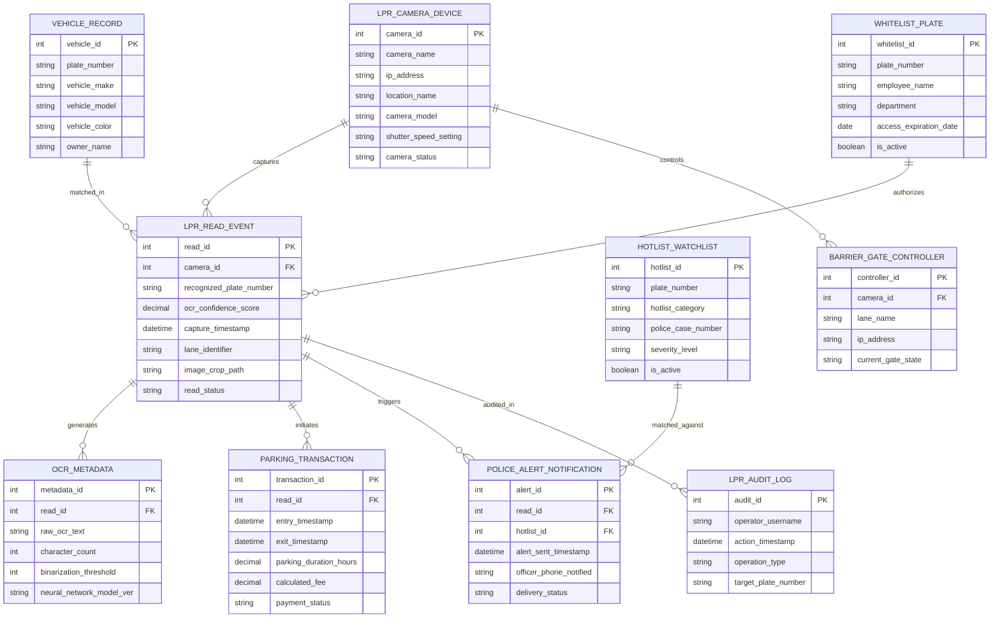

# Conceptual ERD — License Plate Recognition System

## Mermaid Code

## Entity Description Table | Bảng mô tả Entity

| # | Entity Name | Vietnamese Name | Description | Key Attributes | Main Relationships |
|---|-------------|-----------------|-------------|----------------|-------------------|
| 1 | LPR_READ_EVENT | Sự kiện Đọc Biển số (Read) | Master record storing recognized plate numbers, OCR confidence scores, timestamps, lane IDs, and image paths. | read_id, recognized_plate_number, ocr_confidence_score, capture_timestamp, read_status | Primary entity; captured by LPR_CAMERA_DEVICE; generates OCR_METADATA. |
| 2 | LPR_CAMERA_DEVICE | Camera Quét Biển số LPR | Stores high-speed camera IP addresses, location names, models, shutter settings, and status. | camera_id, camera_name, ip_address, location_name, camera_status | Captures LPR_READ_EVENT; controls BARRIER_GATE_CONTROLLER. |
| 3 | VEHICLE_RECORD | Hồ sơ Phương tiện | Stores registered vehicle details, plate numbers, makes, models, colors, and owner names. | vehicle_id, plate_number, vehicle_make, vehicle_model, owner_name | Matched in LPR_READ_EVENT. |
| 4 | HOTLIST_WATCHLIST | Danh sách Đen / Xe Mất cắp | Stores police stolen vehicle plate numbers, amber alerts, police case numbers, and severity levels. | hotlist_id, plate_number, hotlist_category, police_case_number, is_active | Matched against POLICE_ALERT_NOTIFICATION. |
| 5 | BARRIER_GATE_CONTROLLER | Bộ Điều khiển Cổng Chắn | Manages barrier gate controllers, IP addresses, lane names, and gate open/closed states. | controller_id, lane_name, ip_address, current_gate_state | Controlled by LPR_CAMERA_DEVICE. |
| 6 | PARKING_TRANSACTION | Giao dịch Bãi xe / Phí | Calculates parking entry/exit timestamps, duration hours, tariff fees, and payment status. | transaction_id, entry_timestamp, exit_timestamp, calculated_fee, payment_status | Initiated by LPR_READ_EVENT. |
| 7 | WHITELIST_PLATE | Danh sách Trắng Nhân viên (Whitelist) | Manages pre-approved employee and VIP vehicle plate numbers for automated barrier gate entry. | whitelist_id, plate_number, employee_name, department, is_active | Authorizes LPR_READ_EVENT. |
| 8 | OCR_METADATA | Dữ liệu Nhận dạng OCR | Archives raw unparsed OCR text, character confidence metrics, binarization settings, and AI model versions. | metadata_id, raw_ocr_text, character_count, neural_network_model_ver | Belongs to LPR_READ_EVENT. |
| 9 | POLICE_ALERT_NOTIFICATION | Thông báo Canh báo Cảnh sát | Stores hotlist hit notification dispatches, officer phone numbers notified, timestamps, and delivery status. | alert_id, alert_sent_timestamp, officer_phone_notified, delivery_status | Triggered by LPR_READ_EVENT and HOTLIST_WATCHLIST. |
| 10 | LPR_AUDIT_LOG | Nhật ký Kiểm toán & Data Privacy | Captures operator manual overrides, plate edits, data deletion receipts, and auto-purge logs. | audit_id, operator_username, action_timestamp, operation_type, target_plate_number | Audits LPR_READ_EVENT. |

## Relationship Description | Mô tả Quan hệ

| # | From Entity | Cardinality | To Entity | Relationship Label | Business Explanation |
|---|-------------|-------------|-----------|-------------------|----------------------|
| 1 | LPR_CAMERA_DEVICE | one-to-many | LPR_READ_EVENT | captures | An LPR camera device captures multiple vehicle plate read events. |
| 2 | LPR_CAMERA_DEVICE | one-to-many | BARRIER_GATE_CONTROLLER | controls | An LPR camera device controls automated barrier gate controllers. |
| 3 | LPR_READ_EVENT | one-to-one | OCR_METADATA | generates | An LPR read event generates OCR neural network metadata. |
| 4 | LPR_READ_EVENT | one-to-many | PARKING_TRANSACTION | initiates | An LPR read event initiates parking tariff transactions. |
| 5 | LPR_READ_EVENT | one-to-many | POLICE_ALERT_NOTIFICATION | triggers | An LPR read event triggers police hotlist alert notifications. |
| 6 | WHITELIST_PLATE | one-to-many | LPR_READ_EVENT | authorizes | A whitelist plate record authorizes barrier gate open actions for read events. |
| 7 | HOTLIST_WATCHLIST | one-to-many | POLICE_ALERT_NOTIFICATION | matched_against | A hotlist watchlist record is matched against to trigger police alerts. |
