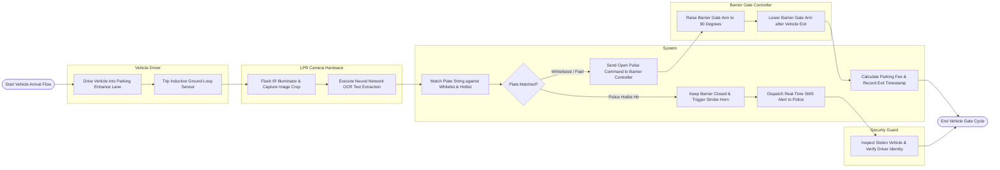

# Swimlane Diagram — License Plate Recognition System

## Mermaid Code

## Flow Description | Mô tả luồng

| Lane | Actor | Role in Flow |
|------|-------|-------------|
| 1 | Vehicle Driver | Drives vehicle into entry lane, tripping inductive ground loop sensors. |
| 2 | LPR Camera Hardware | Flashes IR illuminator, captures high-contrast plate image crops, and executes neural network OCR text extraction. |
| 3 | System | Matches plate strings against Whitelist and Police Hotlists, issues gate open pulse commands, calculates parking fees, and dispatches police SMS alerts. |
| 4 | Barrier Gate Controller | Receives relay pulse commands, raises barrier gate arms for entry, and lowers gate arms safely behind vehicles. |
| 5 | Security Guard | Inspects flagged stolen vehicles, verifies driver identity, and coordinates with law enforcement. |
