# Action Tree — License Plate Recognition System

## Mermaid Code

```mermaid
graph TD
    Root["License Plate Recognition System"]

    Root --> M1["Camera Capture & OCR Engine"]
    Root --> M2["Hotlist & Whitelist Matching"]
    Root --> M3["Barrier & Access Control"]
    Root --> M4["Parking & Toll Integration"]
    Root --> M5["Analytics & Privacy Audit"]

    M1 --> A1["Trigger High-Speed IR Camera Capture"]
    M1 --> A2["Extract Character Text via Neural OCR"]
    M1 --> A3["Apply Image Binarization & Skew Fix"]
    M1 --> A4["Calibrate Camera Shutter (1/2000s)"]

    M2 --> B1["Check Employee Whitelist Register"]
    M2 --> B2["Match Police Stolen Vehicle Hotlist"]
    M2 --> B3["Trigger Red Alert Modal on Guard Desk"]
    M2 --> B4["Dispatch Police SMS Alert Notifications"]

    M3 --> C1["Transmit Gate Open Pulse Command"]
    M3 --> C2["Monitor Safety Loop Obstruction Sensors"]
    M3 --> C3["Process Guard Manual Gate Overrides"]
    M3 --> C4["Update Entrance Lane LED Signage"]

    M4 --> D1["Calculate Entry/Exit Parking Duration"]
    M4 --> D2["Compute Dynamic Tariff Fee Rates"]
    M4 --> D3["Integrate Electronic Toll Gateways"]
    M4 --> D4["Process Ticketless Mobile Payments"]

    M5 --> E1["Monitor Overall OCR Accuracy Score %"]
    M5 --> E2["Execute Auto-Purge of 30-Day Reads"]
    M5 --> E3["Search Historical Vehicle Plate Movements"]
    M5 --> E4["Export Certified Police Evidentiary Report"]
```

## Module Description | Mô tả Module

| # | Module | Description | Actions |
|---|--------|-------------|---------|
| 1 | Camera Capture & OCR Engine | High-speed IR camera triggers, neural network OCR text extraction, image binarization, and shutter speed calibration. | Trigger High-Speed IR Camera Capture, Extract Character Text via Neural OCR, Apply Image Binarization & Skew Fix, Calibrate Camera Shutter (1/2000s) |
| 2 | Hotlist & Whitelist Matching | Employee whitelist lookup, police stolen vehicle hotlist matching, guard alert console popups, and police SMS notifications. | Check Employee Whitelist Register, Match Police Stolen Vehicle Hotlist, Trigger Red Alert Modal on Guard Desk, Dispatch Police SMS Alert Notifications |
| 3 | Barrier & Access Control | Automated barrier gate open pulses, safety loop detector monitoring, manual guard overrides, and lane LED display updates. | Transmit Gate Open Pulse Command, Monitor Safety Loop Obstruction Sensors, Process Guard Manual Gate Overrides, Update Entrance Lane LED Signage |
| 4 | Parking & Toll Integration | Parking duration calculation, dynamic tariff fee computation, electronic toll gateway integration, and ticketless mobile payments. | Calculate Entry/Exit Parking Duration, Compute Dynamic Tariff Fee Rates, Integrate Electronic Toll Gateways, Process Ticketless Mobile Payments |
| 5 | Analytics & Privacy Audit | Overall OCR accuracy score tracking, 30-day data auto-purging (GDPR), historical vehicle movement search, and police report exports. | Monitor Overall OCR Accuracy Score %, Execute Auto-Purge of 30-Day Reads, Search Historical Vehicle Plate Movements, Export Certified Police Evidentiary Report |
