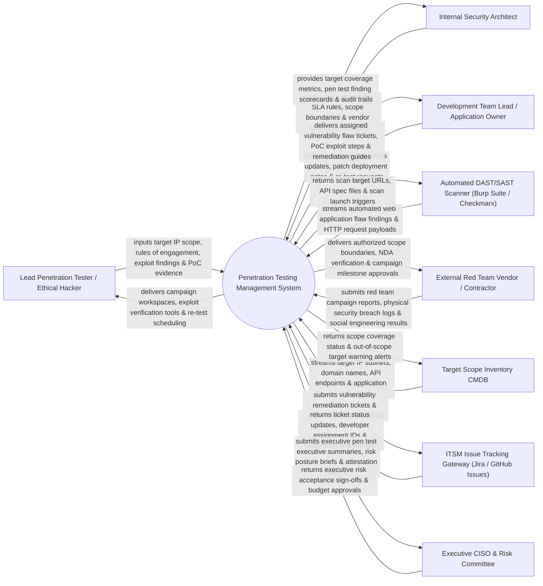

# Context Diagram — Penetration Testing Management System

## Mermaid Code

## Actor & Interaction Table | Bảng Actor & Tương tác

| # | Actor | Actor Type | Data Sent TO System | Data Received FROM System | Notes |
|---|-------|------------|---------------------|---------------------------|-------|
| 1 | Lead Penetration Tester / Ethical Hacker | Primary | Target IP scope, rules of engagement, exploit findings, PoC evidence files. | Campaign workspaces, exploit verification tools, re-test scheduling dashboards. | Certified ethical hacker conducting manual penetration tests and exploit verification. |
| 2 | Internal Security Architect | Primary | Vulnerability SLA rules, scope boundaries, vendor access permissions, rules of engagement. | Target coverage metrics, pen test finding scorecards, audit trails, risk summaries. | Security architect overseeing corporate penetration testing strategy and scope rules. |
| 3 | Development Team Lead / Application Owner | Primary | Remediation status updates, patch deployment notes, re-test verification requests. | Assigned vulnerability flaw tickets, PoC exploit steps, remediation guidance. | Engineering lead receiving vulnerability findings and coordinating code fixes. |
| 4 | Automated DAST/SAST Scanner | Supporting | Automated web application flaw findings, HTTP request/response payloads, vulnerability types. | Scan target URLs, OpenAPI spec files, scan launch triggers, authentication cookies. | Scanning tool (Burp Suite Enterprise, Checkmarx) streaming automated findings into system. |
| 5 | External Red Team Vendor / Contractor | Supporting | Red team campaign reports, physical security breach logs, phishing campaign results. | Authorized scope boundaries, NDA verification receipts, campaign milestone approvals. | Third-party cybersecurity consultancy contracted to conduct independent red team exercises. |
| 6 | Target Scope Inventory CMDB | Supporting | Target IP subnets, web domain names, API endpoints, application criticality ratings. | Scope coverage status, out-of-scope target warning alerts, asset mapping updates. | Enterprise inventory supplying authorized IP ranges and application target boundaries. |
| 7 | ITSM Issue Tracking Gateway | Supporting | Ticket status updates, developer assignment IDs, resolution timestamps, fix confirmations. | Vulnerability remediation tickets, exploit severity metadata, PoC reproduction steps. | ITSM platform (Jira, GitHub Issues) tracking software bug fixes for developers. |
| 8 | Executive CISO & Risk Committee | Supporting / Regulatory | Executive risk acceptance sign-offs, budget approvals, governance directives. | Executive pen test summaries, risk posture briefs, compliance attestation letters. | CISO and Board Risk Committee receiving executive summary reports and attestation letters. |

## System Boundary Description | Mô tả Phạm vi Hệ thống

The **Penetration Testing Management System** is an enterprise penetration test campaign management, Scope Rules of Engagement (RoE) enforcement, Proof of Concept (PoC) exploit evidence repository, developer remediation tracking, and re-testing verification platform.

**Inside System Scope:**
- Definition and tracking of authorized Pen Test Scope, IP subnets, and Rules of Engagement (RoE).
- Structured logging of discovered vulnerability exploits with Proof of Concept (PoC) screenshots and payloads.
- Automated generation of developer remediation tickets (Jira integration) with SLA countdown timers.
- Re-testing verification workflows confirming code fixes successfully eliminate reported exploits.
- Generation of executive pen test summary reports and compliance attestation letters (PCI-DSS 11.3).

**Outside System Scope:**
- Direct physical breaking of building locks or windows (handled by Physical Security Operations).
- Direct manual writing of application source code fixes (handled by Software Developers).
- Direct hosting of external hacker C2 infrastructure (handled by Red Team Testing Infrastructure).
