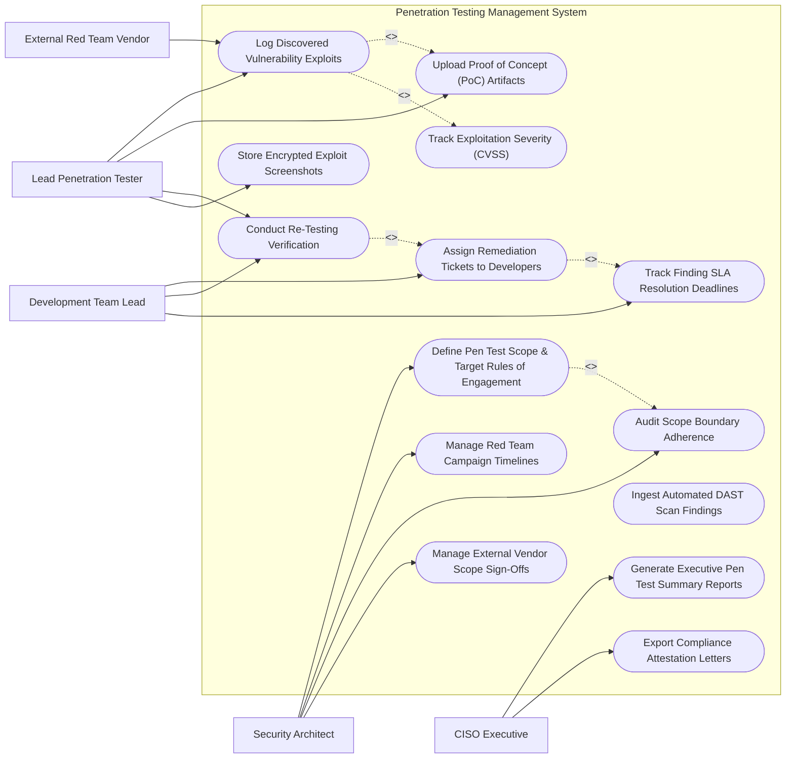

# Use Case Diagram — Penetration Testing Management System

## Mermaid Code

## Actor Table | Bảng Actor

| # | Actor | Actor Type | Role Description | Related Use Cases |
|---|-------|------------|------------------|-------------------|
| 1 | Lead Penetration Tester | Primary | Conducts ethical exploits, logs vulnerability findings, uploads PoC evidence, and conducts re-testing verifications. | UC02, UC03, UC05, UC13 |
| 2 | Security Architect | Primary | Defines target scope, rules of engagement (RoE), red team campaigns, and audits scope boundaries. | UC01, UC07, UC08, UC12 |
| 3 | Development Team Lead | Primary | Receives assigned vulnerability tickets, tracks developer fix SLAs, and requests re-testing verifications. | UC04, UC05, UC11 |
| 4 | CISO Executive | Primary | Reviews executive pen test summary reports, tracks corporate risk posture, and issues attestation letters. | UC09, UC14 |
| 5 | External Red Team Vendor | Supporting / System | Contracted third-party red team testing firm logging penetration test findings and social engineering results. | UC02 |

## Use Case Table | Bảng Use Case

| # | UC ID | Use Case Name | Primary Actor | Secondary Actor | Description | Priority |
|---|-------|---------------|---------------|-----------------|-------------|----------|
| 1 | UC01 | Define Pen Test Scope & Target Rules of Engagement | Security Architect | LeadTester | Specifies authorized IP subnets, domain URLs, testing time windows, and banned testing activities. | High |
| 2 | UC02 | Log Discovered Vulnerability Exploits | LeadTester | RedTeam | Logs detailed technical vulnerability findings, exploit steps, impacted assets, and CVSS scores. | High |
| 3 | UC03 | Upload Proof of Concept (PoC) Artifacts | LeadTester | None | Uploads PoC exploit scripts, raw HTTP request/response text, and encrypted screenshots proving exploitability. | High |
| 4 | UC04 | Assign Remediation Tickets to Developers | DevLead | LeadTester | Automatically maps verified findings into developer Jira tickets with step-by-step reproduction guides. | High |
| 5 | UC05 | Conduct Re-Testing Verification | LeadTester | DevLead | Re-tests patched application endpoints after developer code fixes to confirm vulnerability is fully resolved. | High |
| 6 | UC06 | Track Exploitation Severity (CVSS) | LeadTester | None | Calculates CVSS v3.1 base and environmental scores based on demonstrated exploit impact. | High |
| 7 | UC07 | Manage Red Team Campaign Timelines | Security Architect | RedTeam | Manages red team testing schedules, phase milestones (Recon, Initial Access, Lateral Movement), and deliverables. | Medium |
| 8 | UC08 | Audit Scope Boundary Adherence | Security Architect | LeadTester | Monitors testing targets to ensure testers remain strictly within authorized IP boundaries and RoE terms. | High |
| 9 | UC09 | Generate Executive Pen Test Summary Reports | CISO Executive | Security Architect | Compiles executive-level summaries detailing overall risk posture, critical flaw counts, and remediation progress. | Medium |
| 10 | UC10 | Ingest Automated DAST Scan Findings | LeadTester | None | Imports automated web vulnerability scan results (Burp Suite XML) to seed manual pen testing scope. | Medium |
| 11 | UC11 | Track Finding SLA Resolution Deadlines | DevLead | Security Architect | Monitors patch SLA timers (Critical = 7 days, High = 30 days) and triggers escalation alerts to engineering management. | High |
| 12 | UC12 | Manage External Vendor Scope Sign-Offs | Security Architect | RedTeam | Manages legal NDA execution, vendor liability sign-offs, and authorization letters for third-party testers. | Medium |
| 13 | UC13 | Store Encrypted Exploit Screenshots | LeadTester | None | Applies AES-256 encryption to stored PoC screenshots containing sensitive system data to prevent leaks. | Medium |
| 14 | UC14 | Export Compliance Attestation Letters | CISO Executive | Security Architect | Generates formal PCI-DSS 11.3 / ISO 27001 penetration testing compliance attestation letters for external partners. | Medium |

## Use Case Specification | Đặc tả Use Case

---

### UC01 — Define Pen Test Scope & Target Rules of Engagement

| Field | Detail |
|-------|--------|
| **UC ID** | UC01 |
| **Use Case Name** | Define Pen Test Scope & Target Rules of Engagement |
| **Actor(s)** | Primary: Security Architect   Secondary: Lead Penetration Tester |
| **Description** | Establishes authorized testing boundaries (IP ranges, URLs), approved testing windows, out-of-scope assets, and explicit Rules of Engagement (RoE). |
| **Precondition** | 1. Security Architect has Campaign Manager authorization.   2. Pen testing engagement scope is agreed upon with application owners. |
| **Main Flow** | 1. Architect creates new Penetration Test Campaign (e.g., "Q3 Core Banking Web App Pen Test").   2. Architect inputs target scope details (Target Domain `https://banking.company.com`, Subnet `192.168.10.0/24`, API Gateway endpoints).   3. Architect defines Rules of Engagement (Testing Window: 10:00 PM - 5:00 AM EST, Banned Activities: Denial of Service [DoS] attacks, Destruction of Data).   4. Architect specifies out-of-scope systems (e.g., Production Payment Switch `192.168.10.50` IS OUT OF SCOPE).   5. System generates formal Rules of Engagement Document and routes to Lead Tester and Application Owner for e-signature.   6. System saves campaign scope and activates scope boundary monitoring. |
| **Alternative Flow** | **AF1** — Scope Expansion Request: Tester requests emergency scope expansion during testing; architect reviews and approves updated IP range. |
| **Exception Flow** | **EX1** — Unassigned Target IP: System blocks creation if target IP range overlaps with unverified 3rd-party cloud provider subnets. |
| **Postcondition** | Penetration test campaign scope and RoE are formally authorized and signed. |
| **Business Rule** | **BR1**: Testing against target assets without a digitally signed Rules of Engagement (RoE) document is strictly prohibited. |

---

### UC02 — Log Discovered Vulnerability Exploits

| Field | Detail |
|-------|--------|
| **UC ID** | UC02 |
| **Use Case Name** | Log Discovered Vulnerability Exploits |
| **Actor(s)** | Primary: Lead Penetration Tester   Secondary: External Red Team Vendor |
| **Description** | Logs verified security vulnerabilities and successful exploits, capturing technical flaw descriptions, impact analysis, and CVSS severity scores. |
| **Precondition** | 1. Active pen test campaign exists and tester is authenticated.   2. Vulnerability is successfully demonstrated or exploited. |
| **Main Flow** | 1. Tester opens active campaign workspace and clicks "Log Discovered Finding".   2. Tester inputs finding details (Finding Title: "SQL Injection in User Profile Endpoint", Target URL: `https://app.company.com/profile?id=1`).   3. Tester selects Vulnerability Category (OWASP A03:2021-Injection) and affected asset.   4. Tester inputs detailed technical description, reproduction steps, and root cause analysis.   5. Tester configures CVSS v3.1 metrics (Base Score 9.8 Critical).   6. System checks finding uniqueness against database and creates Finding Record (e.g., `FIND-2026-0823`).   7. System prompts tester to proceed to UC03 Upload Proof of Concept (PoC) Artifacts. |
| **Alternative Flow** | **AF1** — Automated Import: Tester imports findings directly from Burp Suite Professional XML export file. |
| **Exception Flow** | **EX1** — Out-of-Scope Target Alert: If target URL belongs to an out-of-scope asset, system flags "OUT OF SCOPE WARNING" and prompts architect for review. |
| **Postcondition** | Vulnerability finding is logged, categorized, and assigned CVSS severity rating. |
| **Business Rule** | **BR1**: Critical vulnerability findings (CVSS >= 9.0) must be logged and escalated within 4 hours of successful exploitation. |

---

### UC03 — Upload Proof of Concept (PoC) Artifacts

| Field | Detail |
|-------|--------|
| **UC ID** | UC03 |
| **Use Case Name** | Upload Proof of Concept (PoC) Artifacts |
| **Actor(s)** | Primary: Lead Penetration Tester   Secondary: None |
| **Description** | Uploads raw HTTP request/response text, custom exploit scripts, and encrypted screenshots proving vulnerability exploitability. |
| **Precondition** | 1. Finding record exists in database. |
| **Main Flow** | 1. Tester opens target finding record `FIND-2026-0823`.   2. Tester attaches raw HTTP request and response text streams demonstrating payload execution.   3. Tester uploads custom Python/Bash exploit script used during penetration testing.   4. Tester uploads terminal screenshots showing database table dump or shell access.   5. System checks file types, redacts sensitive customer data in text streams if configured, and applies AES-256 encryption to screenshot files.   6. System generates SHA-256 hash for each uploaded PoC artifact.   7. System attaches encrypted PoC artifacts to finding record. |
| **Alternative Flow** | **AF1** — Video PoC Attachment: Tester uploads 30-second screen recording demonstrating complex multi-step cross-site scripting exploit. |
| **Exception Flow** | **EX1** — Unencrypted Screenshot Alert: System blocks storage of raw unencrypted image files containing visible passwords or PII data. |
| **Postcondition** | Encrypted PoC artifacts are attached to finding record with cryptographic hash verification. |
| **Business Rule** | **BR1**: All uploaded PoC screenshots and exploit scripts must be encrypted at rest using AES-256 GCM. |

---

### UC04 — Assign Remediation Tickets to Developers

| Field | Detail |
|-------|--------|
| **UC ID** | UC04 |
| **Use Case Name** | Assign Remediation Tickets to Developers |
| **Actor(s)** | Primary: Development Team Lead   Secondary: Lead Penetration Tester |
| **Description** | Generates structured Jira tickets containing reproduction steps, PoC attachments, and remediation guides, assigning them to development teams. |
| **Precondition** | 1. Vulnerability finding and PoC artifacts are verified by Lead Tester.   2. Jira ITSM API integration is configured. |
| **Main Flow** | 1. Dev Lead opens campaign findings dashboard and selects verified finding `FIND-2026-0823`.   2. System retrieves target application owner mapping from CMDB.   3. Dev Lead selects target Jira Project (e.g., `CORE-APP`) and assigns Lead Developer.   4. System issues Jira API call creating new Issue Ticket (`CORE-3991`).   5. System populates ticket summary, CVSS severity, reproduction steps, sanitized PoC snippets, and OWASP remediation guidelines (e.g., "Use Prepared Statements").   6. System sets ticket SLA deadline based on severity (Critical = 7 days).   7. System links Jira ticket key to finding record and sets status to "IN REMEDIATION". |
| **Alternative Flow** | **AF1** — GitHub Issues Sync: For open-source or GitHub-hosted apps, system syncs finding into a private GitHub Issue ticket. |
| **Exception Flow** | **EX1** — Jira API Authentication Error: System logs ticket generation failure, notifies Dev Lead, and provides fallback manual ticket export PDF. |
| **Postcondition** | Developer ticket is created in Jira with step-by-step reproduction details and SLA timer active. |
| **Business Rule** | **BR1**: Developer tickets must contain complete, self-contained reproduction steps to enable rapid bug fixing without delay. |

---

### UC05 — Conduct Re-Testing Verification

| Field | Detail |
|-------|--------|
| **UC ID** | UC05 |
| **Use Case Name** | Conduct Re-Testing Verification |
| **Actor(s)** | Primary: Lead Penetration Tester   Secondary: Development Team Lead |
| **Description** | Re-evaluates target application endpoints following developer code patches to verify that the vulnerability is completely resolved. |
| **Precondition** | 1. Developer marks Jira ticket as "RESOLVED - READY FOR RETEST".   2. Code patch is deployed to staging/test environment. |
| **Main Flow** | 1. Lead Tester receives automated notification "Re-Test Requested for Ticket CORE-3991".   2. Tester opens finding record `FIND-2026-0823` and reviews original PoC exploit steps.   3. Tester launches original exploit script and sends SQL injection payloads against re-test staging URL.   4. System inspects HTTP response: Target application returns `HTTP 400 Bad Request` with parameterized query validation.   5. Tester attempts 5 alternative SQLi bypass techniques; all are blocked by target app.   6. Tester confirms vulnerability is fully resolved and selects "RE-TEST PASSED - VULNERABILITY VERIFIED FIXED".   7. System updates finding status to "CLOSED - FIXED", updates Jira ticket to "VERIFIED CLOSED", and logs re-test timestamp. |
| **Alternative Flow** | **AF1** — Partial Fix / Re-Test Failed: Exploit still works under specific conditions. Tester selects "RE-TEST FAILED", attaches new PoC, and re-opens Jira ticket. |
| **Exception Flow** | **EX1** — Staging Environment Down: System alerts tester if staging server returns 503 error, postponing re-test session. |
| **Postcondition** | Vulnerability fix is verified through re-testing, and finding ticket is permanently closed. |
| **Business Rule** | **BR1**: A vulnerability finding shall not be closed as "FIXED" without mandatory re-testing verification by a security tester. |
