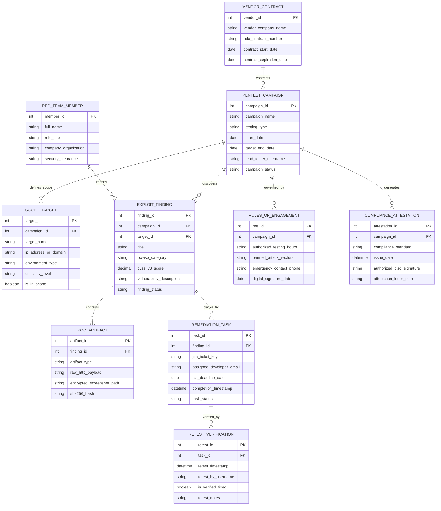

# Conceptual ERD — Penetration Testing Management System

## Mermaid Code

## Entity Description Table | Bảng mô tả Entity

| # | Entity Name | Vietnamese Name | Description | Key Attributes | Main Relationships |
|---|-------------|-----------------|-------------|----------------|-------------------|
| 1 | PENTEST_CAMPAIGN | Chiến dịch Kiểm thử Xâm nhập | Master campaign record tracking pen test engagements, testing types (Web/Mobile/Internal), timelines, and status. | campaign_id, campaign_name, testing_type, start_date, campaign_status | Primary entity; defines SCOPE_TARGET, discovers EXPLOIT_FINDING. |
| 2 | SCOPE_TARGET | Mục tiêu Kiểm thử (Scope) | Stores authorized IP subnets, domain URLs, API gateways, environment types, and in-scope flags. | target_id, target_name, ip_address_or_domain, is_in_scope | Belongs to PENTEST_CAMPAIGN. |
| 3 | EXPLOIT_FINDING | Kết quả Khai thác Lỗ hổng | Master finding table storing verified vulnerability exploits, OWASP categories, CVSS scores, and status. | finding_id, title, owasp_category, cvss_v3_score, finding_status | Discovered in PENTEST_CAMPAIGN; contains POC_ARTIFACT. |
| 4 | POC_ARTIFACT | Bằng chứng Khai thác (PoC) | Archives raw HTTP payload text, encrypted terminal screenshots, custom exploit scripts, and SHA-256 hashes. | artifact_id, artifact_type, raw_http_payload, encrypted_screenshot_path, sha256_hash | Belongs to EXPLOIT_FINDING. |
| 5 | REMEDIATION_TASK | Nhiệm vụ Khắc phục Developer | Tracks Jira/GitHub issue tickets, assigned developer emails, SLA deadlines, and resolution timestamps. | task_id, jira_ticket_key, assigned_developer_email, sla_deadline_date, task_status | Tracks fix for EXPLOIT_FINDING; verified by RETEST_VERIFICATION. |
| 6 | RED_TEAM_MEMBER | Thành viên Đội Red Team | Stores ethical hacker profiles, tester roles, company organizations, and security clearance levels. | member_id, full_name, role_title, company_organization, security_clearance | Reports EXPLOIT_FINDING. |
| 7 | RETEST_VERIFICATION | Kết quả Kiểm tra lại (Re-Test) | Archives post-fix re-test verification sessions, tester usernames, timestamps, and verification outcomes. | retest_id, retest_timestamp, retest_by_username, is_verified_fixed, retest_notes | Belongs to REMEDIATION_TASK. |
| 8 | RULES_OF_ENGAGEMENT | Quy tắc Cuộc thi / Thỏa thuận | Stores authorized testing hours, banned attack vectors, emergency contacts, and digital signature dates. | roe_id, authorized_testing_hours, banned_attack_vectors, digital_signature_date | Governs PENTEST_CAMPAIGN. |
| 9 | VENDOR_CONTRACT | Hợp đồng Nhà thầu Ngoài | Stores external red team vendor details, NDA contract numbers, and contract expiration dates. | vendor_id, vendor_company_name, nda_contract_number, contract_expiration_date | Contracts PENTEST_CAMPAIGN. |
| 10 | COMPLIANCE_ATTESTATION | Giấy Chứng nhận Tuân thủ | Stores generated PCI-DSS 11.3 / ISO 27001 compliance attestation letters signed by the CISO. | attestation_id, compliance_standard, issue_date, authorized_ciso_signature | Generates from PENTEST_CAMPAIGN. |

## Relationship Description | Mô tả Quan hệ

| # | From Entity | Cardinality | To Entity | Relationship Label | Business Explanation |
|---|-------------|-------------|-----------|-------------------|----------------------|
| 1 | PENTEST_CAMPAIGN | one-to-many | SCOPE_TARGET | defines_scope | A pen test campaign defines authorized target scope assets. |
| 2 | PENTEST_CAMPAIGN | one-to-many | EXPLOIT_FINDING | discovers | A pen test campaign discovers multiple vulnerability findings. |
| 3 | PENTEST_CAMPAIGN | one-to-one | RULES_OF_ENGAGEMENT | governed_by | A pen test campaign is governed by explicit Rules of Engagement (RoE). |
| 4 | PENTEST_CAMPAIGN | one-to-many | COMPLIANCE_ATTESTATION | generates | A pen test campaign generates compliance attestation letters upon completion. |
| 5 | EXPLOIT_FINDING | one-to-many | POC_ARTIFACT | contains | An exploit finding contains multiple Proof of Concept (PoC) evidence artifacts. |
| 6 | EXPLOIT_FINDING | one-to-one | REMEDIATION_TASK | tracks_fix | An exploit finding tracks code fixes via a developer remediation task. |
| 7 | REMEDIATION_TASK | one-to-many | RETEST_VERIFICATION | verified_by | A remediation task is verified by re-test verification sessions. |
| 8 | RED_TEAM_MEMBER | one-to-many | EXPLOIT_FINDING | reports | A red team member reports discovered vulnerability findings. |
| 9 | VENDOR_CONTRACT | one-to-many | PENTEST_CAMPAIGN | contracts | A vendor contract governs external red team campaigns. |
