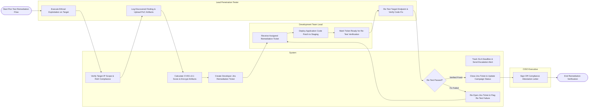

# Swimlane Diagram — Penetration Testing Management System

## Mermaid Code

## Flow Description | Mô tả luồng

| Lane | Actor | Role in Flow |
|------|-------|-------------|
| 1 | Lead Penetration Tester | Conducts ethical exploitation, logs findings, uploads encrypted PoC evidence, and conducts re-testing verifications. |
| 2 | System | Validates scope boundaries, calculates CVSS risk scores, encrypts artifacts, generates Jira developer tickets, tracks SLA timers, and updates campaign status. |
| 3 | Development Team Lead | Receives assigned Jira tickets, deploys application code fixes to staging environments, and requests re-test verification. |
| 4 | CISO Executive | Reviews campaign completion status and signs formal PCI-DSS / ISO 27001 compliance attestation letters. |
