# Action Tree — Penetration Testing Management System

## Mermaid Code

```mermaid
graph TD
    Root["Penetration Testing Management System"]

    Root --> M1["Scope & Campaign Management"]
    Root --> M2["Finding & PoC Logging"]
    Root --> M3["Remediation & Re-Testing"]
    Root --> M4["Vendor & Red Team Management"]
    Root --> M5["Executive Reporting"]

    M1 --> A1["Define Target IP Subnets & URLs"]
    M1 --> A2["Sign Rules of Engagement (RoE)"]
    M1 --> A3["Audit Scope Boundary Adherence"]
    M1 --> A4["Import Target CMDB Inventory"]

    M2 --> B1["Log OWASP & Exploitation Findings"]
    M2 --> B2["Calculate CVSS v3.1 Severity Score"]
    M2 --> B3["Upload Raw HTTP Payload Screenshots"]
    M2 --> B4["Encrypt PoC Evidence with AES-256"]

    M3 --> C1["Generate Jira Developer Patch Tickets"]
    M3 --> C2["Track 7-Day / 30-Day Fix SLAs"]
    M3 --> C3["Execute Re-Testing Verification"]
    M3 --> C4["Close Verified Resolved Tickets"]

    M4 --> D1["Manage Red Team Campaign Milestones"]
    M4 --> D2["Track Vendor NDA Sign-Offs"]
    M4 --> D3["Evaluate Physical Breach Logs"]
    M4 --> D4["Review Phishing Campaign Stats"]

    M5 --> E1["Generate Executive Summary Brief"]
    M5 --> E2["Export PCI-DSS 11.3 Attestation Letter"]
    M5 --> E3["Track Mean Time to Remediate (MTTR)"]
    M5 --> E4["Archive Closed Campaign Files"]
```

## Module Description | Mô tả Module

| # | Module | Description | Actions |
|---|--------|-------------|---------|
| 1 | Scope & Campaign Management | Authorized IP/URL scope setup, Rules of Engagement (RoE) e-signatures, scope boundary auditing, and CMDB import. | Define Target IP Subnets & URLs, Sign Rules of Engagement (RoE), Audit Scope Boundary Adherence, Import Target CMDB Inventory |
| 2 | Finding & PoC Logging | OWASP vulnerability exploit logging, CVSS v3.1 scoring, PoC screenshot uploads, and AES-256 evidence encryption. | Log OWASP & Exploitation Findings, Calculate CVSS v3.1 Severity Score, Upload Raw HTTP Payload Screenshots, Encrypt PoC Evidence with AES-256 |
| 3 | Remediation & Re-Testing | Developer Jira ticket generation, SLA deadline tracking, re-testing verification, and closed ticket verification. | Generate Jira Developer Patch Tickets, Track 7-Day / 30-Day Fix SLAs, Execute Re-Testing Verification, Close Verified Resolved Tickets |
| 4 | Vendor & Red Team Management | External vendor campaign milestones, NDA verification, physical security breach logs, and phishing test statistics. | Manage Red Team Campaign Milestones, Track Vendor NDA Sign-Offs, Evaluate Physical Breach Logs, Review Phishing Campaign Stats |
| 5 | Executive Reporting | Executive summary report generation, PCI-DSS 11.3 attestation letters, MTTR trend tracking, and campaign archiving. | Generate Executive Summary Brief, Export PCI-DSS 11.3 Attestation Letter, Track Mean Time to Remediate (MTTR), Archive Closed Campaign Files |
