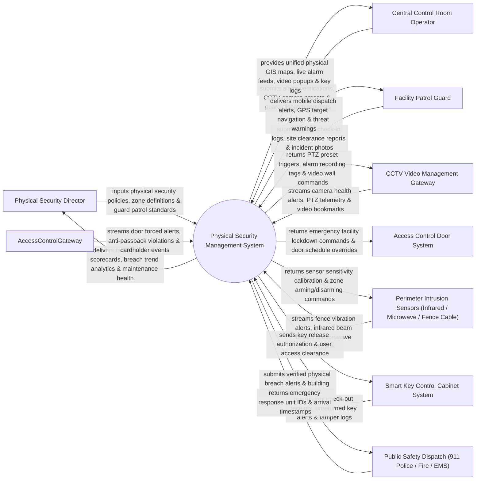

# Context Diagram — Physical Security Management System

## Mermaid Code

## Actor & Interaction Table | Bảng Actor & Tương tác

| # | Actor | Actor Type | Data Sent TO System | Data Received FROM System | Notes |
|---|-------|------------|---------------------|---------------------------|-------|
| 1 | Physical Security Director | Primary | Physical security policies, zone definitions, guard patrol standards, key access rules. | Facility security scorecards, breach trend analytics, maintenance health, audit logs. | Senior security executive managing physical security operations across facilities. |
| 2 | Central Control Room Operator | Primary | Alarm verifications, CCTV camera presets, guard dispatch requests, lockdown commands. | Unified physical GIS maps, live alarm feeds, video popups, key logs, response SLAs. | Security operator monitoring unified physical security console in control room. |
| 3 | Facility Patrol Guard | Primary | Guard check-in logs, site clearance reports, incident photos, mobile GPS updates. | Mobile dispatch alerts, GPS target navigation, threat warnings, zone details. | Field guard conducting physical patrols and responding to facility breaches. |
| 4 | CCTV Video Management Gateway | Supporting | Camera health alerts, PTZ telemetry, video bookmarks, video loss alerts. | PTZ preset triggers, alarm recording tags, video wall popup commands. | Video surveillance system integrated to pop up live camera feeds on physical alerts. |
| 5 | Access Control Door System | Supporting | Door forced alerts, anti-passback violations, cardholder event streams. | Emergency facility lockdown commands, door schedule overrides, cardholder sync. | Door access control platform managing physical electronic locks and barriers. |
| 6 | Perimeter Intrusion Sensors | Supporting | Fence vibration alerts, infrared beam breaks, microwave sensor triggers. | Sensor sensitivity calibration, zone arming/disarming commands. | Hardware perimeter sensors (taut-wire, infrared, microwave) detecting fence breaches. |
| 7 | Smart Key Control Cabinet System | Supporting | Key check-out receipts, unreturned key alerts, key cabinet tamper logs. | Key release authorization, user access clearance, key return verification. | Electronic key cabinets (Traka / Morsett) managing physical master key access. |
| 8 | Public Safety Dispatch | Supporting / Regulatory | Emergency response unit IDs, arrival timestamps, police case numbers. | Verified physical breach alerts, building hazard maps, emergency access codes. | Public emergency services (911 Police / Fire) dispatched for physical breaches. |

## System Boundary Description | Mô tả Phạm vi Hệ thống

The **Physical Security Management System** is an enterprise unified physical security monitoring, GIS facility mapping, perimeter intrusion integration, smart key cabinet tracking, and physical lockdown platform.

**Inside System Scope:**
- Unified Physical Security Information Management (PSIM) console integrating CCTV, Access Control, and Alarms.
- GIS interactive 3D building map visualization rendering real-time device locations and alarm zones.
- Smart key cabinet management tracking physical master key check-outs, returns, and overdue alerts.
- Perimeter Intrusion Detection System (PIDS) fence sensor and infrared beam monitoring.
- Emergency physical lockdown execution and automated public safety dispatch integration.

**Outside System Scope:**
- Direct physical installation of fence post wire cables (handled by Fence Contractors).
- Direct physical repair of broken glass windows (handled by Facilities Maintenance).
- Direct manufacture of physical brass key blanks (handled by Locksmith Vendors).
