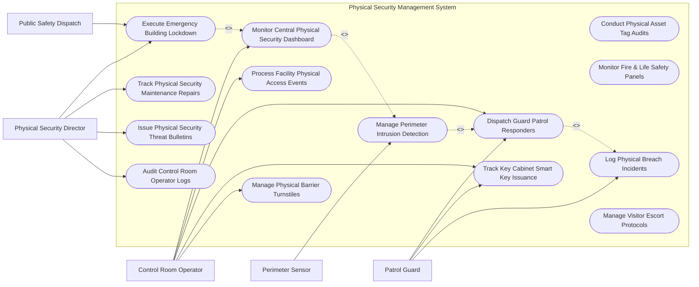

# Use Case Diagram — Physical Security Management System

## Mermaid Code

## Actor Table | Bảng Actor

| # | Actor | Actor Type | Role Description | Related Use Cases |
|---|-------|------------|------------------|-------------------|
| 1 | Physical Security Director | Primary | Establishes physical security policies, executes emergency building lockdowns, and monitors maintenance repairs. | UC08, UC09, UC13, UC14 |
| 2 | Control Room Operator | Primary | Monitors central PSIM GIS dashboard, manages physical access events, tracks smart keys, and dispatches guards. | UC01, UC03, UC04, UC05, UC06 |
| 3 | Patrol Guard | Primary | Receives dispatch assignments, checks out physical master keys, inspects physical breach zones, and files reports. | UC04, UC05, UC11 |
| 4 | Perimeter Sensor | Supporting / System | Hardware sensor (infrared beam, fence cable) detecting perimeter intrusions and triggering system alerts. | UC02 |
| 5 | Public Safety Dispatch | Supporting / System | Emergency 911 police and fire dispatch receiving verified physical security breach notifications. | UC08 |

## Use Case Table | Bảng Use Case

| # | UC ID | Use Case Name | Primary Actor | Secondary Actor | Description | Priority |
|---|-------|---------------|---------------|-----------------|-------------|----------|
| 1 | UC01 | Monitor Central Physical Security Dashboard | Control Room Operator | None | Renders unified 3D GIS maps displaying real-time camera tiles, door states, and active sensor alarms. | High |
| 2 | UC02 | Manage Perimeter Intrusion Detection | Perimeter Sensor | Operator | Ingests fence vibration and beam break alerts, positioning PTZ cameras on the breach vector. | High |
| 3 | UC03 | Process Facility Physical Access Events | Control Room Operator | Access System | Tracks door forced open events, anti-passback violations, and manual door unlock overrides. | High |
| 4 | UC04 | Dispatch Guard Patrol Responders | Control Room Operator | Patrol Guard | Dispatches closest mobile guard via GPS with target zone maps to inspect physical alarms. | High |
| 5 | UC05 | Track Key Cabinet Smart Key Issuance | Patrol Guard | Operator | Controls electronic key cabinet releases (Traka), tracking master physical key check-outs and overdue returns. | High |
| 6 | UC06 | Manage Physical Barrier Turnstiles | Control Room Operator | None | Controls optical turnstiles and speed gates, managing entry flow and tailgate alerts. | High |
| 7 | UC07 | Conduct Physical Asset Tag Audits | Control Room Operator | None | Tracks RFID asset tags on high-value equipment (laptops, servers) moving across building exits. | Medium |
| 8 | UC08 | Execute Emergency Building Lockdown | Security Director | Public Safety | Immediately locks down all physical perimeter and interior doors while maintaining crash bar exit capability. | High |
| 9 | UC09 | Track Physical Security Maintenance Repairs | Security Director | None | Tracks repair tickets for broken magnetic locks, damaged fence cables, or faulty CCTV cameras. | Medium |
| 10 | UC10 | Monitor Fire & Life Safety Panels | Control Room Operator | None | Displays fire panel status, duct smoke detectors, and sprinkler pressure drop alerts. | High |
| 11 | UC11 | Log Physical Breach Incidents | Patrol Guard | Operator | Documents physical security break-ins, property damage, forced entry proof, and officer notes. | High |
| 12 | UC12 | Manage Visitor Escort Protocols | Control Room Operator | Patrol Guard | Manages high-security escort requirements for external guests visiting restricted zones. | Medium |
| 13 | UC13 | Issue Physical Security Threat Bulletins | Security Director | None | Publishes security advisories regarding local crime threats or active facility risk updates. | Low |
| 14 | UC14 | Audit Control Room Operator Logs | Security Director | None | Audits operator response times, manual door overrides, and video viewing histories. | Medium |

## Use Case Specification | Đặc tả Use Case

---

### UC01 — Monitor Central Physical Security Dashboard

| Field | Detail |
|-------|--------|
| **UC ID** | UC01 |
| **Use Case Name** | Monitor Central Physical Security Dashboard |
| **Actor(s)** | Primary: Control Room Operator   Secondary: None |
| **Description** | Displays an interactive 3D GIS building map integrating live CCTV video tiles, door status indicators, and active perimeter alarm alerts. |
| **Precondition** | 1. Physical Security Information Management (PSIM) engine is online.   2. Device GIS coordinates (x, y, z) are mapped. |
| **Main Flow** | 1. Operator logs into Central Control Room Workstation.   2. System renders 3D vector map of facility campus showing building floors and security devices.   3. System displays color-coded device icons (Green = Normal, Red = Alarm Active, Yellow = Maintenance).   4. Operator clicks a camera icon on the 3D map; system opens live HD video feed in pop-up tile.   5. Operator clicks a door icon; system displays cardholder swipe history and door lock state.   6. System updates live event log ticker at bottom of screen. |
| **Alternative Flow** | **AF1** — Multi-Monitor Video Wall: Operator expands 3D map to central video wall matrix while keeping alarm queue on side monitor. |
| **Exception Flow** | **EX1** — GIS Data Disconnection: System displays fallback 2D schematic layout if 3D rendering engine encounters GPU error. |
| **Postcondition** | Unified physical security dashboard is active and rendering real-time device telemetry. |
| **Business Rule** | **BR1**: Alarm status changes on the 3D GIS map must update within 500 milliseconds of hardware signal receipt. |

---

### UC02 — Manage Perimeter Intrusion Detection

| Field | Detail |
|-------|--------|
| **UC ID** | UC02 |
| **Use Case Name** | Manage Perimeter Intrusion Detection |
| **Actor(s)** | Primary: Perimeter Sensor   Secondary: Control Room Operator |
| **Description** | Ingests fence vibration, taut-wire, or infrared beam break alerts, automatically positioning PTZ cameras on the breach vector for verification. |
| **Precondition** | 1. Perimeter Intrusion Detection System (PIDS) sensors are armed. |
| **Main Flow** | 1. Fence taut-wire sensor `SENS-PERIM-14` detects physical cable tension change (vibration/cutting).   2. Sensor controller sends alarm payload to PSIM engine specifying "Zone 14 - North Fence Line".   3. System identifies nearest PTZ camera `CAM-PTZ-08` mapped to Zone 14.   4. System issues PTZ command driving camera `CAM-PTZ-08` to Preset Position 14 (Zoom 10x, Pan 180°).   5. System pops up camera feed in high-priority window on operator console and sounds perimeter alarm.   6. Operator reviews video feed, confirms intruder climbing fence, and initiates UC04 Dispatch Guard Patrol. |
| **Alternative Flow** | **AF1** — Wildlife False Alarm: Operator inspects video, observes a large animal triggering fence, and marks alert "FALSE ALARM - WILDLIFE". |
| **Exception Flow** | **EX1** — PTZ Camera Failure: If PTZ camera fails, system automatically commands secondary adjacent camera `CAM-PTZ-09` to zoom into Zone 14. |
| **Postcondition** | Perimeter intrusion is detected, PTZ camera is positioned, and operator is alerted. |
| **Business Rule** | **BR1**: PTZ camera positioning on perimeter breach zones must complete within 2 seconds of sensor trigger. |

---

### UC04 — Dispatch Guard Patrol Responders

| Field | Detail |
|-------|--------|
| **UC ID** | UC04 |
| **Use Case Name** | Dispatch Guard Patrol Responders |
| **Actor(s)** | Primary: Control Room Operator   Secondary: Patrol Guard |
| **Description** | Dispatches nearest mobile patrol guard to verified physical alarm zones, providing GPS navigation maps and threat context via smartphone app. |
| **Precondition** | 1. Verified physical alarm requires on-site guard inspection.   2. Patrol guards have active mobile app running. |
| **Main Flow** | 1. Operator clicks "Dispatch Guard" on verified perimeter alarm tile `ALM-PERIM-14`.   2. System queries active guard mobile GPS locations and ranks guards by proximity to Zone 14.   3. Operator selects Guard "Unit 2 - Officer Davis" (200 meters away) and clicks "Assign Dispatch".   4. System sends loud push notification to Officer Davis smartphone app.   5. Smartphone app displays target zone map, threat summary ("Perimeter Fence Breach"), and recommended approach vector.   6. Guard taps "Accept Dispatch", and system tracks guard GPS movement towards Zone 14.   7. Guard arrives at zone, secures site, and taps "Zone Clear - Site Secured" in app. |
| **Alternative Flow** | **AF1** — Automated Dispatch: System automatically dispatches closest guard without waiting for manual operator click if alarm is Priority 1. |
| **Exception Flow** | **EX1** — Guard Unresponsive: If guard fails to accept dispatch within 30 seconds, system auto-escalates dispatch to next nearest guard. |
| **Postcondition** | Patrol guard is dispatched, GPS tracked, and site clearance is confirmed. |
| **Business Rule** | **BR1**: Guard mobile dispatch push notifications must override silent mode on guard smartphones. |

---

### UC05 — Track Key Cabinet Smart Key Issuance

| Field | Detail |
|-------|--------|
| **UC ID** | UC05 |
| **Use Case Name** | Track Key Cabinet Smart Key Issuance |
| **Actor(s)** | Primary: Patrol Guard   Secondary: Control Room Operator |
| **Description** | Controls electronic smart key cabinets (Traka/Morsett), authorizing physical master key check-outs based on RFID badge access levels and logging overdue returns. |
| **Precondition** | 1. Physical master keys are locked in smart key cabinet slots with RFID key FOBs. |
| **Main Flow** | 1. Guard taps RFID badge on Smart Key Cabinet reader.   2. Key Cabinet queries System for guard key authorization privileges.   3. System confirms guard is authorized to check out "Master Key Set - Building C".   4. Key Cabinet unlocks specific key slot LED door, releasing "Master Key Set #3".   5. Guard removes key set and closes cabinet door.   6. System logs Key Check-Out event (Guard Name, Key ID, Timestamp, Max Return Time: 8 Hours).   7. System starts 8-hour return countdown timer. |
| **Alternative Flow** | **AF1** — Key Return: Guard inserts key FOB back into empty cabinet slot; system verifies RFID key chip, locks slot, and clears countdown timer. |
| **Exception Flow** | **EX1** — Overdue Key Alert: If key is not returned within 8 hours, system triggers high-priority "OVERDUE MASTER KEY ALERT" on control console. |
| **Postcondition** | Physical master key check-out is authorized, logged, and tracked for timely return. |
| **Business Rule** | **BR1**: Master physical keys shall only be released to cardholders holding explicit Key Management authorization. |

---

### UC08 — Execute Emergency Building Lockdown

| Field | Detail |
|-------|--------|
| **UC ID** | UC08 |
| **Use Case Name** | Execute Emergency Building Lockdown |
| **Actor(s)** | Primary: Physical Security Director   Secondary: Public Safety Dispatch |
| **Description** | Executes an immediate physical building lockdown, securing all perimeter doors, turnstiles, and elevators while ensuring emergency exit crash bars remain functional. |
| **Precondition** | 1. Active physical threat (e.g., active shooter, armed intruder) is identified. |
| **Main Flow** | 1. Security Director presses physical "EMERGENCY LOCKDOWN" glass-break button or executes lockdown command on console.   2. System prompts for confirmation keycode. Director inputs keycode.   3. System issues high-priority broadcast commands to Access Control, Barrier Turnstile, and Elevator gateways.   4. Access Control locks all exterior doors, turnstiles, and elevator floor relays.   5. System triggers UC01 3D GIS Map to flash red "LOCKDOWN ACTIVE" status.   6. System issues automated dispatch notification payload to Public Safety Dispatch (911 Police).   7. System renders real-time door lock verification dashboard for control room operators. |
| **Alternative Flow** | **AF1** — Zone-Specific Lockdown: Director locks down only Building B while keeping Building A in normal operation mode. |
| **Exception Flow** | **EX1** — Unconfirmed Door Lock: System alerts director if a door sensor reports "Door Ajar" during lockdown, sending immediate guard dispatch. |
| **Postcondition** | Facility is secured in emergency lockdown mode and emergency services are notified. |
| **Business Rule** | **BR1**: Emergency exit panic hardware (crash bars) must remain mechanically operable from the inside during all physical lockdowns. |
