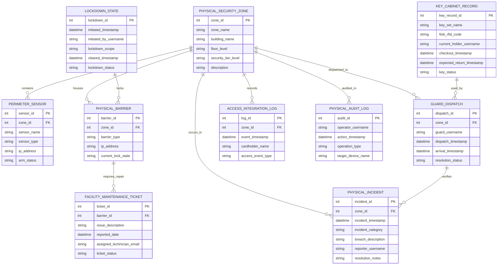

# Conceptual ERD — Physical Security Management System

## Mermaid Code

## Entity Description Table | Bảng mô tả Entity

| # | Entity Name | Vietnamese Name | Description | Key Attributes | Main Relationships |
|---|-------------|-----------------|-------------|----------------|-------------------|
| 1 | PHYSICAL_SECURITY_ZONE | Khu vực An ninh Vật lý | Master zone table defining building floor zones, security tiers, and geographic boundaries. | zone_id, zone_name, building_name, floor_level, security_tier_level | Contains PERIMETER_SENSOR, PHYSICAL_BARRIER; houses PHYSICAL_INCIDENT. |
| 2 | PERIMETER_SENSOR | Cảm biến Tường rào (PIDS) | Stores fence vibration cables, infrared beams, microwave sensors, IP addresses, and arm status. | sensor_id, sensor_name, sensor_type, ip_address, arm_status | Belongs to PHYSICAL_SECURITY_ZONE. |
| 3 | GUARD_DISPATCH | Lượt Điều động Bảo vệ (Dispatch) | Tracks guard dispatch orders, target zones, dispatch/arrival timestamps, and resolution status. | dispatch_id, guard_username, dispatch_timestamp, arrival_timestamp, resolution_status | Dispatched to PHYSICAL_SECURITY_ZONE; verifies PHYSICAL_INCIDENT. |
| 4 | KEY_CABINET_RECORD | Nhật ký Tủ Khóa Thông minh | Manages physical master key check-outs, RFID FOB codes, user assignments, and return countdown timers. | key_record_id, key_set_name, fiob_rfid_code, current_holder_username, checkout_timestamp, key_status | Used by GUARD_DISPATCH. |
| 5 | PHYSICAL_BARRIER | Thiết bị Khóa / Cổng Chắn | Stores turnstiles, speed gates, magnetic door locks, IP controllers, and current lock states. | barrier_id, barrier_type, ip_address, current_lock_state | Housed in PHYSICAL_SECURITY_ZONE; requires FACILITY_MAINTENANCE_TICKET. |
| 6 | PHYSICAL_INCIDENT | Sự cố An ninh Vật lý | Master incident log recording physical break-ins, property damage, intruder locations, and resolution notes. | incident_id, incident_timestamp, incident_category, breach_description, resolution_notes | Occurs in PHYSICAL_SECURITY_ZONE; verified by GUARD_DISPATCH. |
| 7 | FACILITY_MAINTENANCE_TICKET | Phiếu Sửa chữa Thiết bị Vật lý | Tracks hardware maintenance work orders for broken maglocks, damaged fence cables, or malfunctioning turnstiles. | ticket_id, issue_description, reported_date, assigned_technician_email, ticket_status | Requires repair for PHYSICAL_BARRIER. |
| 8 | LOCKDOWN_STATE | Trạng thái Phong tỏa Khan cấp | Archives emergency building lockdown executions, initiation timestamps, user credentials, and cleared timestamps. | lockdown_id, initiated_timestamp, initiated_by_username, lockdown_scope, lockdown_status | Locks PHYSICAL_BARRIER. |
| 9 | ACCESS_INTEGRATION_LOG | Nhật ký Tương tác Kiểm soát Ra vao | Stores door forced open events, cardholder swipe logs, and anti-passback violations. | log_id, event_timestamp, cardholder_name, access_event_type | Records in PHYSICAL_SECURITY_ZONE. |
| 10 | PHYSICAL_AUDIT_LOG | Nhật ký Kiểm toán Thao tác | Captures control room operator actions, manual door overrides, PTZ camera moves, and lockdown commands. | audit_id, operator_username, action_timestamp, operation_type, target_device_name | Audits PHYSICAL_SECURITY_ZONE. |

## Relationship Description | Mô tả Quan hệ

| # | From Entity | Cardinality | To Entity | Relationship Label | Business Explanation |
|---|-------------|-------------|-----------|-------------------|----------------------|
| 1 | PHYSICAL_SECURITY_ZONE | one-to-many | PERIMETER_SENSOR | contains | A physical security zone contains multiple perimeter sensors. |
| 2 | PHYSICAL_SECURITY_ZONE | one-to-many | PHYSICAL_BARRIER | houses | A physical security zone houses physical barriers and electronic door locks. |
| 3 | PHYSICAL_SECURITY_ZONE | one-to-many | GUARD_DISPATCH | dispatched_to | A physical security zone receives guard dispatches for alarm inspection. |
| 4 | PHYSICAL_SECURITY_ZONE | one-to-many | PHYSICAL_INCIDENT | occurs_in | Physical security incidents occur within designated security zones. |
| 5 | PHYSICAL_BARRIER | one-to-many | FACILITY_MAINTENANCE_TICKET | requires_repair | A physical barrier requires maintenance repair tickets when malfunctioning. |
| 6 | GUARD_DISPATCH | one-to-many | PHYSICAL_INCIDENT | verifies | A guard dispatch verifies physical security incidents on-site. |
| 7 | LOCKDOWN_STATE | one-to-many | PHYSICAL_BARRIER | locks | An emergency lockdown state locks all physical barriers and doors. |
