# Swimlane Diagram — Physical Security Management System

## Mermaid Code

```mermaid
flowchart LR
    Start(["Start Perimeter Intrusion Incident"])

    subgraph Lane1["Perimeter Sensor"]
        S1["Detect Fence Cable Vibration / Beam Cut"]
        S2["Transmit Zone Alarm Payload to System"]
    end

    subgraph Lane2["System"]
        C1["Trigger Alarm on 3D GIS Building Map"]
        C2["Command PTZ Camera to Breach Vector"]
        C3["Rank Nearby Guard Mobile GPS Locations"]
        C4["Send Dispatch Alert to Mobile App"]
        C5["Log Physical Breach Incident File"]
    end

    subgraph Lane3["Control Room Operator"]
        O1["Verify Live Video Wall Pop-Up Feed"]
        O2["Confirm Breach & Click Dispatch Guard"]
    end

    subgraph Lane4["Facility Patrol Guard"]
        G1["Accept Dispatch on Mobile App"]
        G2["Check Out Master Key from Smart Cabinet"]
        G3["Navigate to Breach Zone & Secure Intruder"]
        G4["Tap Site Cleared & Upload Photos"]
    end

    Finish(["End Incident Response"])

    Start --> S1 --> S2 --> C1 --> C2 --> O1 --> O2 --> C3 --> C4 --> G1 --> G2 --> G3 --> G4 --> C5 --> Finish
```

## Flow Description | Mô tả luồng

| Lane | Actor | Role in Flow |
|------|-------|-------------|
| 1 | Perimeter Sensor | Detects physical fence line vibration or beam break, transmitting alarm payloads to system. |
| 2 | System | Renders alarm on 3D GIS maps, drives PTZ camera presets to breach vector, ranks guard GPS proximity, sends mobile alerts, and logs incident records. |
| 3 | Control Room Operator | Verifies live video wall pop-ups, confirms perimeter intrusion, and approves guard dispatches. |
| 4 | Facility Patrol Guard | Accepts mobile dispatches, checks out master keys from electronic cabinets, secures physical breach zones, and uploads incident clearance reports. |
