# Action Tree — Physical Security Management System

## Mermaid Code

```mermaid
graph TD
    Root["Physical Security Management System"]

    Root --> M1["Central Monitoring & GIS"]
    Root --> M2["Perimeter & Sensor Control"]
    Root --> M3["Key & Barrier Management"]
    Root --> M4["Guard Dispatch & Incident Response"]
    Root --> M5["Maintenance & Compliance"]

    M1 --> A1["Render 3D Vector Building Campus GIS Map"]
    M1 --> A2["Pop Up CCTV Alarm Video Wall Tile"]
    M1 --> A3["Display Real-Time Device Lock States"]
    M1 --> A4["Audit Control Room Operator Actions"]

    M2 --> B1["Ingest Fence Vibration & Beam Alarms"]
    M2 --> B2["Drive PTZ Camera to Breach Vector"]
    M2 --> B3["Calibrate Sensor Sensitivity Thresholds"]
    M2 --> B4["Arm / Disarm Perimeter Security Zones"]

    M3 --> C1["Authorize Smart Key Cabinet Check-Out"]
    M3 --> C2["Start Key Overdue Return Timer"]
    M3 --> C3["Control Optical Barrier Speed Gates"]
    M3 --> C4["Execute Emergency Building Lockdown"]

    M4 --> D1["Rank Guard GPS Proximity to Zone"]
    M4 --> D2["Dispatch Mobile Guard App Alert"]
    M4 --> D3["Track Real-Time Guard Breadcrumb Trail"]
    M4 --> D4["Log Incident Clearance Report & Photos"]

    M5 --> E1["Track Maglock Repair Work Orders"]
    M5 --> E2["Dispatch Public Safety 911 Police"]
    M5 --> E3["Monitor Fire & Life Safety Panels"]
    M5 --> E4["Export Physical Breach Trend Analytics"]
```

## Module Description | Mô tả Module

| # | Module | Description | Actions |
|---|--------|-------------|---------|
| 1 | Central Monitoring & GIS | 3D vector GIS campus maps, video wall tile pop-ups, real-time device status indicators, and operator log auditing. | Render 3D Vector Building Campus GIS Map, Pop Up CCTV Alarm Video Wall Tile, Display Real-Time Device Lock States, Audit Control Room Operator Actions |
| 2 | Perimeter & Sensor Control | Perimeter intrusion alarm ingestion, PTZ camera preset positioning, sensor calibration, and zone arming/disarming. | Ingest Fence Vibration & Beam Alarms, Drive PTZ Camera to Breach Vector, Calibrate Sensor Sensitivity Thresholds, Arm / Disarm Perimeter Security Zones |
| 3 | Key & Barrier Management | Smart key cabinet releases, key return timers, optical turnstile gate control, and emergency building lockdown execution. | Authorize Smart Key Cabinet Check-Out, Start Key Overdue Return Timer, Control Optical Barrier Speed Gates, Execute Emergency Building Lockdown |
| 4 | Guard Dispatch & Incident Response | Guard GPS proximity ranking, mobile push alert dispatches, real-time guard tracking, and incident clearance photo logs. | Rank Guard GPS Proximity to Zone, Dispatch Mobile Guard App Alert, Track Real-Time Guard Breadcrumb Trail, Log Incident Clearance Report & Photos |
| 5 | Maintenance & Compliance | Hardware repair work order tracking, 911 police dispatch integration, fire panel monitoring, and physical breach trend analytics. | Track Maglock Repair Work Orders, Dispatch Public Safety 911 Police, Monitor Fire & Life Safety Panels, Export Physical Breach Trend Analytics |
