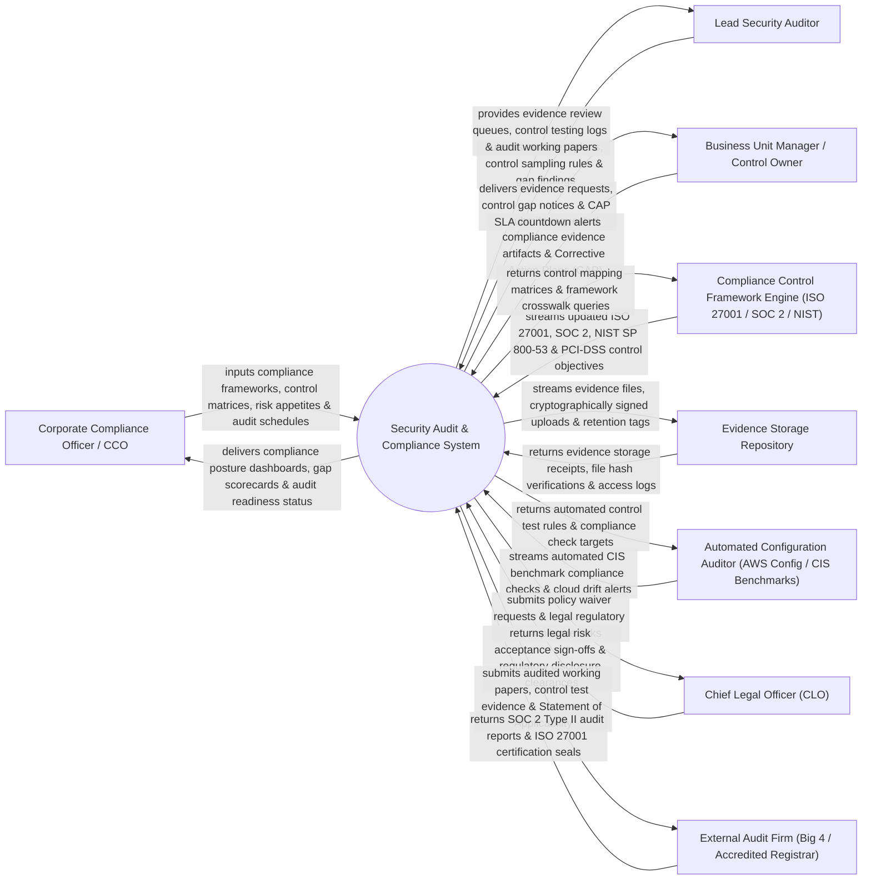

# Context Diagram — Security Audit & Compliance System

## Mermaid Code

## Actor & Interaction Table | Bảng Actor & Tương tác

| # | Actor | Actor Type | Data Sent TO System | Data Received FROM System | Notes |
|---|-------|------------|---------------------|---------------------------|-------|
| 1 | Corporate Compliance Officer / CCO | Primary | Compliance frameworks, control matrices, risk appetites, audit schedules. | Compliance posture dashboards, gap scorecards, audit readiness status, risk trends. | Executive compliance officer overseeing corporate governance and framework compliance. |
| 2 | Lead Security Auditor | Primary | Audit test plans, control sampling rules, gap findings, working paper notes. | Evidence review queues, control testing logs, audit working papers, gap alerts. | Internal auditor evaluating control effectiveness and conducting compliance audits. |
| 3 | Business Unit Manager / Control Owner | Primary | Requested compliance evidence artifacts, Corrective Action Plans (CAP), justification notes. | Evidence requests, control gap notices, CAP SLA countdown alerts, task reminders. | Department manager responsible for maintaining operational controls and submitting proof. |
| 4 | Compliance Control Framework Engine | Supporting | ISO 27001, SOC 2 Type II, NIST 800-53, PCI-DSS, HIPAA control objective standards. | Control mapping matrices, framework crosswalk queries, control mapping receipts. | External framework database providing standardized security control definitions. |
| 5 | Evidence Storage Repository | Supporting | Evidence storage receipts, file hash verifications, access logs, retention tags. | Evidence files, cryptographically signed uploads, audit retention tags. | Encrypted cloud vault storing audit evidence files and working papers. |
| 6 | Automated Configuration Auditor | Supporting | Automated CIS benchmark compliance checks, cloud drift alerts, OS hardening results. | Automated control test rules, compliance check targets, schedule triggers. | Automated audit tool (AWS Config, CIS Cat, Prisma) auditing infrastructure settings. |
| 7 | Chief Legal Officer (CLO) | Supporting | Legal risk acceptance sign-offs, regulatory disclosure clearances, policy waiver approvals. | Policy waiver requests, legal regulatory compliance risks, audit gap summaries. | Executive legal counsel approving policy waivers and regulatory audit disclosures. |
| 8 | External Audit Firm | Supporting / Regulatory | SOC 2 Type II audit reports, ISO 27001 certification seals, external audit opinion letters. | Audited working papers, control test evidence, Statement of Applicability (SoA). | Third-party CPA or ISO registrar performing official certification audits. |

## System Boundary Description | Mô tả Phạm vi Hệ thống

The **Security Audit & Compliance System** is an enterprise multi-framework control mapping (ISO 27001, SOC 2, NIST, PCI-DSS), evidence collection, automated configuration auditing, gap remediation, and audit attestation platform.

**Inside System Scope:**
- Cross-mapping security controls across multiple compliance frameworks (ISO 27001, SOC 2, NIST 800-53, HIPAA, PCI-DSS).
- Automated evidence collection workflows with cryptographic SHA-256 file hashing and retention tagging.
- Continuous automated configuration auditing against CIS benchmarks and AWS/Azure security baselines.
- Control gap identification and Corrective Action Plan (CAP) SLA remediation tracking.
- ISO 27001 Statement of Applicability (SoA) generation and SOC 2 Type II working paper packaging.

**Outside System Scope:**
- Direct software coding of application fixes (handled by Software Engineering).
- Direct physical building fire extinguisher maintenance (handled by Facilities Engineering).
- General financial accounting ledger auditing (handled by Financial Audit Systems).
