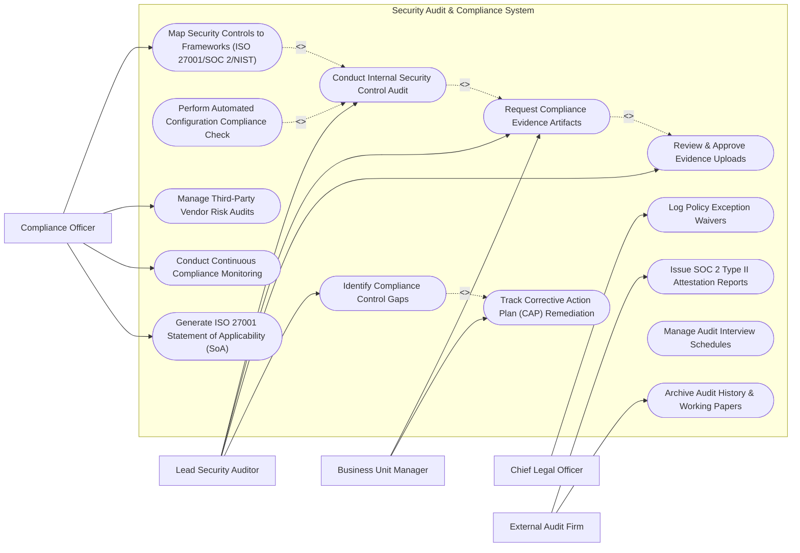

# Use Case Diagram — Security Audit & Compliance System

## Mermaid Code

## Actor Table | Bảng Actor

| # | Actor | Actor Type | Role Description | Related Use Cases |
|---|-------|------------|------------------|-------------------|
| 1 | Compliance Officer | Primary | Maps controls across frameworks (ISO 27001, SOC 2, NIST), manages vendor risk, and generates SoAs. | UC01, UC08, UC10, UC13 |
| 2 | Lead Security Auditor | Primary | Conducts control testing, issues evidence requests, reviews uploaded artifacts, and logs control gaps. | UC02, UC03, UC04, UC05 |
| 3 | Business Unit Manager | Primary | Control owner submitting requested compliance evidence artifacts and executing Corrective Action Plans (CAP). | UC03, UC06 |
| 4 | Chief Legal Officer | Secondary | Reviews and approves policy exception waivers and regulatory compliance risk disclosures. | UC11 |
| 5 | External Audit Firm | Supporting / Regulatory | CPA or ISO registrar reviewing working papers and issuing SOC 2 Type II reports or ISO certifications. | UC09, UC14 |

## Use Case Table | Bảng Use Case

| # | UC ID | Use Case Name | Primary Actor | Secondary Actor | Description | Priority |
|---|-------|---------------|---------------|-----------------|-------------|----------|
| 1 | UC01 | Map Security Controls to Frameworks (ISO 27001/SOC 2/NIST) | Compliance Officer | Auditor | Cross-maps internal security controls across multiple standards to eliminate duplicate evidence testing. | High |
| 2 | UC02 | Conduct Internal Security Control Audit | Auditor | Compliance Officer | Executes control testing procedures, evaluates sample sizes, and verifies operating effectiveness. | High |
| 3 | UC03 | Request Compliance Evidence Artifacts | Auditor | Manager | Issues automated evidence requests with deadlines (e.g., "Provide Q3 Access Review Logs") to control owners. | High |
| 4 | UC04 | Review & Approve Evidence Uploads | Auditor | Manager | Inspects uploaded evidence files, checks SHA-256 hashes, and approves or rejects proof quality. | High |
| 5 | UC05 | Identify Compliance Control Gaps | Auditor | Compliance Officer | Documents control deficiencies, missing evidence, or design flaws, rating gap severity (Critical to Low). | High |
| 6 | UC06 | Track Corrective Action Plan (CAP) Remediation | Manager | Auditor | Assigns remediation tasks, tracks fix SLA timers, and verifies gap resolution prior to external audits. | High |
| 7 | UC07 | Perform Automated Configuration Compliance Check | Auditor | None | Executes automated CIS benchmark and cloud configuration checks (AWS Config) to audit technical controls continuously. | High |
| 8 | UC08 | Manage Third-Party Vendor Risk Audits | Compliance Officer | Auditor | Audits vendor SOC 2 reports, sends SIG questionnaires, and evaluates supply chain security risk. | Medium |
| 9 | UC09 | Issue SOC 2 Type II Attestation Reports | External Firm | CCO | Packages audited working papers and issues official SOC 2 Type II compliance attestation reports. | High |
| 10 | UC10 | Conduct Continuous Compliance Monitoring | Compliance Officer | Auditor | Monitors real-time compliance posture dashboards and alerts on control drift or missing evidence. | Medium |
| 11 | UC11 | Log Policy Exception Waivers | CLO | Compliance Officer | Evaluates and logs temporary business policy exceptions approved by executive legal counsel. | Medium |
| 12 | UC12 | Manage Audit Interview Schedules | Auditor | Manager | Coordinates interview timetables between external auditors and internal control owners. | Low |
| 13 | UC13 | Generate ISO 27001 Statement of Applicability (SoA) | Compliance Officer | Auditor | Generates official ISO 27001 Annex A Statement of Applicability detailing included/excluded controls. | High |
| 14 | UC14 | Archive Audit History & Working Papers | External Firm | Compliance Officer | Permanently locks and archives audit working papers, evidence files, and sign-offs for legal retention. | Low |

## Use Case Specification | Đặc tả Use Case

---

### UC01 — Map Security Controls to Frameworks (ISO 27001/SOC 2/NIST)

| Field | Detail |
|-------|--------|
| **UC ID** | UC01 |
| **Use Case Name** | Map Security Controls to Frameworks |
| **Actor(s)** | Primary: Compliance Officer   Secondary: Lead Security Auditor |
| **Description** | Cross-maps internal security control policies to multiple regulatory standards (ISO 27001, SOC 2, NIST 800-53, PCI-DSS) to enable "test once, comply with many". |
| **Precondition** | 1. Internal security controls are cataloged in Master Control Library.   2. Standard framework control matrices are loaded. |
| **Main Flow** | 1. Compliance Officer opens "Control Mapping & Crosswalk" module.   2. Officer selects internal control `CTRL-AC-01: Multi-Factor Authentication Enforced`.   3. System displays multi-framework crosswalk recommendations.   4. Officer maps `CTRL-AC-01` to:     a. ISO 27001:2022 -> `A.8.5 Secure Authentication`.     b. SOC 2 Type II -> `CC6.1 Logical Access Controls`.     c. NIST SP 800-53 -> `IA-2 Identification and Authentication`.     d. PCI-DSS v4.0 -> `Requirement 8.3 Multi-Factor Authentication`.   5. System saves mapping matrix.   6. System confirms that uploading a single MFA evidence artifact satisfies all 4 compliance standards simultaneously. |
| **Alternative Flow** | **AF1** — Automated Framework Crosswalk: System automatically suggests mappings based on Unified Compliance Framework (UCF) taxonomy. |
| **Exception Flow** | **EX1** — Unmapped Framework Control: System flags framework controls lacking assigned internal controls as "UNMAPPED CONTROL GAP". |
| **Postcondition** | Internal control is cross-mapped across target compliance frameworks. |
| **Business Rule** | **BR1**: Multi-framework mapping shall allow a single evidence artifact to satisfy all cross-mapped compliance requirements. |

---

### UC02 — Conduct Internal Security Control Audit

| Field | Detail |
|-------|--------|
| **UC ID** | UC02 |
| **Use Case Name** | Conduct Internal Security Control Audit |
| **Actor(s)** | Primary: Lead Security Auditor   Secondary: Compliance Officer |
| **Description** | Executes internal audit testing procedures, selects control sample populations, tests operating effectiveness, and documents audit working papers. |
| **Precondition** | 1. Audit Engagement (e.g., "2026 Annual ISO 27001 Internal Audit") is created.   2. Control test plans are assigned to Auditor. |
| **Main Flow** | 1. Auditor opens assigned audit engagement and selects target control `CTRL-AC-01`.   2. System displays Control Test Plan (Test Objective, Population, Sample Size Rule, Testing Procedure).   3. Auditor selects sampling methodology (e.g., "Random Sample of 25 New Hires in Q2").   4. Auditor inspects submitted evidence files (MFA activation logs) for each sampled user.   5. Auditor documents test results: "25 of 25 sampled users had MFA active prior to account provisioning".   6. Auditor inputs test conclusion: "OPERATING EFFECTIVELY" and attaches working paper notes.   7. System updates control audit status to "TESTING PASSED". |
| **Alternative Flow** | **AF1** — Automated Sample Testing: System automatically queries IAM database, pulls random 25 sample user logs, and validates MFA status without manual labor. |
| **Exception Flow** | **EX1** — Control Test Failure: Auditor finds 5 of 25 users lacked MFA. Auditor marks control "OPERATING INEFFECTIVE" and triggers UC05 Identify Compliance Control Gaps. |
| **Postcondition** | Control testing procedure is completed, documented in working papers, and scored. |
| **Business Rule** | **BR1**: Sample sizes for control testing must comply with AICPA SOC audit sampling standards. |

---

### UC03 — Request Compliance Evidence Artifacts

| Field | Detail |
|-------|--------|
| **UC ID** | UC03 |
| **Use Case Name** | Request Compliance Evidence Artifacts |
| **Actor(s)** | Primary: Lead Security Auditor   Secondary: Business Unit Manager |
| **Description** | Issues automated, tracked evidence requests to control owners, specifying required proof descriptions, date ranges, and submission deadlines. |
| **Precondition** | 1. Audit engagement is active.   2. Control owners are assigned in CMDB. |
| **Main Flow** | 1. Auditor selects controls requiring evidence submission for the audit period.   2. Auditor selects "Generate Evidence Request Package".   3. System retrieves control owner mapping (e.g., `CTRL-OPS-03: Firewall Review` -> Assigned to `Network Manager`).   4. System sends automated Evidence Request Email & Task to Manager with detailed instructions: "Upload Q2 Firewall Rule Review Minutes by July 15".   5. Manager clicks task link, accesses Evidence Upload Portal, and attaches requested PDF files.   6. System computes SHA-256 hash of uploaded file, applies audit timestamp, and notifies Auditor.   7. System updates request status to "EVIDENCE SUBMITTED - PENDING REVIEW". |
| **Alternative Flow** | **AF1** — Recurring Evidence Request: System automatically issues quarterly evidence requests on the 1st of every quarter without auditor intervention. |
| **Exception Flow** | **EX1** — Overdue Evidence Reminder: System sends automated daily escalation reminders to Manager and Director if deadline passes without upload. |
| **Postcondition** | Evidence request is issued, uploaded by control owner, and queued for auditor review. |
| **Business Rule** | **BR1**: All uploaded evidence artifacts must be cryptographically hashed (SHA-256) to ensure legal immutability. |

---

### UC05 — Identify Compliance Control Gaps

| Field | Detail |
|-------|--------|
| **UC ID** | UC05 |
| **Use Case Name** | Identify Compliance Control Gaps |
| **Actor(s)** | Primary: Lead Security Auditor   Secondary: Compliance Officer |
| **Description** | Documents control deficiencies, missing evidence, or design flaws, rating gap severity (Critical to Low) and defining gap descriptions. |
| **Precondition** | 1. Control testing or evidence review reveals a control failure or missing proof. |
| **Main Flow** | 1. Auditor inspects failed control test `CTRL-OPS-03`.   2. Auditor selects "Log Compliance Control Gap".   3. System prompts for gap details (Gap Title, Deficiency Type [Design Gap / Operating Deficiency / Missing Evidence], Severity Rating).   4. Auditor inputs description: "Quarterly Firewall Rule Review was not conducted in Q2 due to team transition".   5. Auditor rates Gap Severity: **HIGH** (Violates ISO 27001 A.8.20 and SOC 2 CC6.6).   6. System generates Control Deficiency Finding (e.g., `GAP-2026-0824`).   7. System notifies Compliance Officer and control owner, prompting for UC06 Track Corrective Action Plan (CAP). |
| **Alternative Flow** | **AF1** — Compensating Control Mitigation: Compliance Officer demonstrates an existing compensating control mitigates the gap, reducing severity to LOW. |
| **Exception Flow** | **EX1** — Critical Gap Escalation: If gap is rated CRITICAL (e.g., Unencrypted Customer Database), system sends instant escalation alert to CCO and CISO. |
| **Postcondition** | Compliance gap is documented, rated, and queued for Corrective Action Plan (CAP) assignment. |
| **Business Rule** | **BR1**: All identified control gaps must be mapped to affected compliance frameworks to assess audit certification risk. |

---

### UC06 — Track Corrective Action Plan (CAP) Remediation

| Field | Detail |
|-------|--------|
| **UC ID** | UC06 |
| **Use Case Name** | Track Corrective Action Plan (CAP) Remediation |
| **Actor(s)** | Primary: Business Unit Manager   Secondary: Lead Security Auditor |
| **Description** | Assigns remediation tasks, tracks fix SLA timers, and verifies gap resolution prior to final external audit sign-off. |
| **Precondition** | 1. Compliance control gap (`GAP-2026-0824`) is logged. |
| **Main Flow** | 1. Business Unit Manager receives notification of logged control gap.   2. Manager opens "Corrective Action Plan (CAP) Workspace".   3. Manager inputs proposed remediation action: "Implement automated script to execute and log firewall rule reviews quarterly".   4. Manager sets target remediation completion date (e.g., 30-day SLA deadline).   5. Auditor reviews proposed CAP and clicks "Approve Remediation Plan".   6. Manager completes remediation actions, uploads new evidence proof, and clicks "Mark CAP Resolved".   7. Auditor re-tests control, confirms gap is remediated, and updates status to "CLOSED - REMEDIATED". |
| **Alternative Flow** | **AF1** — CAP Extension Request: Manager requests a 14-day SLA extension; auditor evaluates and grants extension with revised deadline. |
| **Exception Flow** | **EX1** — CAP SLA Overdue: System flags overdue CAP task, sends SLA breach alert to CCO, and highlights gap on executive dashboard. |
| **Postcondition** | Control deficiency is remediated, verified by auditor, and closed. |
| **Business Rule** | **BR1**: High-severity control gaps must be remediated under a mandatory 30-day CAP SLA deadline. |
