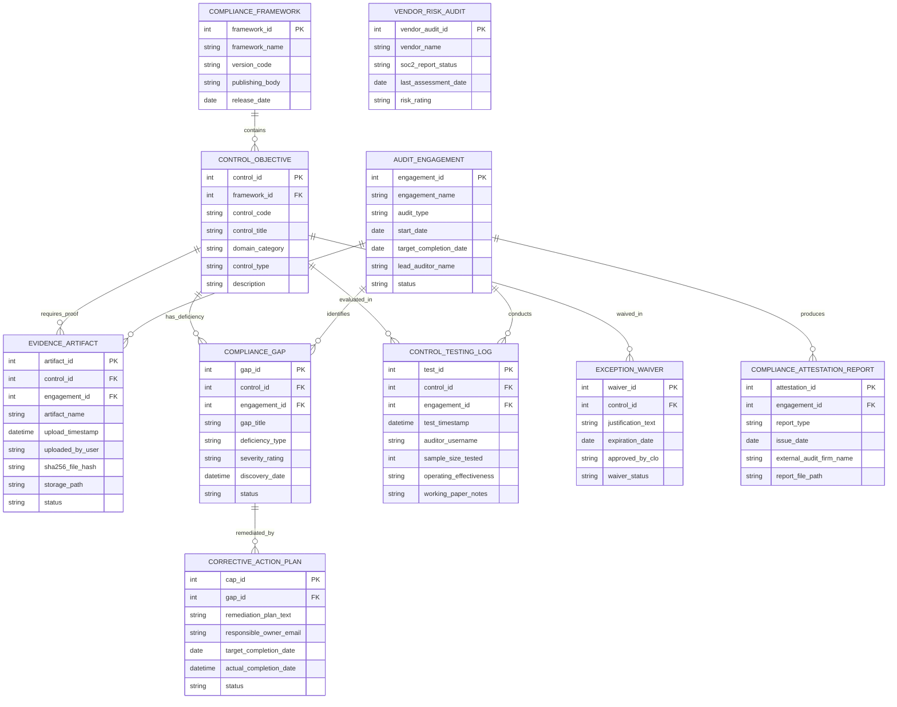

# Conceptual ERD — Security Audit & Compliance System

## Mermaid Code

## Entity Description Table | Bảng mô tả Entity

| # | Entity Name | Vietnamese Name | Description | Key Attributes | Main Relationships |
|---|-------------|-----------------|-------------|----------------|-------------------|
| 1 | COMPLIANCE_FRAMEWORK | Khung Chuẩn Tuân thủ | Master framework repository storing regulatory standards (ISO 27001, SOC 2, NIST SP 800-53, PCI-DSS). | framework_id, framework_name, version_code, publishing_body | Contains CONTROL_OBJECTIVE. |
| 2 | CONTROL_OBJECTIVE | Mục tiêu Kiểm soát (Control) | Stores specific security control definitions, domain categories (e.g., Access Control), and control types. | control_id, control_code, control_title, domain_category, control_type | Belongs to COMPLIANCE_FRAMEWORK; requires EVIDENCE_ARTIFACT. |
| 3 | AUDIT_ENGAGEMENT | Đợt Kiểm toán An ninh | Master record for internal or external audit engagements, audit types, lead auditors, and status. | engagement_id, engagement_name, audit_type, start_date, status | Primary entity; collects EVIDENCE_ARTIFACT, identifies COMPLIANCE_GAP. |
| 4 | EVIDENCE_ARTIFACT | Bằng chứng Tuân thủ (Artifact) | Stores evidence files, upload timestamps, cardholder submitter names, SHA-256 file hashes, and review status. | artifact_id, artifact_name, upload_timestamp, sha256_file_hash, status | Required by CONTROL_OBJECTIVE; collected in AUDIT_ENGAGEMENT. |
| 5 | COMPLIANCE_GAP | Khuyết điểm / Lỗ hổng Tuân thủ | Documents identified control deficiencies, missing evidence gaps, deficiency types, and severity ratings. | gap_id, gap_title, deficiency_type, severity_rating, status | Belongs to CONTROL_OBJECTIVE and AUDIT_ENGAGEMENT; remediated by CORRECTIVE_ACTION_PLAN. |
| 6 | CORRECTIVE_ACTION_PLAN | Kế hoạch Khắc phục (CAP) | Tracks remediation action plans, assigned control owners, target completion dates, and CAP status. | cap_id, remediation_plan_text, responsible_owner_email, target_completion_date, status | Remediates COMPLIANCE_GAP. |
| 7 | CONTROL_TESTING_LOG | Nhật ký Thử nghiệm Kiểm soát | Archives auditor control test executions, sample sizes tested, operating effectiveness scores, and working paper notes. | test_id, test_timestamp, auditor_username, sample_size_tested, operating_effectiveness | Belongs to CONTROL_OBJECTIVE and AUDIT_ENGAGEMENT. |
| 8 | VENDOR_RISK_AUDIT | Kiểm toán Rủi ro Đối tác | Stores third-party vendor risk assessments, SOC 2 report reviews, SIG questionnaire results, and risk ratings. | vendor_audit_id, vendor_name, soc2_report_status, risk_rating | Independent vendor audit entity. |
| 9 | EXCEPTION_WAIVER | Giấy Miễn trừ Chính sách | Manages legal business policy waivers, technical justifications, expiration dates, and CLO approvals. | waiver_id, justification_text, expiration_date, approved_by_clo, waiver_status | Waives CONTROL_OBJECTIVE. |
| 10 | COMPLIANCE_ATTESTATION_REPORT | Báo cáo Chứng nhận Tuân thủ | Stores final SOC 2 Type II attestation reports, ISO 27001 certification files, and external audit opinion letters. | attestation_id, report_type, issue_date, external_audit_firm_name, report_file_path | Produced by AUDIT_ENGAGEMENT. |

## Relationship Description | Mô tả Quan hệ

| # | From Entity | Cardinality | To Entity | Relationship Label | Business Explanation |
|---|-------------|-------------|-----------|-------------------|----------------------|
| 1 | COMPLIANCE_FRAMEWORK | one-to-many | CONTROL_OBJECTIVE | contains | A compliance framework contains multiple security control objectives. |
| 2 | CONTROL_OBJECTIVE | one-to-many | EVIDENCE_ARTIFACT | requires_proof | A control objective requires evidence artifacts to prove compliance. |
| 3 | AUDIT_ENGAGEMENT | one-to-many | EVIDENCE_ARTIFACT | collects | An audit engagement collects evidence artifacts from control owners. |
| 4 | CONTROL_OBJECTIVE | one-to-many | CONTROL_TESTING_LOG | evaluated_in | A control objective is evaluated in auditor control testing logs. |
| 5 | AUDIT_ENGAGEMENT | one-to-many | CONTROL_TESTING_LOG | conducts | An audit engagement conducts control testing procedures. |
| 6 | CONTROL_OBJECTIVE | one-to-many | COMPLIANCE_GAP | has_deficiency | A control objective may have identified compliance gaps or deficiencies. |
| 7 | AUDIT_ENGAGEMENT | one-to-many | COMPLIANCE_GAP | identifies | An audit engagement identifies compliance gaps. |
| 8 | COMPLIANCE_GAP | one-to-one | CORRECTIVE_ACTION_PLAN | remediated_by | A compliance gap is remediated by a Corrective Action Plan (CAP). |
| 9 | AUDIT_ENGAGEMENT | one-to-many | COMPLIANCE_ATTESTATION_REPORT | produces | An audit engagement produces final compliance attestation reports. |
