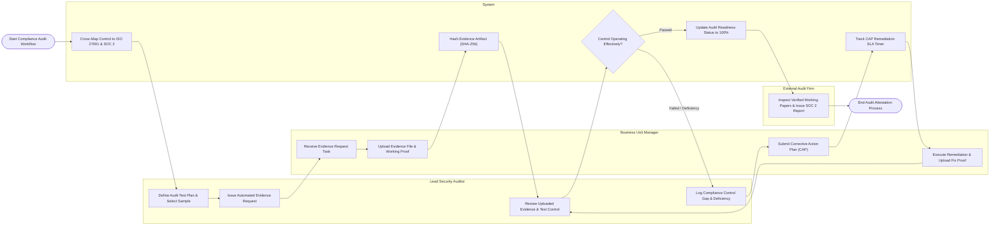

# Swimlane Diagram — Security Audit & Compliance System

## Mermaid Code

## Flow Description | Mô tả luồng

| Lane | Actor | Role in Flow |
|------|-------|-------------|
| 1 | Lead Security Auditor | Defines control test plans, issues evidence requests, reviews uploaded proof, tests control effectiveness, and logs compliance gaps. |
| 2 | System | Cross-maps internal controls to ISO 27001/SOC 2, computes SHA-256 evidence hashes, tracks CAP SLA timers, and compiles audit working papers. |
| 3 | Business Unit Manager | Receives evidence requests, uploads required proof files, submits Corrective Action Plans (CAP) for deficiencies, and executes fixes. |
| 4 | External Audit Firm | Reviews verified working papers, inspects control testing logs, and issues official SOC 2 Type II attestation reports. |
