# Action Tree — Security Audit & Compliance System

## Mermaid Code

```mermaid
graph TD
    Root["Security Audit & Compliance System"]

    Root --> M1["Framework & Control Mapping"]
    Root --> M2["Audit Engagement Management"]
    Root --> M3["Evidence Collection & Review"]
    Root --> M4["Gap & Remediation Tracking"]
    Root --> M5["Reporting & Attestation"]

    M1 --> A1["Cross-Map ISO 27001 & SOC 2 Controls"]
    M1 --> A2["Import NIST SP 800-53 Catalog"]
    M1 --> A3["Generate Statement of Applicability (SoA)"]
    M1 --> A4["Manage Policy Exception Waivers"]

    M2 --> B1["Create Internal Audit Engagement"]
    M2 --> B2["Define Sample Population Rules"]
    M2 --> B3["Log Control Test Working Papers"]
    M2 --> B4["Audit Third-Party Vendor Risk"]

    M3 --> C1["Issue Automated Evidence Requests"]
    M3 --> C2["Compute SHA-256 File Hash Signature"]
    M3 --> C3["Review & Approve Artifact Quality"]
    M3 --> C4["Schedule Recurring Evidence Tasks"]

    M4 --> D1["Log Compliance Control Deficiency"]
    M4 --> D2["Assign Corrective Action Plan (CAP)"]
    M4 --> D3["Track 30-Day CAP Remediation SLA"]
    M4 --> D4["Re-Test Resolved Control Gaps"]

    M5 --> E1["Monitor Continuous Control Drift"]
    M5 --> E2["Execute Automated CIS Benchmark Checks"]
    M5 --> E3["Package SOC 2 Type II Audit Package"]
    M5 --> E4["Export Executive Compliance Scorecard"]
```

## Module Description | Mô tả Module

| # | Module | Description | Actions |
|---|--------|-------------|---------|
| 1 | Framework & Control Mapping | Cross-mapping internal security controls to ISO 27001, SOC 2, and NIST, generating SoAs, and managing policy waivers. | Cross-Map ISO 27001 & SOC 2 Controls, Import NIST SP 800-53 Catalog, Generate Statement of Applicability (SoA), Manage Policy Exception Waivers |
| 2 | Audit Engagement Management | Internal audit engagement creation, AICPA sample size testing, control working paper logs, and vendor risk auditing. | Create Internal Audit Engagement, Define Sample Population Rules, Log Control Test Working Papers, Audit Third-Party Vendor Risk |
| 3 | Evidence Collection & Review | Automated evidence request dispatches, SHA-256 evidence hashing, artifact quality reviews, and recurring evidence scheduling. | Issue Automated Evidence Requests, Compute SHA-256 File Hash Signature, Review & Approve Artifact Quality, Schedule Recurring Evidence Tasks |
| 4 | Gap & Remediation Tracking | Control deficiency logging, Corrective Action Plan (CAP) assignments, 30-day SLA tracking, and re-testing verification. | Log Compliance Control Deficiency, Assign Corrective Action Plan (CAP), Track 30-Day CAP Remediation SLA, Re-Test Resolved Control Gaps |
| 5 | Reporting & Attestation | Continuous automated CIS benchmark checking, SOC 2 Type II working paper packaging, and executive compliance scorecards. | Monitor Continuous Control Drift, Execute Automated CIS Benchmark Checks, Package SOC 2 Type II Audit Package, Export Executive Compliance Scorecard |
