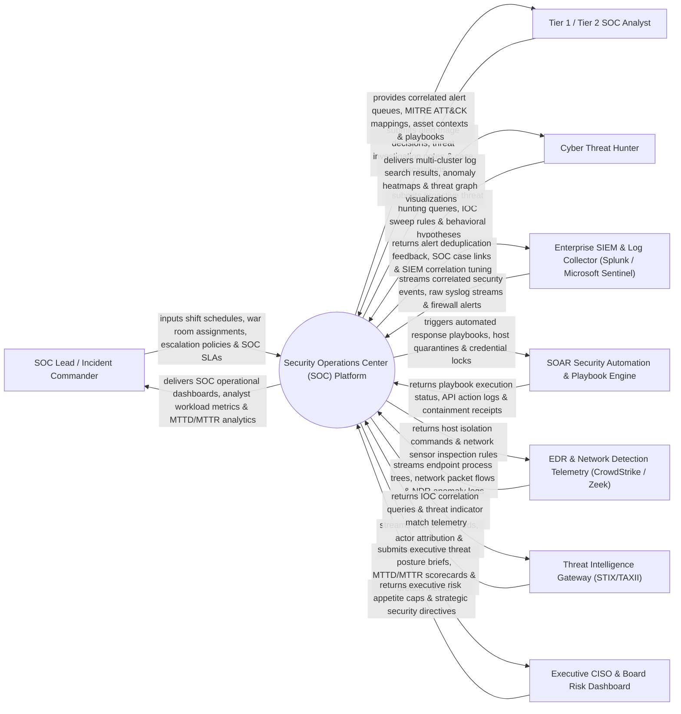

# Context Diagram — Security Operations Center (SOC) Platform

## Mermaid Code

## Actor & Interaction Table | Bảng Actor & Tương tác

| # | Actor | Actor Type | Data Sent TO System | Data Received FROM System | Notes |
|---|-------|------------|---------------------|---------------------------|-------|
| 1 | SOC Lead / Incident Commander | Primary | Shift schedules, war room assignments, escalation policies, SOC SLAs. | SOC operational dashboards, analyst workload metrics, MTTD/MTTR analytics. | SOC manager overseeing 24/7 security monitoring operations and shift management. |
| 2 | Tier 1 / Tier 2 SOC Analyst | Primary | Alert triage decisions, threat investigation notes, case escalations, containment triggers. | Correlated alert queues, MITRE ATT&CK mappings, asset contexts, playbooks. | Front-line SOC analysts investigating security alerts and triaging threats. |
| 3 | Cyber Threat Hunter | Primary | Proactive threat hunting queries, IOC sweep rules, behavioral hypotheses. | Multi-cluster log search results, anomaly heatmaps, threat graph visualizations. | Senior specialist proactively hunting undetected adversary TTPs across log data. |
| 4 | Enterprise SIEM & Log Collector | Supporting | Correlated security events, raw syslog streams, firewall alerts, cloud audit logs. | Alert deduplication feedback, SOC case links, SIEM correlation rule tuning. | SIEM platform (Splunk, Sentinel, Elastic) aggregating raw security logs. |
| 5 | SOAR Security Automation Engine | Supporting | Playbook execution status, API action logs, containment receipts. | Automated response playbooks, host quarantines, credential locks, IP blocks. | SOAR engine orchestrating multi-system security response actions. |
| 6 | EDR & Network Detection Telemetry | Supporting | Endpoint process trees, network packet flows, NDR anomaly logs, DNS queries. | Host isolation commands, network sensor inspection rules, process kill signals. | Endpoint (CrowdStrike) and Network Detection (Zeek/Suricata) telemetry feeds. |
| 7 | Threat Intelligence Gateway | Supporting | IOC threat feeds, actor attribution details, vulnerability severity scores. | IOC correlation queries, threat indicator match telemetry, enrichment requests. | External Threat Intel Platform (TIP) providing threat context. |
| 8 | Executive CISO & Board Risk Dashboard | Supporting / Regulatory | Executive risk appetite caps, strategic security directives, compliance mandates. | Executive threat posture briefs, MTTD/MTTR scorecards, breach impact metrics. | CISO and Board Audit Committee receiving high-level SOC efficiency reports. |

## System Boundary Description | Mô tả Phạm vi Hệ thống

The **Security Operations Center (SOC) Platform** is an enterprise 24/7 security monitoring, alert correlation, MITRE ATT&CK threat mapping, SOAR playbook orchestration, analyst workload management, and SOC operational performance platform.

**Inside System Scope:**
- Centralized SOC alert queue consolidation and deduplication across SIEM, EDR, NDR, and Cloud logs.
- Automated mapping of incoming threat alerts to the MITRE ATT&CK framework matrix.
- Orchestration of SOAR playbooks (host quarantine, active directory lockout, IP block, email purge).
- Real-time Mean Time to Detect (MTTD) and Mean Time to Respond (MTTR) analytics calculation.
- SOC war room collaboration channels, shift handover logs, and analyst workload distribution.

**Outside System Scope:**
- Direct physical guard dispatch for building break-ins (handled by Alarm & Alert Management System).
- Direct hosting of physical SIEM cloud servers (handled by Cloud Infrastructure Provider).
- Direct software coding of core operating system kernels (handled by Operating System Vendors).
