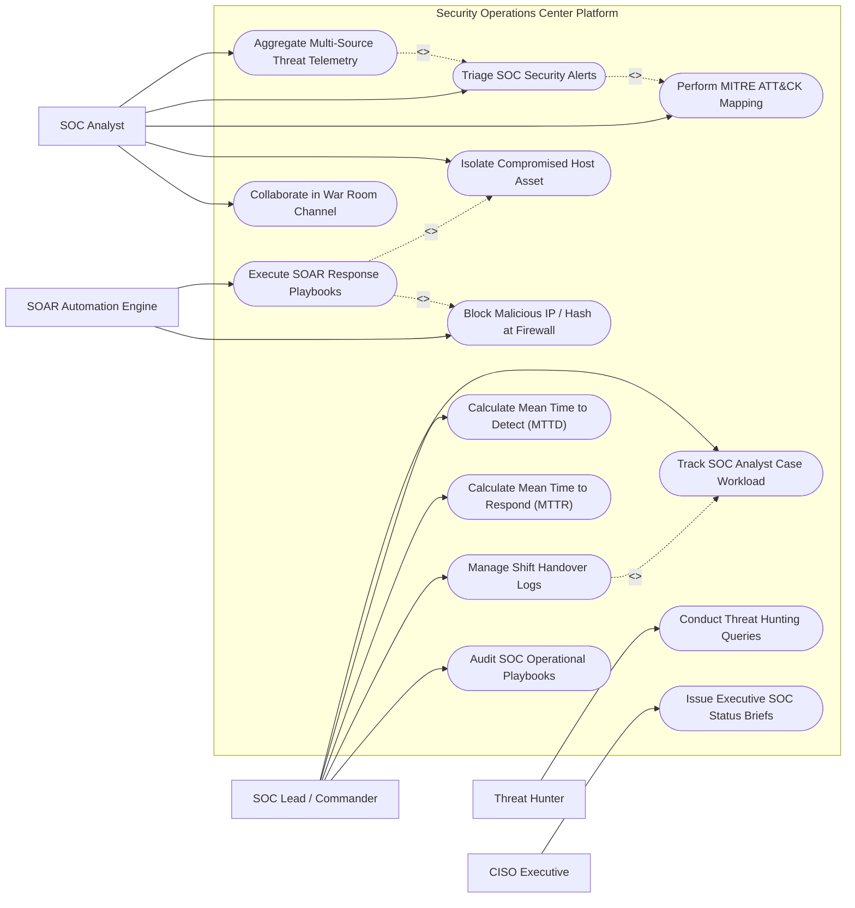

# Use Case Diagram — Security Operations Center (SOC) Platform

## Mermaid Code

## Actor Table | Bảng Actor

| # | Actor | Actor Type | Role Description | Related Use Cases |
|---|-------|------------|------------------|-------------------|
| 1 | SOC Analyst | Primary | Ingests threat telemetry, triages SOC alerts, conducts MITRE ATT&CK mapping, isolates hosts, and collaborates in war rooms. | UC01, UC02, UC04, UC07, UC11 |
| 2 | Threat Hunter | Primary | Executes proactive threat hunting queries across multi-cluster log data to uncover undetected threats. | UC05 |
| 3 | SOC Lead / Commander | Primary | Manages shift handovers, tracks analyst workload metrics, measures MTTD/MTTR KPIs, and audits playbooks. | UC06, UC09, UC10, UC12, UC14 |
| 4 | CISO Executive | Secondary | Reviews executive SOC threat posture briefs, operational scorecards, and high-level breach metrics. | UC13 |
| 5 | SOAR Automation Engine | Supporting / System | Executes automated security response playbooks, host quarantines, and firewall IP blocks. | UC03, UC08 |

## Use Case Table | Bảng Use Case

| # | UC ID | Use Case Name | Primary Actor | Secondary Actor | Description | Priority |
|---|-------|---------------|---------------|-----------------|-------------|----------|
| 1 | UC01 | Aggregate Multi-Source Threat Telemetry | SOC Analyst | SIEM System | Consolidates, normalizes, and deduplicates security logs from SIEM, EDR, NDR, and Cloud sources. | High |
| 2 | UC02 | Triage SOC Security Alerts | SOC Analyst | None | Prioritizes security alert queue, assigns severity tags, and determines true positive vs false positive alerts. | High |
| 3 | UC03 | Execute SOAR Response Playbooks | SOAR Engine | SOC Analyst | Triggers automated response playbooks to quarantine infected endpoints, lock accounts, and block malicious IPs. | High |
| 4 | UC04 | Perform MITRE ATT&CK Mapping | SOC Analyst | None | Automatically maps incoming threat alerts to MITRE ATT&CK tactics, techniques, and sub-techniques. | High |
| 5 | UC05 | Conduct Threat Hunting Queries | Threat Hunter | None | Runs hypothesis-driven IoC and behavioral search queries across petabyte-scale historical log archives. | High |
| 6 | UC06 | Track SOC Analyst Case Workload | SOC Lead | SOC Analyst | Monitors active case tickets per analyst, tracks response SLAs, and balances shift workload distribution. | Medium |
| 7 | UC07 | Isolate Compromised Host Asset | SOC Analyst | EDR System | Issues host isolation command via EDR API to contain lateral movement of malware. | High |
| 8 | UC08 | Block Malicious IP / Hash at Firewall | SOAR Engine | Firewall | Pushes verified malicious C2 IP addresses and file hashes to firewall and gateway block lists. | High |
| 9 | UC09 | Calculate Mean Time to Detect (MTTD) | SOC Lead | None | Measures average time elapsed from initial adversary intrusion to first SOC alert detection. | High |
| 10 | UC10 | Calculate Mean Time to Respond (MTTR) | SOC Lead | None | Measures average time elapsed from alert triage to complete threat containment and eradication. | High |
| 11 | UC11 | Collaborate in War Room Channel | SOC Analyst | SOC Lead | Provides secure real-time chat, file sharing, and live incident timeline updates for response teams. | Medium |
| 12 | UC12 | Manage Shift Handover Logs | SOC Lead | SOC Analyst | Compiles structured 24/7 shift handover notes, open active cases, and pending tasks for incoming shift teams. | Medium |
| 13 | UC13 | Issue Executive SOC Status Briefs | CISO Executive | SOC Lead | Generates executive threat dashboards, SOC efficiency scorecards, and board-level risk reports. | Medium |
| 14 | UC14 | Audit SOC Operational Playbooks | SOC Lead | None | Reviews playbook execution success rates, API failure logs, and updates response rules. | Low |

## Use Case Specification | Đặc tả Use Case

---

### UC01 — Aggregate Multi-Source Threat Telemetry

| Field | Detail |
|-------|--------|
| **UC ID** | UC01 |
| **Use Case Name** | Aggregate Multi-Source Threat Telemetry |
| **Actor(s)** | Primary: SOC Analyst   Secondary: SIEM System |
| **Description** | Consolidates, normalizes into Open Cybersecurity Schema Framework (OCSF), and deduplicates security logs from SIEM, EDR, NDR, and Cloud platforms. |
| **Precondition** | 1. Log collectors (Splunk, EDR, CloudTrail, Palo Alto) are streaming events to SOC Platform API. |
| **Main Flow** | 1. System ingests raw log stream (100,000 events/sec) from enterprise SIEM and EDR connectors.   2. Normalization engine maps vendor-specific log fields into standardized OCSF schema (Source IP, User, Event Action, Hash).   3. Deduplication engine groups identical alerts occurring within a 5-minute window into a single Master SOC Alert.   4. System enriches alert with CMDB asset context (Asset Owner, Business Criticality, Server Location).   5. System places normalized Master Alert into SOC Analyst Triage Queue.   6. System updates real-time ingest volume metrics dashboard. |
| **Alternative Flow** | **AF1** — Cloud Audit Log Stream: Ingests AWS CloudTrail / Azure Activity logs, normalizing cloud API call events into OCSF format. |
| **Exception Flow** | **EX1** — Schema Mapping Error: System routes unparsed custom vendor logs to "Unmapped Log Queue" and alerts SOC Engineer. |
| **Postcondition** | Normalized, enriched, and deduplicated threat telemetry is queued for analyst triage. |
| **Business Rule** | **BR1**: Multi-source log normalization must complete in less than 2 seconds from event ingestion. |

---

### UC02 — Triage SOC Security Alerts

| Field | Detail |
|-------|--------|
| **UC ID** | UC02 |
| **Use Case Name** | Triage SOC Security Alerts |
| **Actor(s)** | Primary: SOC Analyst   Secondary: None |
| **Description** | Evaluates incoming Master SOC Alerts, investigates process trees/packet flows, and classifies alerts into True Positives or False Positives. |
| **Precondition** | 1. Master SOC Alert is queued in Analyst Triage Workspace. |
| **Main Flow** | 1. SOC Analyst opens target alert (e.g., "Powershell Encoded Command Execution").   2. System renders unified investigation view: Process Execution Tree, EDR File Hash, Network Connections, User Account History.   3. Analyst inspects process lineage and observes suspicious parent process `word.exe` launching `powershell.exe -enc`.   4. Analyst queries Threat Intel API and confirms process hash matches known Emotet malware.   5. Analyst classifies alert as "TRUE POSITIVE - MALICIOUS INTRUSION".   6. System elevates alert to Active Incident Case file and prompts for UC03 SOAR Playbook Execution. |
| **Alternative Flow** | **AF1** — Benign False Positive: Analyst inspects process tree, confirms command was executed by IT admin deployment script, and marks alert "FALSE POSITIVE - BENIGN IT SCRIPT". |
| **Exception Flow** | **EX1** — Triage SLA Breach: If High-Severity alert remains untriaged after 10 minutes, system plays audible console alert and auto-reassigns ticket to SOC Lead. |
| **Postcondition** | Security alert is triaged, classified, and escalated to incident case status. |
| **Business Rule** | **BR1**: High-severity alerts must be triaged by an analyst within 15 minutes of queue arrival. |

---

### UC03 — Execute SOAR Response Playbooks

| Field | Detail |
|-------|--------|
| **UC ID** | UC03 |
| **Use Case Name** | Execute SOAR Response Playbooks |
| **Actor(s)** | Primary: SOAR Automation Engine   Secondary: SOC Analyst |
| **Description** | Executes automated multi-step response playbooks across EDR, Active Directory, Firewall, and Email gateways to rapidly contain threats. |
| **Precondition** | 1. Incident case is classified as True Positive malicious threat.   2. Target SOAR playbook (e.g., "Phishing Containment Playbook") is active. |
| **Main Flow** | 1. Analyst clicks "Execute SOAR Playbook" and selects "Phishing & Credential Theft Response".   2. SOAR Engine displays playbook execution graph:     Step 1: Isolate compromised user endpoint via EDR API.     Step 2: Revoke active user Okta/Active Directory sessions & reset password.     Step 3: Purge malicious email from all 5,000 employee Office 365 mailboxes.     Step 4: Block malicious phishing URL on Perimeter Proxy & Firewall.   3. Analyst clicks "Confirm & Run Playbook".   4. SOAR Engine executes API calls in parallel.   5. Engine collects success receipts from each API connector and appends execution logs to incident file.   6. System updates incident status to "CONTAINED". |
| **Alternative Flow** | **AF1** — Automated Auto-Pilot Mode: SOAR Engine executes playbook automatically without analyst confirmation for high-confidence ransomware signatures. |
| **Exception Flow** | **EX1** — API Connector Auth Failure: SOAR Engine detects expired API token for firewall, logs failure step, executes fallback email notification, and alerts admin. |
| **Postcondition** | Automated containment actions are executed across enterprise security platforms. |
| **Business Rule** | **BR1**: SOAR playbook execution across all target security platforms must complete in under 30 seconds. |

---

### UC04 — Perform MITRE ATT&CK Mapping

| Field | Detail |
|-------|--------|
| **UC ID** | UC04 |
| **Use Case Name** | Perform MITRE ATT&CK Mapping |
| **Actor(s)** | Primary: SOC Analyst   Secondary: None |
| **Description** | Automatically maps ingested threat alerts, techniques, and adversary behaviors to the MITRE ATT&CK matrix framework. |
| **Precondition** | 1. Threat alert contains process execution, registry edit, or network connection telemetry. |
| **Main Flow** | 1. System parses alert telemetry (e.g., `lsass.exe` memory dump attempt).   2. System maps event to MITRE ATT&CK Tactic: "Credential Access" (TA0006) and Technique: "OS Credential Dumping: LSASS Memory" (T1003.001).   3. System renders MITRE ATT&CK Heatmap Matrix on incident dashboard, highlighting active technique tiles in red.   4. SOC Analyst inspects the MITRE matrix to identify preceding tactics (Initial Access, Persistence) and anticipated next moves (Lateral Movement T1021).   5. Analyst uses MITRE recommendations to deploy preventative detection rules for anticipated techniques. |
| **Alternative Flow** | **AF1** — Threat Actor Campaign Mapping: System links detected MITRE techniques to known threat actor profiles (e.g., APT29 / Cozy Bear playbook). |
| **Exception Flow** | **EX1** — Unmapped Custom Technique: System flags unmapped behavioral event as "CUSTOM TTP" for manual analyst MITRE tagging. |
| **Postcondition** | Threat alerts are mapped to MITRE ATT&CK matrix and visual attack progression heatmap is rendered. |
| **Business Rule** | **BR1**: 100% of verified malicious incident cases must be mapped to MITRE ATT&CK techniques. |

---

### UC07 — Isolate Compromised Host Asset

| Field | Detail |
|-------|--------|
| **UC ID** | UC07 |
| **Use Case Name** | Isolate Compromised Host Asset |
| **Actor(s)** | Primary: SOC Analyst   Secondary: EDR System |
| **Description** | Triggers an immediate network isolation command via EDR agent API to sever a compromised host's IP connectivity and stop lateral spread. |
| **Precondition** | 1. Target host computer has an active EDR agent installed.   2. SOC Analyst has containment execution authorization. |
| **Main Flow** | 1. Analyst inspects active incident case involving compromised server `HOST-FINANCE-09`.   2. Analyst selects "Isolate Host From Network".   3. System issues HTTPS API POST request to EDR Management Server (CrowdStrike / Defender) specifying target host ID.   4. EDR server commands endpoint agent driver to block all network traffic except EDR cloud control port.   5. Host is network isolated; malware lateral movement and data exfiltration are stopped instantly.   6. EDR server returns "ISOLATION CONFIRMED" receipt.   7. System updates host icon status to "ISOLATED" on SOC dashboard and logs event in timeline. |
| **Alternative Flow** | **AF1** — Un-Isolate Host: Once remediation is complete, analyst selects "Remove Host Isolation", restoring full network access. |
| **Exception Flow** | **EX1** — EDR Isolation Failure: If host fails to isolate, system automatically issues fallback VLAN quarantine command to network switch. |
| **Postcondition** | Compromised host is isolated from enterprise network while preserving security control channel. |
| **Business Rule** | **BR1**: Host isolation execution must complete within 10 seconds of analyst command submission. |
