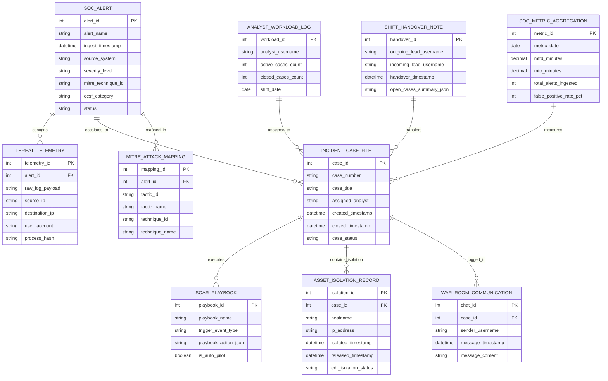

# Conceptual ERD — Security Operations Center (SOC) Platform

## Mermaid Code

## Entity Description Table | Bảng mô tả Entity

| # | Entity Name | Vietnamese Name | Description | Key Attributes | Main Relationships |
|---|-------------|-----------------|-------------|----------------|-------------------|
| 1 | SOC_ALERT | Cảnh báo SOC Tập trung | Master normalized SOC alert table storing ingested alerts, severity ratings, MITRE IDs, and OCSF categories. | alert_id, alert_name, source_system, severity_level, status | Contains THREAT_TELEMETRY; escalates to INCIDENT_CASE_FILE. |
| 2 | THREAT_TELEMETRY | Dữ liệu Giám sát Chi tiết (Telemetry) | Stores raw log payloads, source/dest IPs, user accounts, and process file hashes. | telemetry_id, raw_log_payload, source_ip, process_hash | Belongs to SOC_ALERT. |
| 3 | INCIDENT_CASE_FILE | Hồ sơ Vụ việc SOC | Master incident case record tracking case numbers, assigned analysts, creation/closure timestamps, and status. | case_id, case_number, assigned_analyst, created_timestamp, case_status | Escalated from SOC_ALERT; executes SOAR_PLAYBOOK. |
| 4 | SOAR_PLAYBOOK | Kịch bản Tự động SOAR | Stores pre-configured automated SOAR response playbooks (isolation, account lock, IP block). | playbook_id, playbook_name, trigger_event_type, is_auto_pilot | Executed by INCIDENT_CASE_FILE. |
| 5 | MITRE_ATTACK_MAPPING | Ánh xạ Khung MITRE ATT&CK | Maps security alerts to MITRE ATT&CK Tactics (e.g., Execution) and Technique IDs (e.g., T1059). | mapping_id, tactic_id, technique_id, technique_name | Belongs to SOC_ALERT. |
| 6 | ANALYST_WORKLOAD_LOG | Nhật ký Thao tác & Tải của Analyst | Tracks active case counts per analyst, ticket resolution speed, and shift workload distribution. | workload_id, analyst_username, active_cases_count, shift_date | Assigned to INCIDENT_CASE_FILE. |
| 7 | ASSET_ISOLATION_RECORD | Nhật ký Cách ly Thiết bị (EDR) | Archives endpoint host isolation commands, timestamps, EDR status receipts, and release timestamps. | isolation_id, hostname, isolated_timestamp, edr_isolation_status | Belongs to INCIDENT_CASE_FILE. |
| 8 | WAR_ROOM_COMMUNICATION | Trao đổi Kênh War Room | Stores real-time war room chat messages, analyst notes, file attachments, and incident updates. | chat_id, sender_username, message_timestamp, message_content | Belongs to INCIDENT_CASE_FILE. |
| 9 | SHIFT_HANDOVER_NOTE | Biên bản Bàn giao Ca Trực SOC | Compiles 24/7 shift handover summaries, open active P1/P2 cases, and pending tasks for incoming shift leads. | handover_id, outgoing_lead_username, handover_timestamp, open_cases_summary_json | Transfers INCIDENT_CASE_FILE. |
| 10 | SOC_METRIC_AGGREGATION | Chỉ số Vận hành SOC (MTTD/MTTR) | Aggregates daily SOC performance metrics (Mean Time to Detect, Mean Time to Respond, False Positive %). | metric_id, metric_date, mttd_minutes, mttr_minutes, false_positive_rate_pct | Measures INCIDENT_CASE_FILE performance. |

## Relationship Description | Mô tả Quan hệ

| # | From Entity | Cardinality | To Entity | Relationship Label | Business Explanation |
|---|-------------|-------------|-----------|-------------------|----------------------|
| 1 | SOC_ALERT | one-to-many | THREAT_TELEMETRY | contains | A SOC alert contains multiple raw threat telemetry logs. |
| 2 | SOC_ALERT | one-to-one | INCIDENT_CASE_FILE | escalates_to | A triaged SOC alert escalates to a master incident case file. |
| 3 | SOC_ALERT | one-to-many | MITRE_ATTACK_MAPPING | mapped_in | A SOC alert is mapped to MITRE ATT&CK tactics and techniques. |
| 4 | INCIDENT_CASE_FILE | one-to-many | SOAR_PLAYBOOK | executes | An incident case file executes one or more automated SOAR playbooks. |
| 5 | INCIDENT_CASE_FILE | one-to-many | ASSET_ISOLATION_RECORD | contains_isolation | An incident case file contains host isolation execution records. |
| 6 | INCIDENT_CASE_FILE | one-to-many | WAR_ROOM_COMMUNICATION | logged_in | An incident case file records real-time war room communications. |
| 7 | ANALYST_WORKLOAD_LOG | one-to-many | INCIDENT_CASE_FILE | assigned_to | An analyst workload log tracks assigned incident case files. |
| 8 | SHIFT_HANDOVER_NOTE | many-to-many | INCIDENT_CASE_FILE | transfers | A shift handover note transfers open active incident cases. |
