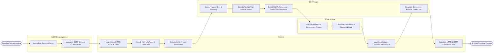

# Swimlane Diagram — Security Operations Center (SOC) Platform

## Mermaid Code

## Flow Description | Mô tả luồng

| Lane | Actor | Role in Flow |
|------|-------|-------------|
| 1 | SIEM & Log Ingestion | Ingests multi-source security events, normalizes log fields into OCSF schema, and deduplicates redundant alerts. |
| 2 | System | Maps threat alerts to MITRE ATT&CK techniques, enriches IoCs with threat intelligence, queues alerts, executes host isolation API calls, and calculates MTTD/MTTR KPIs. |
| 3 | SOC Analyst | Inspects alert process execution trees, classifies threats as true positives, selects automated response playbooks, and documents containment notes. |
| 4 | SOAR Engine | Executes automated multi-platform response actions (host isolation, credential locks, firewall IP blocks) via API connectors. |
