# Action Tree — Security Operations Center (SOC) Platform

## Mermaid Code

```mermaid
graph TD
    Root["Security Operations Center Platform"]

    Root --> M1["Telemetry & Ingestion Engine"]
    Root --> M2["Triage & Alert Management"]
    Root --> M3["SOAR Playbook Automation"]
    Root --> M4["Threat Hunting & MITRE Mapping"]
    Root --> M5["Operations & Metrics Reporting"]

    M1 --> A1["Ingest Multi-Source SIEM Logs"]
    M1 --> A2["Normalize Logs to OCSF Schema"]
    M1 --> A3["Group & Deduplicate 5-Min Alerts"]
    M1 --> A4["Enrich Alert with CMDB Asset Info"]

    M2 --> B1["Inspect Process Execution Lineage"]
    M2 --> B2["Classify True Positive vs False Positive"]
    M2 --> B3["Assign Severity P1-P4 Ticket Tag"]
    M2 --> B4["Open Incident War Room Channel"]

    M3 --> C1["Trigger Automated Host Isolation"]
    M3 --> C2["Revoke Compromised OAuth Tokens"]
    M3 --> C3["Inject Malicious IP Firewall Block"]
    M3 --> C4["Purge Phishing Mail from O365"]

    M4 --> D1["Map Alerts to MITRE ATT&CK Matrix"]
    M4 --> D2["Execute Multi-Cluster Log Sweep"]
    M4 --> D3["Query Malicious Hash Reputation"]
    M4 --> D4["Identify Threat Actor TTP Profiles"]

    M5 --> E1["Calculate Mean Time to Detect (MTTD)"]
    M5 --> E2["Calculate Mean Time to Respond (MTTR)"]
    M5 --> E3["Compile 24/7 Shift Handover Log"]
    M5 --> E4["Generate Executive CISO Scorecard"]
```

## Module Description | Mô tả Module

| # | Module | Description | Actions |
|---|--------|-------------|---------|
| 1 | Telemetry & Ingestion Engine | Multi-source SIEM log ingestion, OCSF schema normalization, 5-minute alert deduplication, and CMDB asset context enrichment. | Ingest Multi-Source SIEM Logs, Normalize Logs to OCSF Schema, Group & Deduplicate 5-Min Alerts, Enrich Alert with CMDB Asset Info |
| 2 | Triage & Alert Management | Process lineage inspection, true/false positive classification, P1-P4 severity assignment, and incident war room channel creation. | Inspect Process Execution Lineage, Classify True Positive vs False Positive, Assign Severity P1-P4 Ticket Tag, Open Incident War Room Channel |
| 3 | SOAR Playbook Automation | Automated host network isolation, OAuth token revocation, firewall IP blocking, and phishing email purging. | Trigger Automated Host Isolation, Revoke Compromised OAuth Tokens, Inject Malicious IP Firewall Block, Purge Phishing Mail from O365 |
| 4 | Threat Hunting & MITRE Mapping | MITRE ATT&CK matrix heatmap mapping, multi-cluster log search queries, threat intelligence IoC lookup, and actor TTP profiling. | Map Alerts to MITRE ATT&CK Matrix, Execute Multi-Cluster Log Sweep, Query Malicious Hash Reputation, Identify Threat Actor TTP Profiles |
| 5 | Operations & Metrics Reporting | Real-time MTTD and MTTR KPI calculations, 24/7 shift handover log management, analyst workload tracking, and CISO scorecards. | Calculate Mean Time to Detect (MTTD), Calculate Mean Time to Respond (MTTR), Compile 24/7 Shift Handover Log, Generate Executive CISO Scorecard |
