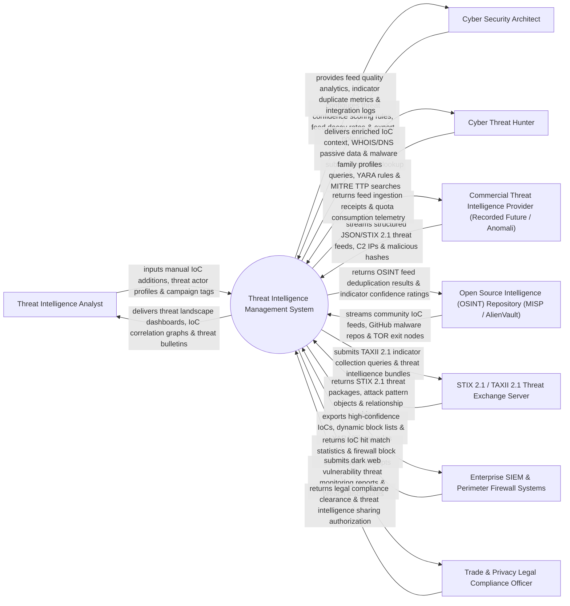

# Context Diagram — Threat Intelligence Management System

## Mermaid Code

## Actor & Interaction Table | Bảng Actor & Tương tác

| # | Actor | Actor Type | Data Sent TO System | Data Received FROM System | Notes |
|---|-------|------------|---------------------|---------------------------|-------|
| 1 | Threat Intelligence Analyst | Primary | Manual IoC additions, threat actor profiles, campaign tags, intelligence bulletins. | Threat landscape dashboards, IoC correlation graphs, threat bulletins, vulnerability alerts. | Senior analyst researching adversary tactics, managing threat feeds, and writing intel briefs. |
| 2 | Cyber Security Architect | Primary | Threat confidence scoring rules, feed decay rates, export policies, SIEM integration rules. | Feed quality analytics, indicator duplicate metrics, integration logs, system health. | Architect designing threat intelligence ingestion pipelines and automated firewall block rules. |
| 3 | Cyber Threat Hunter | Primary | Indicator lookup queries, YARA rules, MITRE TTP searches, file hash queries. | Enriched IoC context, WHOIS/DNS passive data, malware family profiles, relationship graphs. | Specialist querying threat intel repository for proactive threat sweeps. |
| 4 | Commercial Threat Intelligence Provider | Supporting | Structured JSON/STIX 2.1 threat feeds, C2 IP addresses, malicious domain lists, file hashes. | Feed ingestion receipts, quota consumption telemetry, subscriber auth tokens. | Paid commercial threat intelligence feeds (Recorded Future, Anomali, CrowdStrike FalconX). |
| 5 | Open Source Intelligence Repository | Supporting | Community IoC feeds, GitHub malware repos, TOR exit node lists, CERT alerts. | OSINT feed deduplication results, indicator confidence ratings, parser logs. | Free OSINT threat sharing platforms (MISP, AlienVault OTX, abuse.ch). |
| 6 | STIX/TAXII Threat Exchange Server | Supporting | STIX 2.1 threat packages, attack pattern objects, relationship objects, threat actor profiles. | TAXII 2.1 indicator collection queries, threat intelligence bundle uploads. | Industry standard STIX 2.1 / TAXII 2.1 protocol server exchanging threat data. |
| 7 | Enterprise SIEM & Perimeter Firewall Systems | Supporting | IoC hit match statistics, firewall block confirmation receipts, log correlation counts. | High-confidence IoC export packages, dynamic block lists, YARA/Sigma detection rules. | SIEM and Firewall infrastructure receiving automated high-confidence threat block lists. |
| 8 | Trade & Privacy Legal Compliance Officer | Supporting / Regulatory | Legal compliance clearance, threat intelligence sharing authorization, privacy mandates. | Dark web vulnerability threat monitoring reports, breach disclosures, threat sharing logs. | Compliance officer verifying legal compliance for sharing threat indicators under ISAC frameworks. |

## System Boundary Description | Mô tả Phạm vi Hệ thống

The **Threat Intelligence Management System** is an enterprise Threat Intelligence Platform (TIP), STIX 2.1 / TAXII 2.1 feed aggregator, Indicator of Compromise (IoC) deduplication, confidence scoring, threat enrichment, and automated firewall/SIEM export system.

**Inside System Scope:**
- Automated multi-source ingestion of commercial, OSINT, and ISAC threat intelligence feeds.
- Indicator of Compromise (IoC) deduplication, STIX 2.1 JSON parsing, and normalization.
- Dynamic IoC confidence scoring and decay rate management (aging out stale IP/domain indicators).
- Passive DNS, WHOIS, and sandbox threat enrichment of IP addresses, domain names, and file hashes.
- Automated export of high-confidence IoCs to SIEM, Firewall, and EDR block lists.

**Outside System Scope:**
- Direct penetration testing of external hacker servers (handled by Offensive Red Teams).
- Direct hosting of external dark web forums (handled by External Cyber Crime Infrastructure).
- Direct software patch deployment to end-user workstations (handled by IT Patch Management).
