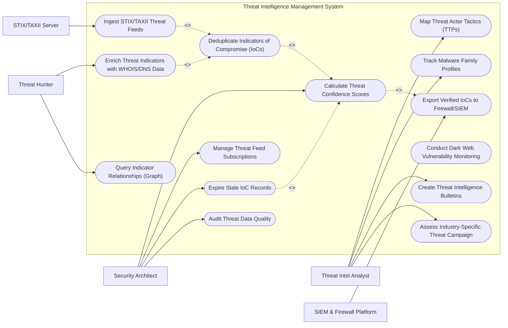

# Use Case Diagram — Threat Intelligence Management System

## Mermaid Code

## Actor Table | Bảng Actor

| # | Actor | Actor Type | Role Description | Related Use Cases |
|---|-------|------------|------------------|-------------------|
| 1 | Threat Intel Analyst | Primary | Researches threat actor TTPs, tracks malware families, creates intel bulletins, and evaluates industry threat campaigns. | UC04, UC07, UC11, UC13 |
| 2 | Security Architect | Primary | Configures threat feed subscriptions, confidence scoring algorithms, IoC expiration decay rules, and audits data quality. | UC03, UC09, UC10, UC14 |
| 3 | Threat Hunter | Primary | Performs IoC relationship graph queries and enriches indicators with passive DNS/WHOIS data during threat sweeps. | UC06, UC12 |
| 4 | STIX/TAXII Server | Supporting / System | External threat intelligence server delivering structured STIX 2.1 JSON packages via TAXII 2.1 protocol. | UC01 |
| 5 | SIEM & Firewall Platform | Supporting / System | Enterprise security infrastructure receiving automated high-confidence IoC export block lists. | UC05 |

## Use Case Table | Bảng Use Case

| # | UC ID | Use Case Name | Primary Actor | Secondary Actor | Description | Priority |
|---|-------|---------------|---------------|-----------------|-------------|----------|
| 1 | UC01 | Ingest STIX/TAXII Threat Feeds | STIX Server | Architect | Ingests structured STIX 2.1 threat intelligence packages via TAXII 2.1 API polling from commercial and OSINT feeds. | High |
| 2 | UC02 | Deduplicate Indicators of Compromise (IoCs) | Architect | None | Merges identical IoCs (IP addresses, domain names, file hashes) coming from multiple different threat feeds. | High |
| 3 | UC03 | Calculate Threat Confidence Scores | Architect | Analyst | Evaluates feed reliability, source reputation, and indicator age to compute a normalized Confidence Score (0-100). | High |
| 4 | UC04 | Map Threat Actor Tactics (TTPs) | Analyst | None | Links threat indicators to known Threat Actor profiles (e.g., APT28, Lazarus Group) and MITRE ATT&CK techniques. | High |
| 5 | UC05 | Export Verified IoCs to Firewall/SIEM | SIEM Platform | Architect | Pushes high-confidence verified IoCs to enterprise SIEM, EDR, and Firewall dynamic block lists. | High |
| 6 | UC06 | Enrich Threat Indicators with WHOIS/DNS Data | Threat Hunter | None | Queries passive DNS, WHOIS registration data, and VirusTotal APIs to enrich raw IoCs with threat context. | High |
| 7 | UC07 | Track Malware Family Profiles | Analyst | None | Maintains threat intelligence profiles for malware families (e.g., LockBit, Emotet, Qakbot) including C2 behaviors. | Medium |
| 8 | UC08 | Conduct Dark Web Vulnerability Monitoring | Analyst | None | Monitors dark web forums and paste sites for leaked company credentials, compromised SSL keys, and zero-day mentions. | Medium |
| 9 | UC09 | Manage Threat Feed Subscriptions | Architect | None | Manages API keys, polling schedules, feed rate limits, and subscription renewals for commercial threat feeds. | Medium |
| 10 | UC10 | Expire Stale IoC Records | Architect | None | Automatically deactivates and prunes expired IoCs (e.g., dynamic IP addresses older than 30 days) to prevent block list bloat. | High |
| 11 | UC11 | Create Threat Intelligence Bulletins | Analyst | None | Publishes internal threat briefs and vulnerability advisory bulletins for SOC analysts and IT security teams. | Medium |
| 12 | UC12 | Query Indicator Relationships (Graph) | Threat Hunter | Analyst | Visualizes threat indicator relationships in an interactive graph network (e.g., Domain -> IP -> SSL Certificate -> Malware Hash). | Medium |
| 13 | UC13 | Assess Industry-Specific Threat Campaign | Analyst | None | Evaluates threat campaigns targeting specific industry verticals (e.g., Healthcare, Financial, Energy). | Medium |
| 14 | UC14 | Audit Threat Data Quality | Architect | None | Analyzes feed overlap metrics, false positive rates, and provider accuracy scorecards. | Low |

## Use Case Specification | Đặc tả Use Case

---

### UC01 — Ingest STIX/TAXII Threat Feeds

| Field | Detail |
|-------|--------|
| **UC ID** | UC01 |
| **Use Case Name** | Ingest STIX/TAXII Threat Feeds |
| **Actor(s)** | Primary: STIX/TAXII Server   Secondary: Security Architect |
| **Description** | Polls external TAXII 2.1 servers, downloads STIX 2.1 JSON threat packages, parses indicator objects, and stores them in the threat database. |
| **Precondition** | 1. TAXII 2.1 collection endpoints and API authentication keys are configured. |
| **Main Flow** | 1. System scheduler executes TAXII 2.1 poll request to Commercial Threat Feed (Recorded Future API).   2. TAXII server returns STIX 2.1 JSON Bundle containing Indicator, Malware, and Threat Actor objects.   3. System STIX Parser parses JSON objects into standardized TIP schema.   4. System extracts IoCs: IP addresses (`ipv4-addr`), Malicious Domains (`domain-name`), File Hashes (`file:hashes.SHA-256`), and C2 URLs.   5. System tags IoCs with source feed metadata and ingestion timestamp.   6. System passes extracted IoCs to UC02 Deduplicate Indicators of Compromise. |
| **Alternative Flow** | **AF1** — Manual MISP JSON Import: Analyst manually uploads an offline MISP event JSON file containing emergency threat indicators. |
| **Exception Flow** | **EX1** — STIX Parsing Exception: If STIX payload contains malformed JSON, system logs parser error, isolates invalid bundle, and alerts Architect. |
| **Postcondition** | Threat indicators are parsed, tagged with source metadata, and queued for deduplication. |
| **Business Rule** | **BR1**: Automated TAXII feed polling must execute every 15 minutes to capture zero-day threat indicators in near real-time. |

---

### UC02 — Deduplicate Indicators of Compromise (IoCs)

| Field | Detail |
|-------|--------|
| **UC ID** | UC02 |
| **Use Case Name** | Deduplicate Indicators of Compromise (IoCs) |
| **Actor(s)** | Primary: Security Architect   Secondary: None |
| **Description** | Merges duplicate IoCs arriving from multiple threat feeds, consolidating source attribution and increasing indicator confidence ratings. |
| **Precondition** | 1. Raw IoCs are parsed and queued in ingestion memory buffer. |
| **Main Flow** | 1. System receives newly ingested IoC (e.g., C2 IP `198.51.100.42` from AlienVault OTX).   2. System queries Master IoC Database for existing record matching `198.51.100.42`.   3. System finds existing IoC record previously ingested from Recorded Future 2 hours ago.   4. System merges new feed metadata into existing master IoC record rather than creating a duplicate.   5. System increments "Feed Count Multiplier" (Indicator confirmed by 2 independent sources).   6. System passes merged IoC to UC03 Calculate Threat Confidence Scores. |
| **Alternative Flow** | **AF1** — Brand New IoC: If no matching IoC exists, system creates new Master IoC record in database. |
| **Exception Flow** | **EX1** — Conflicting Indicator Tags: If Feed A tags IP as "Malware C2" while Feed B tags IP as "Benign Cloud Server", system flags IoC for manual analyst review. |
| **Postcondition** | Master IoC database contains clean, deduplicated indicators with multi-source attribution. |
| **Business Rule** | **BR1**: Deduplication matching must evaluate IP addresses, domain strings, and SHA-256 file hashes across a database of 10 million IoCs in less than 50 milliseconds. |

---

### UC03 — Calculate Threat Confidence Scores

| Field | Detail |
|-------|--------|
| **UC ID** | UC03 |
| **Use Case Name** | Calculate Threat Confidence Scores |
| **Actor(s)** | Primary: Security Architect   Secondary: Threat Intel Analyst |
| **Description** | Computes a normalized Confidence Score (0 to 100) for every IoC based on provider reliability, multi-feed confirmation, enrichment hits, and indicator age. |
| **Precondition** | 1. IoC is deduplicated and tagged with source feeds.   2. Confidence scoring weighting rules are defined. |
| **Main Flow** | 1. System selects master IoC record `198.51.100.42` for confidence scoring.   2. System calculates weighted score components:     a. Provider Reliability Weight: Recorded Future (Weight: 40) + AlienVault (Weight: 20) = 60.     b. Multi-Feed Confirmation Bonus: 2 Feeds = +15 points.     c. Passive DNS Enrichment Hit: Active C2 Domain = +15 points.     d. Age Decay Deduction: Fresh Ingestion (< 24 hours) = 0 deduction.   3. System calculates total Confidence Score: `60 + 15 + 15 = 90 / 100`.   4. System assigns Confidence Tier: "HIGH CONFIDENCE (90)".   5. If Confidence Score >= 80, system triggers UC05 Export Verified IoCs to Firewall/SIEM for automated blocking. |
| **Alternative Flow** | **AF1** — Low Confidence Quarantine: If score is below 50, system marks IoC "LOW CONFIDENCE - MONITORED ONLY" and skips automated blocking. |
| **Exception Flow** | **EX1** — Manual Score Override: Analyst manually forces a confidence score of 100 for a critical emergency threat IoC. |
| **Postcondition** | IoC confidence score is calculated, stored, and used to drive automated defense policies. |
| **Business Rule** | **BR1**: Only IoCs achieving a calculated Confidence Score >= 80 shall be exported for automated firewall blocking. |

---

### UC04 — Map Threat Actor Tactics (TTPs)

| Field | Detail |
|-------|--------|
| **UC ID** | UC04 |
| **Use Case Name** | Map Threat Actor Tactics (TTPs) |
| **Actor(s)** | Primary: Threat Intel Analyst   Secondary: None |
| **Description** | Associates threat indicators and malware samples with known Threat Actor groups (APT29, FIN7, Lazarus) and MITRE ATT&CK TTP objects. |
| **Precondition** | 1. STIX 2.1 Threat Actor and Attack Pattern objects are ingested. |
| **Main Flow** | 1. Analyst opens Threat Actor Management workspace and selects "APT28 (Fancy Bear)".   2. System displays APT28 profile: Country Origin, Target Industries, Associated Malware (Zebrocy), and STIX Relationship Graph.   3. Analyst links newly ingested C2 domain `malicious-domain.com` to APT28 profile based on SSL certificate fingerprint.   4. System maps associated MITRE ATT&CK techniques: `T1071.001 (Application Layer Protocol: Web Protocols)` and `T1566.001 (Spearphishing Attachment)`.   5. System updates threat actor campaign timeline and exports updated TTP threat bundle. |
| **Alternative Flow** | **AF1** — Automated STIX Relationship Parsing: System automatically parses STIX 2.1 `relationship` JSON objects to link IoCs to Threat Actors. |
| **Exception Flow** | **EX1** — Unattributed IoC: If threat actor identity is unknown, system maps IoC to "UNATTRIBUTED CAMPAIGN - CLUSTER 44". |
| **Postcondition** | IoCs are linked to Threat Actor profiles and MITRE ATT&CK techniques in the threat graph. |
| **Business Rule** | **BR1**: Threat actor attribution linkages must reference verified technical proof (SSL certificates, code overlap, or shared C2 infrastructure). |

---

### UC05 — Export Verified IoCs to Firewall/SIEM

| Field | Detail |
|-------|--------|
| **UC ID** | UC05 |
| **Use Case Name** | Export Verified IoCs to Firewall/SIEM |
| **Actor(s)** | Primary: SIEM & Firewall Platform   Secondary: Security Architect |
| **Description** | Pushes high-confidence, verified threat indicators (IP blocklists, domain blocklists, YARA rules) to enterprise SIEM, EDR, and Firewall enforcement gateways. |
| **Precondition** | 1. IoC has achieved Confidence Score >= 80.   2. Export API connectors (Palo Alto Panorama, CrowdStrike, Splunk API) are configured. |
| **Main Flow** | 1. Export Engine selects all active IoCs reaching High Confidence threshold (e.g., 250 new malicious C2 IPs).   2. System formats export payloads for target security systems:     a. Firewall Payload: Plaintext External Dynamic List (EDL) URL.     b. EDR Payload: Hash block list JSON for CrowdStrike.     c. SIEM Payload: Splunk lookup table CSV file.   3. System issues API POST request to security enforcement platforms.   4. Palo Alto Panorama updates Dynamic Block List and enforces perimeter packet drops.   5. System receives API confirmation receipts and updates export status to "EXPORTED & ACTIVE". |
| **Alternative Flow** | **AF1** — Export YARA & Sigma Rules: System exports compiled YARA rules for endpoint file scanning and Sigma rules for SIEM detection. |
| **Exception Flow** | **EX1** — Block List Capacity Limit: If firewall EDL reaches maximum 50,000 IP limit, system automatically triggers UC10 Expire Stale IoC Records to free up capacity. |
| **Postcondition** | High-confidence threat indicators are deployed to perimeter firewalls and SIEM engines for automated blocking. |
| **Business Rule** | **BR1**: High-confidence IoC export packages must deploy to perimeter firewalls within 60 seconds of confidence score calculation. |
