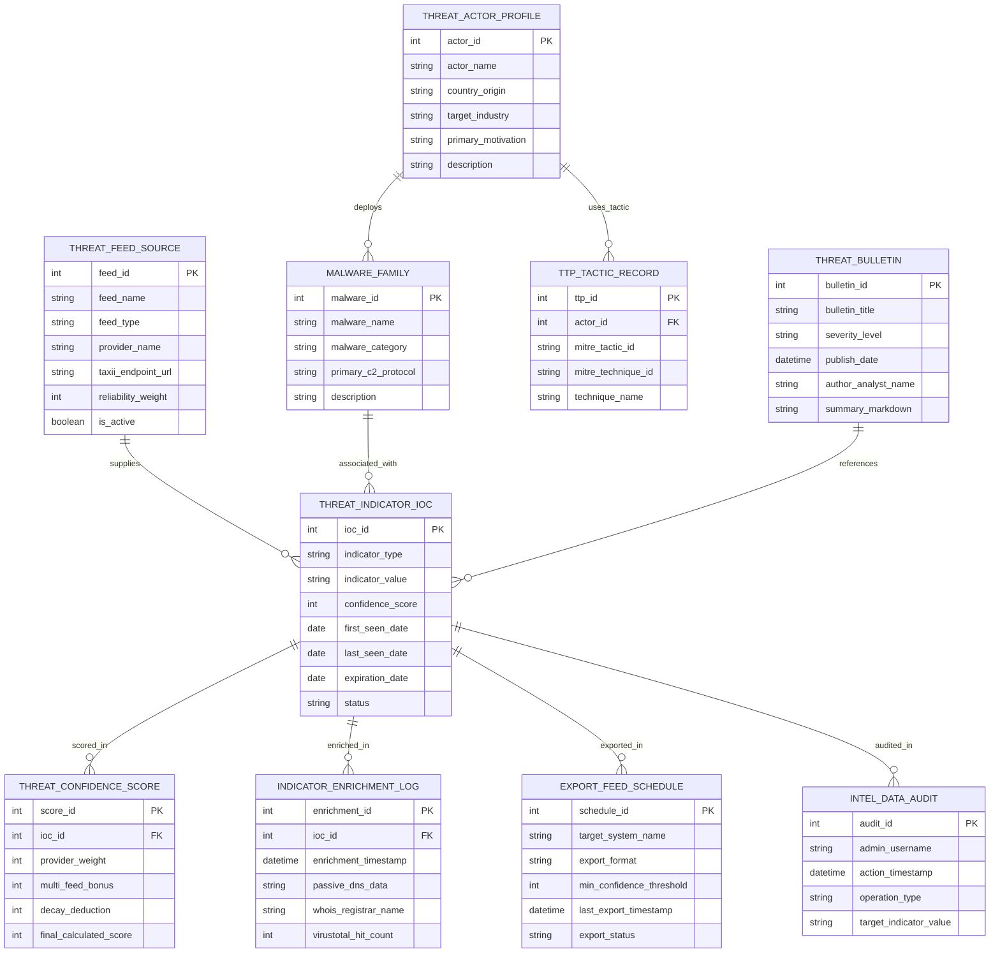

# Conceptual ERD — Threat Intelligence Management System

## Mermaid Code

## Entity Description Table | Bảng mô tả Entity

| # | Entity Name | Vietnamese Name | Description | Key Attributes | Main Relationships |
|---|-------------|-----------------|-------------|----------------|-------------------|
| 1 | THREAT_INDICATOR_IOC | Chỉ số Vết hằn Độc hại (IoC) | Master table storing deduplicated Indicators of Compromise (IPs, domains, file hashes), scores, and expiration dates. | ioc_id, indicator_type, indicator_value, confidence_score, status | Primary entity; supplied by THREAT_FEED_SOURCE; scored in THREAT_CONFIDENCE_SCORE. |
| 2 | THREAT_FEED_SOURCE | Nguồn Dữ liệu Tình báo | Stores commercial and OSINT feed providers, TAXII endpoints, reliability weights, and active status. | feed_id, feed_name, provider_name, reliability_weight, is_active | Supplies THREAT_INDICATOR_IOC. |
| 3 | THREAT_ACTOR_PROFILE | Hồ sơ Nhóm Hacker (Threat Actor) | Stores adversary threat actor profiles (e.g., APT28, Lazarus), origin countries, and target industry verticals. | actor_id, actor_name, country_origin, target_industry | Uses TTP_TACTIC_RECORD; deploys MALWARE_FAMILY. |
| 4 | MALWARE_FAMILY | Hồ sơ Dòng Mã độc (Malware) | Maintains profiles for malware families (LockBit, Emotet, Qakbot), C2 protocols, and behavioral descriptions. | malware_id, malware_name, malware_category, primary_c2_protocol | Deployed by THREAT_ACTOR_PROFILE; associated with THREAT_INDICATOR_IOC. |
| 5 | TTP_TACTIC_RECORD | Hồ sơ Thủ đoạn TTP (MITRE) | Maps threat actors to MITRE ATT&CK Tactics (e.g., Execution) and Technique IDs (e.g., T1059). | ttp_id, mitre_tactic_id, mitre_technique_id, technique_name | Belongs to THREAT_ACTOR_PROFILE. |
| 6 | THREAT_CONFIDENCE_SCORE | Nhật ký Tính Điểm Tin cậy | Records confidence scoring components (provider weight, multi-feed bonus, age decay) and calculated scores. | score_id, provider_weight, multi_feed_bonus, final_calculated_score | Belongs to THREAT_INDICATOR_IOC. |
| 7 | INDICATOR_ENRICHMENT_LOG | Nhật ký Làm giàu Dữ liệu IoC | Archives passive DNS resolution records, WHOIS domain registrar details, and VirusTotal hit counts. | enrichment_id, enrichment_timestamp, passive_dns_data, virustotal_hit_count | Belongs to THREAT_INDICATOR_IOC. |
| 8 | THREAT_BULLETIN | Bản tin Tình báo An ninh | Publishes internal threat intelligence briefs, executive advisories, and security recommendations. | bulletin_id, bulletin_title, severity_level, publish_date, summary_markdown | References THREAT_INDICATOR_IOC. |
| 9 | EXPORT_FEED_SCHEDULE | Lịch Xuất Dữ liệu Chặn (Export) | Manages automated IoC export schedules, minimum confidence thresholds, and firewall/SIEM target systems. | schedule_id, target_system_name, export_format, min_confidence_threshold | Exports THREAT_INDICATOR_IOC. |
| 10 | INTEL_DATA_AUDIT | Nhật ký Kiểm toán Tình báo | Captures manual IoC overrides, analyst edits, rule deactivations, and configuration changes. | audit_id, admin_username, action_timestamp, operation_type | Audits THREAT_INDICATOR_IOC. |

## Relationship Description | Mô tả Quan hệ

| # | From Entity | Cardinality | To Entity | Relationship Label | Business Explanation |
|---|-------------|-------------|-----------|-------------------|----------------------|
| 1 | THREAT_FEED_SOURCE | one-to-many | THREAT_INDICATOR_IOC | supplies | A threat feed source supplies multiple threat indicators (IoCs). |
| 2 | THREAT_INDICATOR_IOC | one-to-many | THREAT_CONFIDENCE_SCORE | scored_in | A threat indicator is scored in confidence calculation logs. |
| 3 | THREAT_INDICATOR_IOC | one-to-many | INDICATOR_ENRICHMENT_LOG | enriched_in | A threat indicator is enriched in passive DNS and WHOIS logs. |
| 4 | THREAT_ACTOR_PROFILE | one-to-many | TTP_TACTIC_RECORD | uses_tactic | A threat actor profile uses multiple MITRE ATT&CK TTP tactics. |
| 5 | THREAT_ACTOR_PROFILE | many-to-many | MALWARE_FAMILY | deploys | A threat actor profile deploys one or more malware families. |
| 6 | MALWARE_FAMILY | one-to-many | THREAT_INDICATOR_IOC | associated_with | A malware family is associated with specific threat indicators (hashes, C2 IPs). |
| 7 | THREAT_INDICATOR_IOC | many-to-many | EXPORT_FEED_SCHEDULE | exported_in | High-confidence threat indicators are exported in automated firewall block schedules. |
| 8 | THREAT_BULLETIN | many-to-many | THREAT_INDICATOR_IOC | references | A threat intelligence bulletin references specific threat indicators. |
