# Swimlane Diagram — Threat Intelligence Management System

## Mermaid Code

```mermaid
flowchart LR
    Start(["Start Threat Intel Processing"])

    subgraph Lane1["Commercial STIX/TAXII Feed"]
        F1["Publish STIX 2.1 Threat Bundle"]
        F2["Deliver TAXII 2.1 JSON Payload"]
    end

    subgraph Lane2["System"]
        S1["Parse STIX 2.1 JSON & Extract IoCs"]
        S2["Deduplicate IoC against Master Database"]
        S3["Calculate Normalized Confidence Score"]
        S4{"Confidence Score >= 80?"}
        S5["Enrich IoC with Passive DNS & WHOIS"]
        S6["Export High-Confidence Block List via API"]
        S7["Flag IoC Low Confidence Monitored Only"]
    end

    subgraph Lane3["SIEM & Firewall Platform"]
        E1["Receive Dynamic IP Block List URL"]
        E2["Enforce Perimeter Packet Drop Rules"]
    end

    subgraph Lane4["Threat Intel Analyst"]
        A1["Review Threat Intelligence Bulletin"]
        A2["Link IoC to Threat Actor Profile"]
    end

    Finish(["End Threat Intel Export"])

    Start --> F1 --> F2 --> S1 --> S2 --> S3 --> S4
    S4 -->|"Yes"| S5 --> S6 --> E1 --> E2 --> A1 --> A2 --> Finish
    S4 -->|"No"| S7 --> Finish
```

## Flow Description | Mô tả luồng

| Lane | Actor | Role in Flow |
|------|-------|-------------|
| 1 | Commercial STIX/TAXII Feed | Publishes STIX 2.1 threat intelligence bundles and delivers JSON payloads over TAXII 2.1 APIs. |
| 2 | System | Parses STIX JSON objects, deduplicates IoCs against master database, computes normalized confidence scores, enriches with passive DNS, and exports high-confidence block lists. |
| 3 | SIEM & Firewall Platform | Receives automated dynamic IP/domain block list APIs and enforces active packet drop rules at the perimeter. |
| 4 | Threat Intel Analyst | Reviews threat bulletins, links verified IoCs to Threat Actor profiles (e.g., APT28), and maps MITRE ATT&CK techniques. |
