# Action Tree — Threat Intelligence Management System

## Mermaid Code

```mermaid
graph TD
    Root["Threat Intelligence Management System"]

    Root --> M1["Feed Ingestion & Parsing"]
    Root --> M2["IoC Normalization & Deduplication"]
    Root --> M3["Threat Enrichment & Scoring"]
    Root --> M4["Campaign & Actor Mapping"]
    Root --> M5["Export & Integration"]

    M1 --> A1["Poll Commercial TAXII 2.1 Feeds"]
    M1 --> A2["Parse STIX 2.1 JSON Objects"]
    M1 --> A3["Import Manual MISP Threat Events"]
    M1 --> A4["Manage Feed API Subscriptions"]

    M2 --> B1["Deduplicate Multi-Source IoCs"]
    M2 --> B2["Standardize IP, Domain & Hash Schema"]
    M2 --> B3["Expire Stale 30-Day Indicators"]
    M2 --> B4["Resolve Conflicting Feed Tags"]

    M3 --> C1["Calculate Normalized Confidence Score"]
    M3 --> C2["Query Passive DNS & WHOIS Records"]
    M3 --> C3["Check VirusTotal Hash Reputations"]
    M3 --> C4["Set Indicator Age Decay Deduction"]

    M4 --> D1["Link IoCs to Threat Actor Profiles"]
    M4 --> D2["Map TTPs to MITRE ATT&CK Matrix"]
    M4 --> D3["Track Malware Family Profiles"]
    M4 --> D4["Query Interactive Indicator Graph"]

    M5 --> E1["Export High-Confidence Firewall Block List"]
    M5 --> E2["Push YARA & Sigma Rules to SIEM"]
    M5 --> E3["Publish Intel Threat Bulletins"]
    M5 --> E4["Audit Threat Data Quality"]
```

## Module Description | Mô tả Module

| # | Module | Description | Actions |
|---|--------|-------------|---------|
| 1 | Feed Ingestion & Parsing | TAXII 2.1 feed polling, STIX 2.1 JSON parsing, manual MISP event imports, and commercial feed subscription management. | Poll Commercial TAXII 2.1 Feeds, Parse STIX 2.1 JSON Objects, Import Manual MISP Threat Events, Manage Feed API Subscriptions |
| 2 | IoC Normalization & Deduplication | Multi-source IoC deduplication, schema standardization, stale indicator auto-expiration, and conflicting tag resolution. | Deduplicate Multi-Source IoCs, Standardize IP, Domain & Hash Schema, Expire Stale 30-Day Indicators, Resolve Conflicting Feed Tags |
| 3 | Threat Enrichment & Scoring | Confidence score calculation (0-100), passive DNS/WHOIS enrichment, VirusTotal API queries, and indicator age decay management. | Calculate Normalized Confidence Score, Query Passive DNS & WHOIS Records, Check VirusTotal Hash Reputations, Set Indicator Age Decay Deduction |
| 4 | Campaign & Actor Mapping | Threat Actor profile linkages, MITRE ATT&CK TTP mapping, malware family tracking, and interactive threat graph queries. | Link IoCs to Threat Actor Profiles, Map TTPs to MITRE ATT&CK Matrix, Track Malware Family Profiles, Query Interactive Indicator Graph |
| 5 | Export & Integration | High-confidence firewall block list exports, YARA/Sigma rule pushes to SIEM/EDR, threat intel bulletins, and feed quality auditing. | Export High-Confidence Firewall Block List, Push YARA & Sigma Rules to SIEM, Publish Intel Threat Bulletins, Audit Threat Data Quality |
