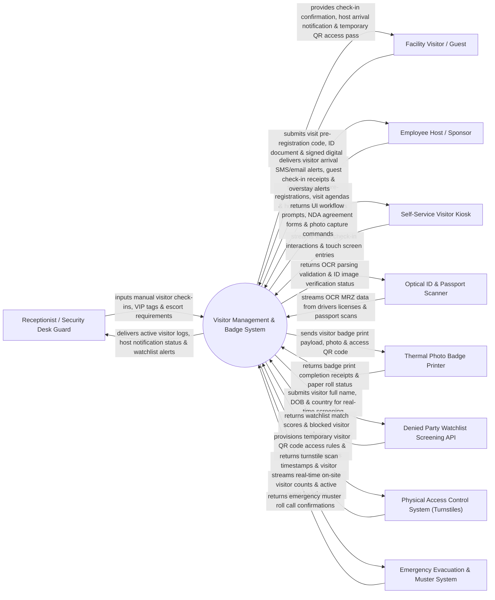

# Context Diagram — Visitor Management & Badge System

## Mermaid Code

## Actor & Interaction Table | Bảng Actor & Tương tác

| # | Actor | Actor Type | Data Sent TO System | Data Received FROM System | Notes |
|---|-------|------------|---------------------|---------------------------|-------|
| 1 | Receptionist / Security Desk Guard | Primary | Manual visitor check-ins, VIP flags, escort requirement settings, badge re-issues. | Active visitor logs, host notification status, watchlist alert notifications, check-in queue. | Front desk security personnel managing guest arrivals and issuing visitor badges. |
| 2 | Facility Visitor / Guest | Primary | Visit pre-registration code, ID document presentation, digital NDA signature, photo capture. | Check-in confirmation, host arrival notification, temporary QR access pass, printed badge. | External guest, contractor, or vendor arriving at corporate facility. |
| 3 | Employee Host / Sponsor | Primary | Guest pre-registrations, visit agendas, host approval sign-offs, visit extensions. | Visitor arrival SMS/email alerts, guest check-in receipts, overstay warning alerts. | Corporate employee sponsoring and receiving external visitors. |
| 4 | Self-Service Visitor Kiosk | Supporting | Visitor touch screen entries, check-in responses, webcam photo captures. | UI workflow prompts, NDA agreement text, check-in completion receipts. | Unattended lobby kiosk (iPad/Tablet) allowing guests to self-check-in. |
| 5 | Optical ID & Passport Scanner | Supporting | OCR Machine Readable Zone (MRZ) data from driver licenses and passports. | OCR parsing validation, ID image verification status, barcode decode receipts. | Desktop scanner (Descartes/Honeywell) reading driver licenses and passport MRZs. |
| 6 | Thermal Photo Badge Printer | Supporting | Paper roll status, print engine error codes, ribbon remaining metrics. | Visitor badge print payload, photo image, barcode/QR code, host name. | Thermal printer (Zebra/Evolis) printing temporary adhesive visitor photo badges. |
| 7 | Denied Party Watchlist Screening API | Supporting | Watchlist match scores, Specially Designated Nationals (SDN) flags, criminal alerts. | Visitor full name, date of birth, country of citizenship for screening. | External API screening visitors against corporate sex offender and denied party watchlists. |
| 8 | Physical Access Control System | Supporting | Turnstile scan timestamps, visitor entrance/exit logs, door access events. | Temporary visitor QR code access rules, turnstile barcode permissions. | Building access control system allowing visitor QR codes to open lobby turnstiles. |
| 9 | Emergency Evacuation & Muster System | Supporting | Emergency muster roll call confirmations, evacuation zone clearance receipts. | Real-time on-site visitor counts, active guest location rosters, host contacts. | Safety system compiling evacuation muster lists during building fires or emergencies. |

## System Boundary Description | Mô tả Phạm vi Hệ thống

The **Visitor Management & Badge System** is an enterprise guest pre-registration, self-service kiosk check-in, ID document OCR scanning, denied party screening, digital NDA e-signing, and temporary badge issuance platform.

**Inside System Scope:**
- Guest visit pre-registration by employee hosts via web portal or Outlook calendar add-in.
- Self-service kiosk check-in workflow with webcam photo capture and ID document OCR scanning.
- Automated screening of visitor names against global watchlists and corporate banned lists.
- Digital Non-Disclosure Agreement (NDA) e-signing and health safety questionnaire capture.
- Thermal photo badge printing, temporary QR code access pass provisioning, host SMS alerts, and overstay tracking.

**Outside System Scope:**
- Direct physical maintenance of lobby turnstile mechanical barriers (handled by Facilities Team).
- Direct physical security guard escort duty during high-security lab tours (handled by Escort Personnel).
- General hotel room reservation booking (handled by Hotel Operations Systems).
