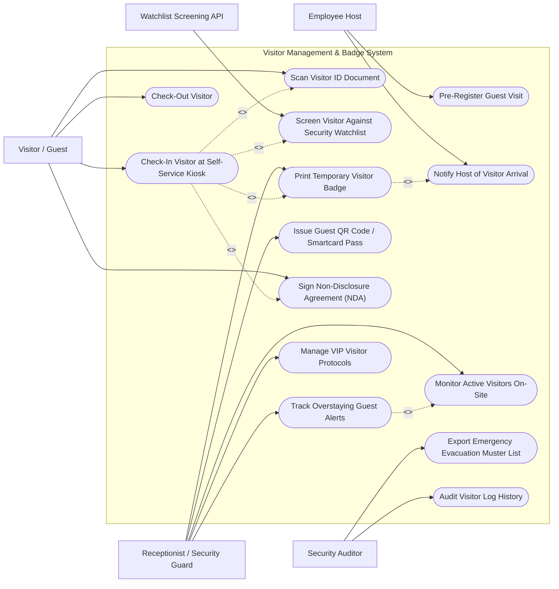

# Use Case Diagram — Visitor Management & Badge System

## Mermaid Code

## Actor Table | Bảng Actor

| # | Actor | Actor Type | Role Description | Related Use Cases |
|---|-------|------------|------------------|-------------------|
| 1 | Visitor / Guest | Primary | Self-checks-in at lobby kiosk, scans ID document, signs digital NDA, and checks out upon visit completion. | UC02, UC03, UC08, UC09 |
| 2 | Employee Host | Primary | Pre-registers upcoming guest visits and receives arrival notifications (SMS/Email/Teams). | UC01, UC07 |
| 3 | Receptionist / Security Guard | Primary | Manages front desk arrivals, prints temporary badges, issues turnstile QR passes, and monitors VIP guests. | UC05, UC06, UC10, UC11, UC13 |
| 4 | Security Auditor | Secondary | Audits visitor log history, inspects NDA compliance, and exports emergency evacuation muster lists. | UC12, UC14 |
| 5 | Watchlist Screening API | Supporting / System | External screening service evaluating visitor names against government watchlists and corporate banned lists. | UC04 |

## Use Case Table | Bảng Use Case

| # | UC ID | Use Case Name | Primary Actor | Secondary Actor | Description | Priority |
|---|-------|---------------|---------------|-----------------|-------------|----------|
| 1 | UC01 | Pre-Register Guest Visit | Employee Host | Visitor | Pre-registers guest details (Name, Email, Company, Visit Date/Time) and sends pre-registration QR code invitation. | High |
| 2 | UC02 | Check-In Visitor at Self-Service Kiosk | Visitor | Receptionist | Guides guest through self-service kiosk check-in, photo capture, and arrival verification. | High |
| 3 | UC03 | Scan Visitor ID Document | Visitor | None | Scans driver license or passport via optical OCR reader to auto-populate visitor name and verification. | High |
| 4 | UC04 | Screen Visitor Against Security Watchlist | Watchlist API | Receptionist | Screens visitor name against denied party watchlists and flags potential security threats. | High |
| 5 | UC05 | Print Temporary Visitor Badge | Receptionist | Thermal Printer | Prints adhesive thermal photo badge containing visitor photo, name, host name, and expiration date. | High |
| 6 | UC06 | Issue Guest QR Code / Smartcard Pass | Receptionist | Access Control | Generates temporary QR code access pass for turnstile entry limited to authorized meeting floors. | High |
| 7 | UC07 | Notify Host of Visitor Arrival | Employee Host | None | Automatically sends SMS, Email, and Microsoft Teams notifications to employee host when guest checks in. | High |
| 8 | UC08 | Sign Non-Disclosure Agreement (NDA) | Visitor | None | Displays digital legal NDA or safety waiver on touchscreen for visitor e-signature before badge printing. | High |
| 9 | UC09 | Check-Out Visitor | Visitor | Receptionist | Scans visitor badge QR code at exit turnstile or kiosk to log formal check-out timestamp and deactivate access. | High |
| 10 | UC10 | Monitor Active Visitors On-Site | Receptionist | None | Displays real-time dashboard of all visitors currently on-site, their hosts, entry times, and assigned zones. | High |
| 11 | UC11 | Track Overstaying Guest Alerts | Receptionist | Employee Host | Triggers automated alerts to host and security if a visitor remains on-site past expected departure time. | Medium |
| 12 | UC12 | Export Emergency Evacuation Muster List | Security Auditor | None | Generates real-time active visitor evacuation roster accessible on mobile devices during emergency roll calls. | High |
| 13 | UC13 | Manage VIP Visitor Protocols | Receptionist | Security Admin | Configures special handling protocols, discrete host alerts, and expedited check-in for VIP executive guests. | Medium |
| 14 | UC14 | Audit Visitor Log History | Security Auditor | None | Provides searchable historical records of all visitor entries, host details, scanned IDs, and signed NDAs. | Medium |

## Use Case Specification | Đặc tả Use Case

---

### UC01 — Pre-Register Guest Visit

| Field | Detail |
|-------|--------|
| **UC ID** | UC01 |
| **Use Case Name** | Pre-Register Guest Visit |
| **Actor(s)** | Primary: Employee Host   Secondary: Visitor / Guest |
| **Description** | Enables an employee to pre-register upcoming guest visits, generating a pre-arrival email invite with a fast-track check-in QR code. |
| **Precondition** | 1. Employee Host is authenticated in Corporate Portal or Outlook Calendar Add-in. |
| **Main Flow** | 1. Employee Host opens "Pre-Register Visitor" form in web portal or Outlook.   2. Host inputs guest details (First Name, Last Name, Email, Company, Visit Date, Start/End Time, Visit Purpose).   3. Host selects facility building, meeting room, and optional escort requirements.   4. Host clicks "Submit Pre-Registration".   5. System creates Visit Appointment record (e.g., `APT-2026-0818`).   6. System generates pre-registration QR code and emails branded invitation to the guest with calendar event and building directions. |
| **Alternative Flow** | **AF1** — Bulk Group Pre-Registration: Host uploads CSV spreadsheet to pre-register 50 conference attendees simultaneously. |
| **Exception Flow** | **EX1** — Banned Visitor Flag: If pre-registered guest matches corporate banned visitor list, system blocks pre-registration and alerts Security. |
| **Postcondition** | Visit appointment is created and guest receives fast-track check-in QR invitation. |
| **Business Rule** | **BR1**: Pre-registered guests can check in at self-service kiosks in under 15 seconds using their pre-arrival QR code. |

---

### UC02 — Check-In Visitor at Self-Service Kiosk

| Field | Detail |
|-------|--------|
| **UC ID** | UC02 |
| **Use Case Name** | Check-In Visitor at Self-Service Kiosk |
| **Actor(s)** | Primary: Visitor / Guest   Secondary: Receptionist / Security Guard |
| **Description** | Walks an arriving guest through self-service kiosk check-in, QR code scanning, photo capture, NDA signing, and host notification. |
| **Precondition** | 1. Self-Service Kiosk is online in lobby workspace. |
| **Main Flow** | 1. Visitor approaches Kiosk touch screen and taps "Start Check-In".   2. Kiosk prompts visitor to scan pre-arrival QR code OR type name/company.   3. System retrieves matching pre-registered appointment `APT-2026-0818`.   4. Kiosk executes UC03 Scan Visitor ID Document to verify visitor identity.   5. System executes UC04 Screen Visitor Against Security Watchlist.   6. Kiosk prompts visitor to e-sign digital NDA on screen (UC08).   7. Kiosk webcam captures high-resolution visitor photo.   8. System triggers UC05 Print Temporary Visitor Badge and UC07 Notify Host of Visitor Arrival.   9. Kiosk displays "Check-In Complete - Please Take Your Printed Badge". |
| **Alternative Flow** | **AF1** — Walk-In Check-In (No Pre-Registration): Guest selects "Walk-In Visitor", types host employee name, and host receives instant approval request via mobile app before check-in completes. |
| **Exception Flow** | **EX1** — Kiosk Printer Out of Paper: Kiosk displays "Collect Badge at Security Desk" and routes print job to Receptionist printer. |
| **Postcondition** | Visitor is checked in, badge is printed, host is notified, and active visitor status is set to "ON-SITE". |
| **Business Rule** | **BR1**: Kiosk check-in session timeout shall reset after 45 seconds of visitor inactivity to protect guest privacy. |

---

### UC03 — Scan Visitor ID Document

| Field | Detail |
|-------|--------|
| **UC ID** | UC03 |
| **Use Case Name** | Scan Visitor ID Document |
| **Actor(s)** | Primary: Visitor / Guest   Secondary: None |
| **Description** | Scans driver license or passport via optical OCR reader, parsing Machine Readable Zone (MRZ) data to verify legal identity and auto-populate check-in fields. |
| **Precondition** | 1. Optical ID scanner hardware is connected to kiosk or receptionist workstation. |
| **Main Flow** | 1. Kiosk prompts visitor to place driver license or passport face down on optical glass reader.   2. Optical scanner captures high-resolution infrared and ultraviolet image frames.   3. System OCR engine parses Machine Readable Zone (MRZ) and PDF417 2D barcode data.   4. System extracts Legal First Name, Last Name, Date of Birth, Expiration Date, Document Number, and Address.   5. System checks document expiration date (must not be expired).   6. System auto-populates visitor profile fields and verifies identity match against appointment.   7. System returns "ID VERIFIED SUCCESS". |
| **Alternative Flow** | **AF1** — Manual ID Entry: If ID scanner fails to read worn document, receptionist manually inputs document details after visual inspection. |
| **Exception Flow** | **EX1** — Expired Document Flag: System displays "ID EXPIRED - MANUAL RECEPTIONIST VERIFICATION REQUIRED" and alerts front desk guard. |
| **Postcondition** | Visitor legal identity is verified via OCR data parsing and recorded in check-in file. |
| **Business Rule** | **BR1**: Full raw ID card images must be encrypted and stored in compliance with privacy retention laws. |

---

### UC04 — Screen Visitor Against Security Watchlist

| Field | Detail |
|-------|--------|
| **UC ID** | UC04 |
| **Use Case Name** | Screen Visitor Against Security Watchlist |
| **Actor(s)** | Primary: Watchlist Screening API   Secondary: Receptionist / Security Guard |
| **Description** | Automatically screens visitor name, date of birth, and country against government denied party lists, sex offender registries, and corporate banned visitor databases. |
| **Precondition** | 1. Visitor name and date of birth are extracted from ID scan or check-in form. |
| **Main Flow** | 1. System extracts Visitor Full Name and Date of Birth during check-in flow.   2. System calls Denied Party Watchlist API with fuzzy-matching algorithm.   3. API queries government watchlists (OFAC SDN, National Sex Offender Registry, Corporate Banned Visitor List).   4. API returns match confidence score (e.g., 0% match score = CLEAR).   5. If match score is 0%, system permits check-in flow to proceed seamlessly. |
| **Alternative Flow** | **AF1** — False Positive Receptionist Override: If match is 75% (potential name collision), receptionist reviews photo comparison, confirms false positive, inputs override note, and proceeds with check-in. |
| **Exception Flow** | **EX1** — Confirmed Watchlist Match (100% Hit): If visitor is a confirmed banned individual or SDN hit, kiosk quietly pauses check-in, displays "Please Wait - Security Staff Assigned", and sends discrete silent alert to Security Desk Guard. |
| **Postcondition** | Visitor screening result is logged and security clearance is verified. |
| **Business Rule** | **BR1**: 100% of facility guests must undergo automated security watchlist screening prior to badge issuance. |

---

### UC05 — Print Temporary Visitor Badge

| Field | Detail |
|-------|--------|
| **UC ID** | UC05 |
| **Use Case Name** | Print Temporary Visitor Badge |
| **Actor(s)** | Primary: Receptionist / Security Guard   Secondary: Thermal Badge Printer |
| **Description** | Prints an adhesive thermal photo badge displaying visitor photo, full name, company, host name, valid date, and access QR code. |
| **Precondition** | 1. Visitor check-in, ID verification, and NDA signing are complete.   2. Thermal photo badge printer is online and loaded with badge stock. |
| **Main Flow** | 1. System formats badge print layout JSON payload (Visitor Name, Photo Image, Host Name, Visit Date, Dynamic Turnstile QR Code).   2. System sends print payload to thermal badge printer API.   3. Printer prints high-contrast black-and-white thermal photo badge on self-adhesive or clip-on card stock.   4. System sets badge status to "ISSUED & ACTIVE".   5. Visitor or Receptionist peels badge, applies to clothing, and enters facility. |
| **Alternative Flow** | **AF1** — Expiring Ink Badge: System prints on special chemical badge paper where a red "EXPIRED" VOID pattern automatically bleeds through after 12 hours. |
| **Exception Flow** | **EX1** — Printer Out of Ribbon: Printer returns error code. System re-routes print job to secondary receptionist printer and alerts staff. |
| **Postcondition** | Physical visitor badge is printed, issued, and valid for the authorized visit duration. |
| **Business Rule** | **BR1**: All visitor badges must clearly display the employee host name and a high-visibility expiration date. |
