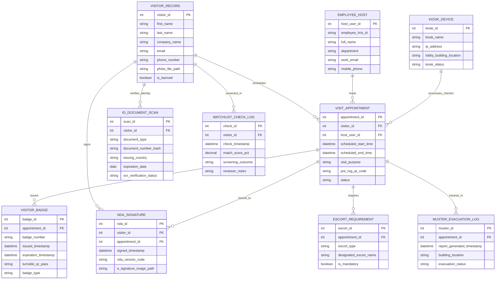

# Conceptual ERD — Visitor Management & Badge System

## Mermaid Code

## Entity Description Table | Bảng mô tả Entity

| # | Entity Name | Vietnamese Name | Description | Key Attributes | Main Relationships |
|---|-------------|-----------------|-------------|----------------|-------------------|
| 1 | VISITOR_RECORD | Hồ sơ Khách Thăm | Master record storing visitor personal details, company name, photo file paths, and banned status. | visitor_id, first_name, last_name, company_name, is_banned | Primary entity; schedules VISIT_APPOINTMENT, signs NDA_SIGNATURE. |
| 2 | VISIT_APPOINTMENT | Lịch hẹn Thăm | Tracks scheduled guest appointments, visit purposes, pre-registration QR codes, and check-in/out status. | appointment_id, scheduled_start_time, scheduled_end_time, status | Scheduled by VISITOR_RECORD; hosted by EMPLOYEE_HOST; issues VISITOR_BADGE. |
| 3 | EMPLOYEE_HOST | Nhân viên Đón tiếp (Host) | Stores employee host profiles, department codes, emails, and mobile phones for notification dispatch. | host_user_id, employee_hris_id, full_name, mobile_phone | Hosts multiple VISIT_APPOINTMENT records. |
| 4 | VISITOR_BADGE | Thẻ Khách Tạm thời | Manages issued thermal photo badges, badge numbers, turnstile QR passes, and expiration timestamps. | badge_id, badge_number, issued_timestamp, turnstile_qr_pass | Issued for VISIT_APPOINTMENT. |
| 5 | ID_DOCUMENT_SCAN | Quét Giấy tờ Tùy thân (OCR) | Archives legal ID document types (Driver License/Passport), hashed document numbers, and OCR verification status. | scan_id, document_type, document_number_hash, ocr_verification_status | Verifies identity for VISITOR_RECORD. |
| 6 | NDA_SIGNATURE | Chữ ký Thỏa thuận Bảo mật (NDA) | Stores e-signed Non-Disclosure Agreements, timestamps, legal version codes, and signature image paths. | nda_id, signed_timestamp, nda_version_code, e_signature_image_path | Signed by VISITOR_RECORD; bound to VISIT_APPOINTMENT. |
| 7 | WATCHLIST_CHECK_LOG | Nhật ký Tầm soát Danh sách Đen | Logs security screening checks, match percentage scores, screening outcomes (Clear/Hit), and reviewer notes. | check_id, check_timestamp, match_score_pct, screening_outcome | Screened for VISITOR_RECORD. |
| 8 | KIOSK_DEVICE | Thiết bị Kiosk Tự phục vụ | Stores self-service lobby kiosk IP addresses, device names, building locations, and hardware status. | kiosk_id, kiosk_name, ip_address, lobby_building_location, kiosk_status | Processes check-in for VISIT_APPOINTMENT. |
| 9 | ESCORT_REQUIREMENT | Yêu cầu Nhân viên Đi kèm | Tracks mandatory visitor escort rules, escort types (Full Escort / Unescorted Lobby Only), and assigned escort names. | escort_id, escort_type, designated_escort_name, is_mandatory | Required by VISIT_APPOINTMENT. |
| 10 | MUSTER_EVACUATION_LOG | Danh sách Tập trung Khan cấp | Stores real-time emergency evacuation rosters of active on-site guests for safety roll calls. | muster_id, report_generated_timestamp, building_location, evacuation_status | Tracked for active VISIT_APPOINTMENT. |

## Relationship Description | Mô tả Quan hệ

| # | From Entity | Cardinality | To Entity | Relationship Label | Business Explanation |
|---|-------------|-------------|-----------|-------------------|----------------------|
| 1 | VISITOR_RECORD | one-to-many | VISIT_APPOINTMENT | schedules | A visitor record can schedule multiple visit appointments over time. |
| 2 | EMPLOYEE_HOST | one-to-many | VISIT_APPOINTMENT | hosts | An employee host can sponsor and receive multiple visit appointments. |
| 3 | VISIT_APPOINTMENT | one-to-many | VISITOR_BADGE | issues | A visit appointment issues temporary visitor photo badges. |
| 4 | VISITOR_RECORD | one-to-many | ID_DOCUMENT_SCAN | verifies_identity | A visitor record undergoes legal ID document scanning. |
| 5 | VISITOR_RECORD | one-to-many | NDA_SIGNATURE | signs | A visitor signs digital non-disclosure agreements. |
| 6 | VISIT_APPOINTMENT | one-to-many | NDA_SIGNATURE | bound_to | A visit appointment is bound to signed legal NDA records. |
| 7 | VISITOR_RECORD | one-to-many | WATCHLIST_CHECK_LOG | screened_in | A visitor is screened against security denied party watchlists. |
| 8 | VISIT_APPOINTMENT | one-to-many | ESCORT_REQUIREMENT | requires | A visit appointment may require designated security escorts. |
| 9 | KIOSK_DEVICE | one-to-many | VISIT_APPOINTMENT | processes_checkin | A self-service lobby kiosk processes visitor check-ins. |
