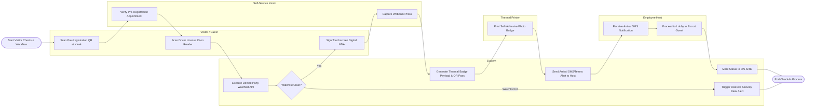

# Swimlane Diagram — Visitor Management & Badge System

## Mermaid Code

## Flow Description | Mô tả luồng

| Lane | Actor | Role in Flow |
|------|-------|-------------|
| 1 | Visitor / Guest | Scans pre-arrival QR code at kiosk, presents driver license ID for OCR scanning, and signs digital legal NDA. |
| 2 | Self-Service Kiosk | Verifies pre-registration records, guides user touch interactions, and captures webcam visitor photos. |
| 3 | System | Executes denied party watchlist screening, generates turnstile QR passes, dispatches host SMS/Teams notifications, and updates active guest rosters. |
| 4 | Thermal Printer | Receives badge payloads and prints self-adhesive thermal visitor photo badges. |
| 5 | Employee Host | Receives real-time SMS/Teams guest arrival alerts and proceeds to lobby workspace to escort visitor. |
