# Action Tree — Visitor Management & Badge System

## Mermaid Code

```mermaid
graph TD
    Root["Visitor Management & Badge System"]

    Root --> M1["Pre-Registration & Appointments"]
    Root --> M2["Check-In & Kiosk Operations"]
    Root --> M3["Security Screening & NDA"]
    Root --> M4["Badge Printing & Access Pass"]
    Root --> M5["On-Site Monitoring & Evacuation"]

    M1 --> A1["Pre-Register Guest Visit"]
    M1 --> A2["Send Pre-Arrival QR Email Invitation"]
    M1 --> A3["Bulk Upload Conference Attendees"]
    M1 --> A4["Configure Escort Requirements"]

    M2 --> B1["Scan Pre-Registration QR Code"]
    M2 --> B2["Scan ID Document via OCR Reader"]
    M2 --> B3["Capture Kiosk Webcam Photo"]
    M2 --> B4["Process Visitor Check-Out"]

    M3 --> C1["Screen Against Denied Party Watchlist"]
    M3 --> C2["Capture Digital NDA Signature"]
    M3 --> C3["Flag Banned Visitor Alert"]
    M3 --> C4["Log Security Desk Overrides"]

    M4 --> D1["Print Thermal Photo Visitor Badge"]
    M4 --> D2["Provision Turnstile QR Access Pass"]
    M4 --> D3["Send Host SMS & Teams Arrival Alert"]
    M4 --> D4["Manage VIP Guest Protocol"]

    M5 --> E1["Monitor Active On-Site Visitors"]
    M5 --> E2["Track Overstaying Guest Alerts"]
    M5 --> E3["Export Emergency Evacuation Muster List"]
    M5 --> E4["Audit Historical Visitor Logs"]
```

## Module Description | Mô tả Module

| # | Module | Description | Actions |
|---|--------|-------------|---------|
| 1 | Pre-Registration & Appointments | Employee guest pre-registration, pre-arrival QR email invites, bulk attendee uploads, and escort rules. | Pre-Register Guest Visit, Send Pre-Arrival QR Email Invitation, Bulk Upload Conference Attendees, Configure Escort Requirements |
| 2 | Check-In & Kiosk Operations | Self-service lobby kiosk check-in, optical ID document OCR scanning, webcam photo capture, and visitor check-out. | Scan Pre-Registration QR Code, Scan ID Document via OCR Reader, Capture Kiosk Webcam Photo, Process Visitor Check-Out |
| 3 | Security Screening & NDA | Denied party watchlist screening, digital touchscreen NDA e-signing, banned visitor alerts, and security overrides. | Screen Against Denied Party Watchlist, Capture Digital NDA Signature, Flag Banned Visitor Alert, Log Security Desk Overrides |
| 4 | Badge Printing & Access Pass | Thermal photo badge printing, turnstile QR access pass generation, host SMS/Teams arrival alerts, and VIP guest handling. | Print Thermal Photo Visitor Badge, Provision Turnstile QR Access Pass, Send Host SMS & Teams Arrival Alert, Manage VIP Guest Protocol |
| 5 | On-Site Monitoring & Evacuation | Live active visitor dashboards, overstaying guest alerts, emergency evacuation muster lists, and historical audit reporting. | Monitor Active On-Site Visitors, Track Overstaying Guest Alerts, Export Emergency Evacuation Muster List, Audit Historical Visitor Logs |
