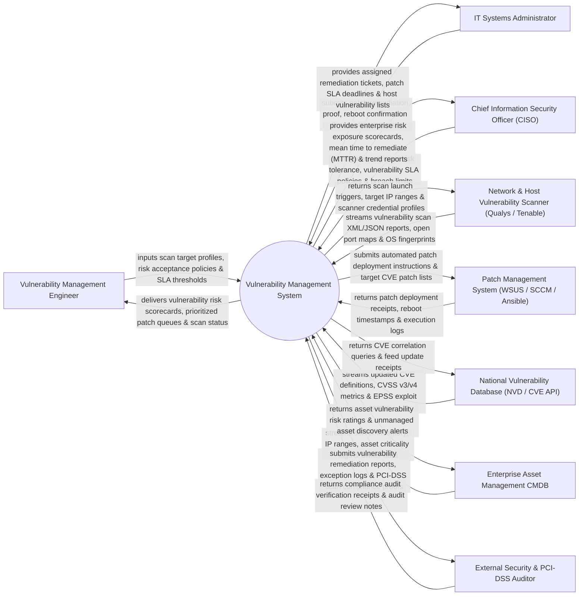

# Context Diagram — Vulnerability Management System

## Mermaid Code

## Actor & Interaction Table | Bảng Actor & Tương tác

| # | Actor | Actor Type | Data Sent TO System | Data Received FROM System | Notes |
|---|-------|------------|---------------------|---------------------------|-------|
| 1 | Vulnerability Management Engineer | Primary | Scan target profiles, risk acceptance policies, SLA thresholds, exception reviews. | Vulnerability risk scorecards, prioritized patch queues, scan status dashboards. | Security engineer configuring vulnerability scanners and prioritizing flaw remediations. |
| 2 | IT Systems Administrator | Primary | Patch remediation proof, reboot confirmation, risk exception requests. | Assigned remediation tickets, patch SLA deadlines, host vulnerability lists. | IT sysadmin responsible for applying OS/application patches and server reboots. |
| 3 | Chief Information Security Officer (CISO) | Primary | Corporate risk tolerance limits, SLA policies, executive reporting parameters. | Enterprise risk exposure scorecards, Mean Time to Remediate (MTTR), vulnerability trends. | Senior executive overseeing enterprise cyber risk exposure and vulnerability SLAs. |
| 4 | Network & Host Vulnerability Scanner | Supporting | Vulnerability scan XML/JSON reports, open port maps, OS fingerprints, software versions. | Scan launch triggers, target IP ranges, scanner credential profiles, schedule jobs. | Automated scanning appliances (Qualys, Tenable Nessus, Rapid7) auditing asset flaws. |
| 5 | Patch Management System | Supporting | Patch deployment receipts, reboot timestamps, execution logs, software inventory. | Automated patch deployment instructions, target CVE patch lists, host target lists. | Enterprise patch system (WSUS, SCCM, Ansible) executing software update installations. |
| 6 | National Vulnerability Database (NVD / CVE API) | Supporting | Updated CVE definitions, CVSS v3/v4 risk vectors, EPSS exploit likelihood scores. | CVE correlation queries, feed update receipts, synchronization timestamps. | Federal NIST NVD repository supplying standardized CVE vulnerability data. |
| 7 | Enterprise Asset Management CMDB | Supporting | Server inventory, IP ranges, asset criticality tags (Tier 1 Core vs Tier 3 Lab), owner emails. | Asset vulnerability risk ratings, unmanaged asset discovery alerts, asset health scores. | IT Service Management CMDB providing asset inventory and business criticality context. |
| 8 | External Security & PCI-DSS Auditor | Supporting / Regulatory | Compliance audit verification receipts, audit review notes, inspection mandates. | Vulnerability remediation reports, exception logs, PCI-DSS scan compliance proofs. | External auditor verifying mandatory vulnerability scanning compliance (PCI-DSS 11.2). |

## System Boundary Description | Mô tả Phạm vi Hệ thống

The **Vulnerability Management System** is an enterprise vulnerability ingestion, CVSS risk scoring, asset criticality correlation, patch ticket assignment, and SLA remediation tracking platform.

**Inside System Scope:**
- Ingestion and normalization of vulnerability scan reports from Qualys, Tenable, and Rapid7.
- Correlation of CVE IDs with NVD feeds, CVSS v3/v4 base scores, and Exploit Prediction Scoring System (EPSS).
- Asset criticality weighting combining CMDB asset tiers with vulnerability severity.
- Automated creation and tracking of IT patch remediation tickets (Jira / ServiceNow integration).
- Risk exception management and PCI-DSS compliance scanning verification.

**Outside System Scope:**
- Direct physical application of thermal paste or replacement of burnt CPU chips (handled by Hardware Technicians).
- Direct writing of vendor software source code patches (handled by Software Vendors like Microsoft/RedHat).
- General employee IT helpdesk password resets (handled by IT Service Desk).
