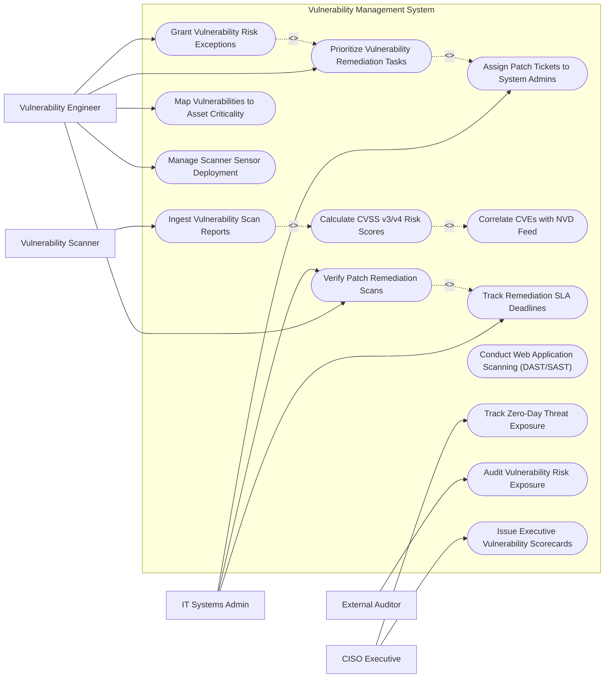

# Use Case Diagram — Vulnerability Management System

## Mermaid Code

## Actor Table | Bảng Actor

| # | Actor | Actor Type | Role Description | Related Use Cases |
|---|-------|------------|------------------|-------------------|
| 1 | Vulnerability Engineer | Primary | Manages scanner configurations, prioritizes vulnerabilities, approves risk exceptions, and verifies patch scans. | UC03, UC07, UC08, UC09, UC14 |
| 2 | IT Systems Admin | Primary | Receives assigned patch remediation tickets, applies software updates, and monitors SLA deadlines. | UC04, UC06, UC07 |
| 3 | CISO Executive | Primary | Reviews enterprise vulnerability scorecards, monitors zero-day exposure, and tracks MTTR KPIs. | UC11, UC13 |
| 4 | External Auditor | Secondary | Audits vulnerability management processes, exception logs, and PCI-DSS quarterly scan compliance. | UC12 |
| 5 | Vulnerability Scanner | Supporting / System | Network scanning appliance streaming automated vulnerability finding reports into the system. | UC01 |

## Use Case Table | Bảng Use Case

| # | UC ID | Use Case Name | Primary Actor | Secondary Actor | Description | Priority |
|---|-------|---------------|---------------|-----------------|-------------|----------|
| 1 | UC01 | Ingest Vulnerability Scan Reports | Vulnerability Scanner | VM Engineer | Ingests XML/JSON scan findings from Qualys, Tenable, or Rapid7 scanners and normalizes findings. | High |
| 2 | UC02 | Calculate CVSS v3/v4 Risk Scores | VM Engineer | None | Computes normalized risk ratings incorporating CVSS base metrics, temporal scores, and EPSS likelihood. | High |
| 3 | UC03 | Prioritize Vulnerability Remediation Tasks | VM Engineer | SysAdmin | Ranks vulnerability findings based on risk score, asset business criticality, and active exploit availability. | High |
| 4 | UC04 | Assign Patch Tickets to System Admins | SysAdmin | VM Engineer | Automatically creates and routes patch tickets (Jira/ServiceNow) to responsible system owners. | High |
| 5 | UC05 | Correlate CVEs with NVD Feed | VM Engineer | None | Synchronizes with NIST NVD API to link detected software flaws with official CVE numbers and vendor advisories. | High |
| 6 | UC06 | Track Remediation SLA Deadlines | SysAdmin | VM Engineer | Monitors countdown timers for patch SLAs (e.g., Critical = 7 days, High = 30 days) and triggers escalation alerts. | High |
| 7 | UC07 | Verify Patch Remediation Scans | VM Engineer | SysAdmin | Triggers target rescans following patch deployment to confirm vulnerability is fixed before closing tickets. | High |
| 8 | UC08 | Grant Vulnerability Risk Exceptions | VM Engineer | CISO Executive | Processes formal risk acceptance requests for unpatchable legacy systems with compensating controls. | Medium |
| 9 | UC09 | Map Vulnerabilities to Asset Criticality | VM Engineer | None | Weights vulnerability severity against CMDB asset tiers (e.g., Tier 1 Core Database vs Tier 3 Test Host). | High |
| 10 | UC10 | Conduct Web Application Scanning (DAST/SAST) | VM Engineer | Scanner | Audits web application code and live endpoints for OWASP Top 10 vulnerabilities (SQLi, XSS, CSRF). | Medium |
| 11 | UC11 | Track Zero-Day Threat Exposure | CISO Executive | VM Engineer | Instantly queries asset database for newly disclosed zero-day CVEs to determine enterprise exposure. | High |
| 12 | UC12 | Audit Vulnerability Risk Exposure | External Auditor | VM Engineer | Generates searchable audit trails of vulnerability discoveries, patch histories, and risk acceptance waivers. | Medium |
| 13 | UC13 | Issue Executive Vulnerability Scorecards | CISO Executive | None | Renders high-level dashboards displaying Mean Time to Remediate (MTTR), open flaw counts, and risk trends. | Medium |
| 14 | UC14 | Manage Scanner Sensor Deployment | VM Engineer | Scanner | Monitors vulnerability scanner sensor health, IP target ranges, authentication credentials, and schedules. | Low |

## Use Case Specification | Đặc tả Use Case

---

### UC01 — Ingest Vulnerability Scan Reports

| Field | Detail |
|-------|--------|
| **UC ID** | UC01 |
| **Use Case Name** | Ingest Vulnerability Scan Reports |
| **Actor(s)** | Primary: Vulnerability Scanner   Secondary: Vulnerability Engineer |
| **Description** | Ingests XML/JSON vulnerability scan output files from network scanners (Qualys, Tenable, Rapid7), parsing and normalizing raw findings into master vulnerability records. |
| **Precondition** | 1. Network scan job is completed by scanning appliance.   2. Scanner API connector or report folder watcher is active. |
| **Main Flow** | 1. Vulnerability Scanner posts completed scan report XML payload to Ingestion API.   2. System parses report file, extracting scan metadata (Scan ID, Target IP Range, Scanner Appliance ID, Duration).   3. System iterates through individual host findings, extracting Host IP, MAC Address, Detected OS, Port/Protocol, Plugin ID, and CVE references.   4. System correlates findings with existing Asset CMDB records to match target Host ID.   5. System creates or updates master Vulnerability Finding records in database.   6. System passes findings to UC02 Calculate CVSS v3/v4 Risk Scores. |
| **Alternative Flow** | **AF1** — Agent-Based Scan Ingestion: System ingests local vulnerability findings directly from lightweight host endpoint agents. |
| **Exception Flow** | **EX1** — Malformed Scan XML: System detects XML parsing error, logs report ingestion failure, and alerts Vulnerability Engineer. |
| **Postcondition** | Scan findings are parsed, normalized, and linked to host asset records. |
| **Business Rule** | **BR1**: Scan report ingestion and normalization must complete within 5 minutes of scan job completion. |

---

### UC02 — Calculate CVSS v3/v4 Risk Scores

| Field | Detail |
|-------|--------|
| **UC ID** | UC02 |
| **Use Case Name** | Calculate CVSS v3/v4 Risk Scores |
| **Actor(s)** | Primary: Vulnerability Engineer   Secondary: None |
| **Description** | Calculates normalized composite risk scores by combining CVSS base metrics, EPSS exploit likelihood probabilities, and CMDB asset criticality tiers. |
| **Precondition** | 1. Vulnerability finding is normalized and linked to CVE reference.   2. NVD CVE metrics and EPSS scores are loaded. |
| **Main Flow** | 1. System retrieves CVE metrics for finding (CVSS v3.1 Base Score, Attack Vector, Privileges Required, User Interaction).   2. System fetches Exploit Prediction Scoring System (EPSS) score (e.g., 85% probability of active exploitation in 30 days).   3. System checks target host CMDB Asset Criticality Weight (Tier 1 Core = 2.0x, Tier 2 Business = 1.0x, Tier 3 Non-Prod = 0.5x).   4. System calculates Composite Risk Score: `Risk Score = (CVSS Base Score * Asset Weight) + (EPSS Score * 2.0)`.   5. System assigns normalized Risk Level: **CRITICAL** (Score >= 9.0), **HIGH** (7.0 - 8.9), **MEDIUM** (4.0 - 6.9), **LOW** (< 4.0).   6. System updates finding record and assigns default remediation SLA deadline based on Risk Level. |
| **Alternative Flow** | **AF1** — Active CISA KEV Exploit Override: If CVE is listed on CISA Known Exploited Vulnerabilities (KEV) catalog, system automatically elevates Risk Level to CRITICAL regardless of base score. |
| **Exception Flow** | **EX1** — Unscored Custom Plugin: If scanner plugin lacks assigned CVE, system assigns fallback risk score based on vendor plugin severity rating. |
| **Postcondition** | Composite risk score and SLA remediation deadline are calculated and assigned. |
| **Business Rule** | **BR1**: Vulnerabilities present on the CISA Known Exploited Vulnerabilities (KEV) list must be assigned Critical priority. |

---

### UC03 — Prioritize Vulnerability Remediation Tasks

| Field | Detail |
|-------|--------|
| **UC ID** | UC03 |
| **Use Case Name** | Prioritize Vulnerability Remediation Tasks |
| **Actor(s)** | Primary: Vulnerability Engineer   Secondary: IT Systems Admin |
| **Description** | Groups and ranks open vulnerability findings into prioritized remediation queues to ensure high-risk flaws are addressed first. |
| **Precondition** | 1. Vulnerability findings are scored and assigned risk levels. |
| **Main Flow** | 1. Engineer opens "Remediation Prioritization Workspace".   2. System displays prioritized queue of open vulnerabilities sorted by Composite Risk Score and SLA urgency.   3. Engineer filters queue by Business Unit, Operating System (Windows vs Linux), or CVE Category.   4. System groups identical vulnerabilities affecting multiple hosts into a single Consolidated Remediation Package (e.g., "Patch Log4j across 45 Web Servers").   5. Engineer reviews recommended patch solution details and vendor KB links.   6. Engineer selects "Approve & Generate Patch Tickets" to trigger ticket assignment to IT Admins. |
| **Alternative Flow** | **AF1** — Automated Ticket Routing: System automatically approves and routes Critical Risk remediation packages without manual engineer review. |
| **Exception Flow** | **EX1** — Approved Risk Exception Exists: System suppresses ticket creation for findings covered by an active approved Risk Acceptance Waiver. |
| **Postcondition** | Vulnerabilities are consolidated into prioritized remediation packages ready for ticketing. |
| **Business Rule** | **BR1**: Remediation queue prioritization must consider both vulnerability exploitability and asset business impact. |

---

### UC04 — Assign Patch Tickets to System Admins

| Field | Detail |
|-------|--------|
| **UC ID** | UC04 |
| **Use Case Name** | Assign Patch Tickets to System Admins |
| **Actor(s)** | Primary: IT Systems Admin   Secondary: Vulnerability Engineer |
| **Description** | Integrates with enterprise ticketing systems (Jira / ServiceNow) to automatically create, assign, and track patch remediation work orders. |
| **Precondition** | 1. Remediation package is approved for ticketing.   2. IT Service Management (ITSM) API integration is active. |
| **Main Flow** | 1. System extracts remediation package details (CVE List, Affected Host List, Vendor Patch KB ID, Target SLA Date).   2. System queries CMDB to identify assigned System Administrator owner for target hosts.   3. System issues ITSM API call creating a new Patch Remediation Ticket.   4. ITSM returns ticket reference key (e.g., `PATCH-8841`).   5. System binds ticket key to target vulnerability finding records and sets status to "IN REMEDIATION - TICKET ASSIGNED".   6. System sends email notification with ticket link to assigned IT Systems Admin. |
| **Alternative Flow** | **AF1** — Direct Ansible/Patch Gateway Integration: For automated environments, system pushes patch job directly to Ansible/WSUS for scheduled deployment. |
| **Exception Flow** | **EX1** — Unassigned Host Owner: If CMDB lacks owner email for host, system assigns ticket to Default Infrastructure Lead and flags CMDB data gap. |
| **Postcondition** | Patch remediation ticket is created, assigned to sysadmin owner, and tracked against SLA. |
| **Business Rule** | **BR1**: Critical vulnerability tickets must be assigned with a mandatory 7-day SLA resolution deadline. |

---

### UC08 — Grant Vulnerability Risk Exceptions

| Field | Detail |
|-------|--------|
| **UC ID** | UC08 |
| **Use Case Name** | Grant Vulnerability Risk Exceptions |
| **Actor(s)** | Primary: Vulnerability Engineer   Secondary: CISO Executive |
| **Description** | Evaluates and documents formal Risk Acceptance Waivers for unpatchable vulnerabilities backed by compensating controls. |
| **Precondition** | 1. System Administrator submits a Risk Exception Request detailing why a vulnerability cannot be patched (e.g., legacy app incompatibility). |
| **Main Flow** | 1. Vulnerability Engineer opens pending Risk Exception Request in compliance module.   2. Engineer inspects exception details (CVE ID, Affected Host, Technical Justification, Proposed Expiration Date).   3. Engineer reviews submitted Compensating Controls (e.g., Host isolated behind WAF with strict IPS rules).   4. Engineer evaluates residual risk and inputs recommendation notes.   5. If risk is High/Critical, system routes request to CISO Executive for final sign-off.   6. CISO approves exception grant.   7. System updates finding status to "RISK ACCEPTED - EXCEPTION GRANTED", sets expiration date (max 180 days), and suppresses SLA breach alerts. |
| **Alternative Flow** | **AF1** — Exception Rejection: Engineer or CISO rejects request; system changes status to "EXCEPTION REJECTED" and re-enforces original patch SLA. |
| **Exception Flow** | **EX1** — Expired Risk Exception: Upon reaching expiration date, system automatically revokes exception and re-opens patch ticket. |
| **Postcondition** | Risk acceptance waiver is formally documented, approved, and tracked until expiration. |
| **Business Rule** | **BR1**: Risk acceptance waivers shall not exceed 180 days without mandatory formal CISO re-evaluation. |
