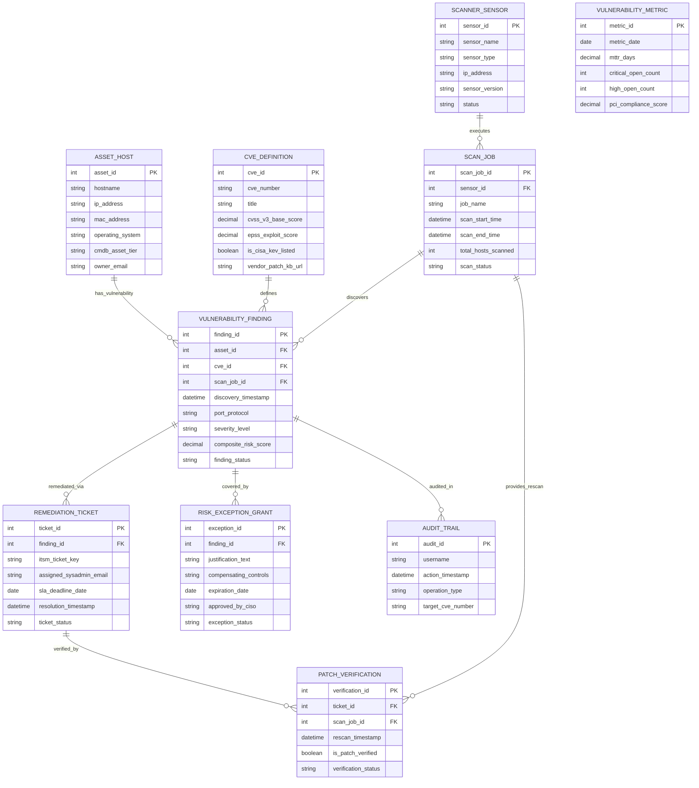

# Conceptual ERD — Vulnerability Management System

## Mermaid Code

## Entity Description Table | Bảng mô tả Entity

| # | Entity Name | Vietnamese Name | Description | Key Attributes | Main Relationships |
|---|-------------|-----------------|-------------|----------------|-------------------|
| 1 | VULNERABILITY_FINDING | Kết quả Phát hiện Lỗ hổng | Master finding table linking host assets to CVE definitions, discovery timestamps, risk scores, and status. | finding_id, discovery_timestamp, severity_level, composite_risk_score, finding_status | Belongs to ASSET_HOST, CVE_DEFINITION, SCAN_JOB; remediated via REMEDIATION_TICKET. |
| 2 | CVE_DEFINITION | Định nghĩa Lỗ hổng (CVE/NVD) | Stores official NVD CVE metadata, CVSS v3 base scores, EPSS exploit likelihood scores, and CISA KEV flags. | cve_id, cve_number, cvss_v3_base_score, epss_exploit_score, is_cisa_kev_listed | Defines VULNERABILITY_FINDING. |
| 3 | ASSET_HOST | Thiết bị / Host Máy chủ | Stores CMDB asset host inventory, IP addresses, OS fingerprints, asset criticality tiers, and owner emails. | asset_id, hostname, ip_address, operating_system, cmdb_asset_tier, owner_email | Has VULNERABILITY_FINDING. |
| 4 | SCAN_JOB | Lượt Quét Lỗ hổng | Tracks vulnerability scanner job executions, target IP ranges, scan durations, host counts, and status. | scan_job_id, job_name, scan_start_time, total_hosts_scanned, scan_status | Executed by SCANNER_SENSOR; discovers VULNERABILITY_FINDING. |
| 5 | REMEDIATION_TICKET | Phiếu Sửa lỗi Patching | Tracks Jira/ServiceNow patch tickets, assigned sysadmin emails, SLA deadlines, and resolution timestamps. | ticket_id, itsm_ticket_key, assigned_sysadmin_email, sla_deadline_date, ticket_status | Belongs to VULNERABILITY_FINDING; verified by PATCH_VERIFICATION. |
| 6 | RISK_EXCEPTION_GRANT | Miễn trừ Chấp nhận Rủi ro | Manages formal risk acceptance waivers, technical justifications, compensating controls, and expiration dates. | exception_id, justification_text, compensating_controls, expiration_date, approved_by_ciso | Covers VULNERABILITY_FINDING. |
| 7 | SCANNER_SENSOR | Cảm biến Scanner Hardware | Stores vulnerability scanner sensor nodes (Qualys/Tenable), IP addresses, sensor types, and status. | sensor_id, sensor_name, sensor_type, ip_address, status | Executes SCAN_JOB. |
| 8 | VULNERABILITY_METRIC | Chỉ số MTTR & Compliance | Aggregates daily vulnerability risk metrics, Mean Time to Remediate (MTTR), open flaw counts, and PCI scores. | metric_id, metric_date, mttr_days, critical_open_count, pci_compliance_score | Measures overall vulnerability risk. |
| 9 | PATCH_VERIFICATION | Xác minh Kết quả Patching | Archives post-patch rescan verification jobs, rescan timestamps, and patch verification outcomes. | verification_id, rescan_timestamp, is_patch_verified, verification_status | Belongs to REMEDIATION_TICKET and SCAN_JOB. |
| 10 | AUDIT_TRAIL | Nhật ký Kiểm toán Lỗ hổng | Captures user actions, risk score recalculations, exception approvals, and compliance export logs. | audit_id, username, action_timestamp, operation_type, target_cve_number | Audits VULNERABILITY_FINDING. |

## Relationship Description | Mô tả Quan hệ

| # | From Entity | Cardinality | To Entity | Relationship Label | Business Explanation |
|---|-------------|-------------|-----------|-------------------|----------------------|
| 1 | ASSET_HOST | one-to-many | VULNERABILITY_FINDING | has_vulnerability | An asset host can have multiple vulnerability findings. |
| 2 | CVE_DEFINITION | one-to-many | VULNERABILITY_FINDING | defines | A CVE definition defines multiple vulnerability finding instances across hosts. |
| 3 | SCAN_JOB | one-to-many | VULNERABILITY_FINDING | discovers | A scan job discovers multiple vulnerability findings. |
| 4 | SCANNER_SENSOR | one-to-many | SCAN_JOB | executes | A scanner sensor executes multiple scheduled scan jobs. |
| 5 | VULNERABILITY_FINDING | one-to-one | REMEDIATION_TICKET | remediated_via | A vulnerability finding is remediated via an ITSM patch ticket. |
| 6 | VULNERABILITY_FINDING | one-to-one | RISK_EXCEPTION_GRANT | covered_by | A vulnerability finding can be covered by a formal risk exception grant. |
| 7 | REMEDIATION_TICKET | one-to-one | PATCH_VERIFICATION | verified_by | A remediation ticket is verified by a post-patch rescan job. |
| 8 | SCAN_JOB | one-to-many | PATCH_VERIFICATION | provides_rescan | A rescan job provides verification data for remediation tickets. |
