# Swimlane Diagram — Vulnerability Management System

## Mermaid Code

```mermaid
flowchart LR
    Start(["Start Vulnerability Management Cycle"])

    subgraph Lane1["Vulnerability Scanner"]
        S1["Execute Scheduled Network Scan"]
        S2["Export Scan Report Payload JSON"]
    end

    subgraph Lane2["System"]
        C1["Ingest Report & Normalize CVEs"]
        C2["Correlate with NVD EPSS & Asset Tier"]
        C3["Calculate Composite Risk Score"]
        C4["CreateITSMPatchTicket & Assign SLA"]
        C5["Trigger Target Rescan Verification"]
        C6{"Rescan Verified Patch?"}
        C7["Close Ticket & Update Risk Status"]
        C8["Re-Open Ticket & Flag Failed Patch"]
    end

    subgraph Lane3["IT Systems Admin"]
        A1["Receive Assigned Patch Ticket"]
        A2["Deploy OS Vendor Patch & Reboot Server"]
        A3["Mark Ticket Ready for Rescan"]
    end

    subgraph Lane4["Vulnerability Engineer"]
        E1["Review Prioritized Remediation Queue"]
        E2["Approve Automated Patch Routing"]
    end

    Finish(["End Remediation Cycle"])

    Start --> S1 --> S2 --> C1 --> C2 --> C3 --> E1 --> E2 --> C4 --> A1 --> A2 --> A3 --> C5 --> C6
    C6 -->|"Verified Fixed"| C7 --> Finish
    C6 -->|"Flaw Persists"| C8 --> A1
```

## Flow Description | Mô tả luồng

| Lane | Actor | Role in Flow |
|------|-------|-------------|
| 1 | Vulnerability Scanner | Executes scheduled network scan jobs across target subnets and exports raw scan report payloads. |
| 2 | System | Ingests scan findings, correlates CVEs with NVD metrics and CMDB asset tiers, calculates composite risk scores, generates ITSM patch tickets, and executes rescan verifications. |
| 3 | IT Systems Admin | Receives assigned patch tickets, deploys OS/software patches on target servers, reboots hosts, and requests verification rescans. |
| 4 | Vulnerability Engineer | Reviews prioritized vulnerability queues, sets risk scoring parameters, and approves patch routing workflows. |
