# Action Tree — Vulnerability Management System

## Mermaid Code

```mermaid
graph TD
    Root["Vulnerability Management System"]

    Root --> M1["Vulnerability Scan Ingestion"]
    Root --> M2["Risk Scoring & Prioritization"]
    Root --> M3["Remediation & Patch Tracking"]
    Root --> M4["Exception Management"]
    Root --> M5["Analytics & Compliance"]

    M1 --> A1["Ingest Qualys / Tenable Scan XML"]
    M1 --> A2["Parse Host Operating Systems & Ports"]
    M1 --> A3["Correlate CVEs with NVD API"]
    M1 --> A4["Monitor Scanner Appliance Health"]

    M2 --> B1["Calculate CVSS v3/v4 Base Score"]
    M2 --> B2["Fetch EPSS Exploit Likelihood"]
    M2 --> B3["Weight CMDB Asset Criticality Tiers"]
    M2 --> B4["Check CISA KEV Exploited List"]

    M3 --> C1["Generate ITSM Jira Patch Tickets"]
    M3 --> C2["Assign Ticket to Host Sysadmin"]
    M3 --> C3["Track 7-Day / 30-Day SLA Countdown"]
    M3 --> C4["Execute Post-Patch Rescan Verification"]

    M4 --> D1["Submit Risk Acceptance Waiver"]
    M4 --> D2["Review Compensating Controls"]
    M4 --> D3["Request CISO Exception Sign-Off"]
    M4 --> D4["Auto-Revoke Expired 180-Day Exception"]

    M5 --> E1["Calculate Mean Time to Remediate (MTTR)"]
    M5 --> E2["Track Zero-Day CVE Asset Exposure"]
    M5 --> E3["Export PCI-DSS 11.2 Compliance Report"]
    M5 --> E4["Generate Executive Risk Scorecard"]
```

## Module Description | Mô tả Module

| # | Module | Description | Actions |
|---|--------|-------------|---------|
| 1 | Vulnerability Scan Ingestion | Multi-vendor scan report ingestion (Qualys/Tenable), OS fingerprint parsing, NVD CVE synchronization, and scanner health monitoring. | Ingest Qualys / Tenable Scan XML, Parse Host Operating Systems & Ports, Correlate CVEs with NVD API, Monitor Scanner Appliance Health |
| 2 | Risk Scoring & Prioritization | CVSS v3/v4 score calculation, EPSS exploit likelihood scoring, CMDB asset tier weighting, and CISA KEV list checks. | Calculate CVSS v3/v4 Base Score, Fetch EPSS Exploit Likelihood, Weight CMDB Asset Criticality Tiers, Check CISA KEV Exploited List |
| 3 | Remediation & Patch Tracking | ITSM patch ticket generation, sysadmin owner routing, SLA deadline tracking, and post-patch rescan verification. | Generate ITSM Jira Patch Tickets, Assign Ticket to Host Sysadmin, Track 7-Day / 30-Day SLA Countdown, Execute Post-Patch Rescan Verification |
| 4 | Exception Management | Risk acceptance waiver submissions, compensating control reviews, CISO approval routing, and auto-revocation of expired waivers. | Submit Risk Acceptance Waiver, Review Compensating Controls, Request CISO Exception Sign-Off, Auto-Revoke Expired 180-Day Exception |
| 5 | Analytics & Compliance | Mean Time to Remediate (MTTR) calculation, zero-day CVE exposure tracking, PCI-DSS compliance reporting, and executive scorecards. | Calculate Mean Time to Remediate (MTTR), Track Zero-Day CVE Asset Exposure, Export PCI-DSS 11.2 Compliance Report, Generate Executive Risk Scorecard |
