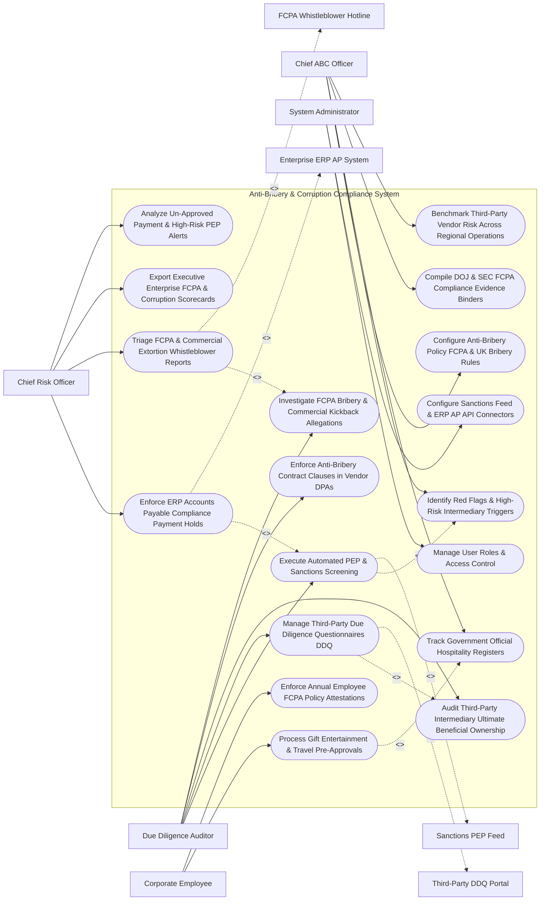

# Use Case Diagram — Anti-Bribery & Corruption Compliance System

## Mermaid Code

## Actor Table | Bảng Actor

| # | Actor | Actor Type | Role Description | Related Use Cases |
|---|-------|------------|------------------|-------------------|
| 1 | Chief ABC Officer | Primary | Executive modeling FCPA/UK Bribery rules, flagging red flags, reviewing government hospitality, and compiling DOJ evidence binders. | UC01, UC03, UC06, UC13, UC14 |
| 2 | Due Diligence Auditor | Primary | Analyst conducting vendor background checks, reviewing DDQs, auditing beneficial ownership (UBO), and investigating kickbacks. | UC02, UC04, UC08, UC09, UC11 |
| 3 | Corporate Employee | Primary | Staff member requesting gift/entertainment pre-approvals and signing annual FCPA policy attestations. | UC05, UC07 |
| 4 | Chief Risk Officer | Primary | Executive monitoring ERP payment holds, triaging whistleblower reports, viewing risk scorecards, and tracking high-risk alerts. | UC10, UC12, UC15, UC18 |
| 5 | System Administrator | Primary | IT admin managing user security roles, Refinitiv World-Check API keys, and SAP ERP AP connectors. | UC16, UC17 |
| 6 | Sanctions PEP Feed | System (Secondary) | Real-time compliance feed (Refinitiv World-Check / LexisNexis) streaming OFAC sanctions, PEP profiles, and adverse media. | UC02 |
| 7 | Enterprise ERP AP System | System (Secondary) | Law firm or enterprise ERP system (SAP/NetSuite) accepting compliance payment holds and vendor screening tokens. | UC10 |
| 8 | Third-Party DDQ Portal | System (Secondary) | Vendor portal collecting Due Diligence Questionnaires (DDQ) and ultimate beneficial ownership (UBO) disclosures. | UC04 |
| 9 | FCPA Whistleblower Hotline | System (Secondary) | Third-party ethics hotline streaming confidential FCPA bribery allegations and extortion reports. | UC12 |

## Use Case Table | Bảng Use Case

| # | UC ID | Use Case Name | Primary Actor | Secondary Actor | Description | Priority |
|---|-------|---------------|---------------|-----------------|-------------|----------|
| 1 | UC01 | Configure Anti-Bribery Policy FCPA & UK Bribery Rules | ABCOfficer | None | Configures corporate ABC compliance matrices enforcing FCPA, UK Bribery Act 2010, and OECD anti-corruption rules. | Critical |
| 2 | UC02 | Execute Automated PEP & Sanctions Screening | Auditor | SanctionsFeed | Automatically screens vendors, sales agents, and government officials against OFAC, EU, UN sanctions, and PEP lists. | Critical |
| 3 | UC03 | Identify Red Flags & High-Risk Intermediary Triggers | ABCOfficer | None | Flags ABC red flags (e.g., offshore bank accounts, excessive success fees, government family ties) for manual review. | Critical |
| 4 | UC04 | Manage Third-Party Due Diligence Questionnaires DDQ | Auditor | IntermediaryPortal | Dispatches automated Due Diligence Questionnaires (DDQ) to sales agents, distributors, and vendors, tracking completion. | Critical |
| 5 | UC05 | Process Gift Entertainment & Travel Pre-Approvals | Employee | None | Enforces mandatory pre-approval workflows for gifts, entertainment, and travel extended to government officials ($> \$50$). | Critical |
| 6 | UC06 | Track Government Official Hospitality Registers | ABCOfficer | None | Maintains centralized government official hospitality registers, tracking cumulative annual gift values per official. | High |
| 7 | UC07 | Enforce Annual Employee FCPA Policy Attestations | Employee | None | Dispatches mandatory annual FCPA policy sign-off attestations and compliance training to all global commercial employees. | High |
| 8 | UC08 | Audit Third-Party Intermediary Ultimate Beneficial Ownership | Auditor | None | Audits corporate ownership structures of sales agents, verifying Ultimate Beneficial Ownership (UBO) down to 10% thresholds. | Critical |
| 9 | UC09 | Enforce Anti-Bribery Contract Clauses in Vendor DPAs | Auditor | None | Ensures all third-party contracts include mandatory ABC representation clauses, audit rights, and termination rights. | High |
| 10 | UC10 | Enforce ERP Accounts Payable Compliance Payment Holds | CRO | ERPAP | Integrates with SAP/NetSuite ERP to place automated payment holds on invoices from un-cleared or red-flagged vendors. | Critical |
| 11 | UC11 | Investigate FCPA Bribery & Commercial Kickback Allegations | Auditor | None | Manages confidential FCPA investigation case files, forensic accounting evidence, witness interviews, and DOJ self-disclosure logs. | Critical |
| 12 | UC12 | Triage FCPA & Commercial Extortion Whistleblower Reports | CRO | FCPAHotline | Ingests confidential ethics hotline tickets, triaging bribery allegations and assigning senior forensic investigators. | Critical |
| 13 | UC13 | Compile DOJ & SEC FCPA Compliance Evidence Binders | ABCOfficer | None | Auto-assembles comprehensive FCPA compliance evidence binders for US Department of Justice (DOJ) and SEC regulatory audits. | High |
| 14 | UC14 | Benchmark Third-Party Vendor Risk Across Regional Operations | ABCOfficer | None | Measures vendor risk distribution %, DDQ completion velocity, and high-risk vendor concentration across global operating units. | High |
| 15 | UC15 | Export Executive Enterprise FCPA & Corruption Scorecards | CRO | None | Renders executive scorecards detailing residual bribery risk scores, vendor DDQ clearance %, active FCPA investigations, and spend. | High |
| 16 | UC16 | Manage User Roles & Access Control | Admin | None | Controls user login credentials, RBAC permissions, and confidential FCPA investigation access clearances. | High |
| 17 | UC17 | Configure Sanctions Feed & ERP AP API Connectors | Admin | None | Configures API connectors for Refinitiv World-Check, SAP S/4HANA Accounts Payable, OneTrust, and NAVEX Ethics. | High |
| 18 | UC18 | Analyze Un-Approved Payment & High-Risk PEP Alerts | CRO | None | Dispatches urgent warning alerts when an un-approved payment to a red-flagged vendor is attempted in ERP. | High |

## Use Case Specification | Đặc tả Use Case

---

### UC02 — Execute Automated PEP & Sanctions Screening

| Field | Detail |
|-------|--------|
| **UC ID** | UC02 |
| **Use Case Name** | Execute Automated PEP & Sanctions Screening |
| **Actor(s)** | Primary: Due Diligence Auditor, Chief Anti-Bribery Officer   Secondary: Global Sanctions & PEP Monitoring Feed (Refinitiv World-Check / LexisNexis API) |
| **Description** | Automatically screens third-party vendors, sales agents, and government officials against OFAC, EU, UN, UK HMT sanctions lists, Politically Exposed Persons (PEP) profiles, and adverse media databases. |
| **Precondition** | 1. Vendor or sales agent profile is submitted for due diligence onboarding (UC04).   2. Refinitiv World-Check / LexisNexis REST API connector is online. |
| **Main Flow** | 1. System initiates automated background screening for New Vendor `#VEN-88412` (`Global Apex Logistics FZE - Dubai`).   2. System extracts Vendor Entity Metadata:   &nbsp;&nbsp;&nbsp;&nbsp; a. Company Legal Name: `Global Apex Logistics FZE`.   &nbsp;&nbsp;&nbsp;&nbsp; b. Key Officers / Directors: `Tareq Al-Mansoor (Managing Director)`.   &nbsp;&nbsp;&nbsp;&nbsp; c. Operating Jurisdiction: `United Arab Emirates (UAE)`.   3. System dispatches HTTPS REST API payload to Refinitiv World-Check Screening Engine.   4. World-Check Engine executes Fuzzy Matching & Phonetic Algorithm across:   &nbsp;&nbsp;&nbsp;&nbsp; a. Global Sanctions Lists (OFAC SDN, EU Consolidated, UN Security Council).   &nbsp;&nbsp;&nbsp;&nbsp; b. PEP Database (Foreign Government Officials, Ministers, State-Owned Enterprise Executives).   &nbsp;&nbsp;&nbsp;&nbsp; c. Adverse Media Database (Bribery, Money Laundering, Fraud news hits).   5. World-Check Engine returns Screening Results:   &nbsp;&nbsp;&nbsp;&nbsp; a. Hit 1 (PEP Match): `Tareq Al-Mansoor` matches PEP Profile (Brother of UAE Ministry of Commerce Undersecretary) -> `PEP_HIT_CONFIRMED`.   &nbsp;&nbsp;&nbsp;&nbsp; b. Hit 2 (Sanctions Match): `Global Apex Logistics FZE` -> `CLEARED (0 Sanctions Matches)`.   6. System evaluates Composite Risk Tier: PEP Connection to Foreign Government Official -> `HIGH_RISK_VENDOR_TIER`.   7. System places Vendor `#VEN-88412` on `COMPLIANCE_HOLD` in ERP (UC10) and triggers UC03 (Identify Red Flags), routing to Chief ABC Officer for mandatory approval. |
| **Alternative Flow** | **AF1** — Zero Hit Clearance: Screening returns 0 Sanctions/PEP hits; System marks vendor as `SCREENING_CLEARED` and auto-approves for low-risk contracting. |
| **Exception Flow** | **EX1** — False Positive Resolution: Auditor reviews PEP hit, verifying birthdate and passport # differ from target official; Auditor logs "False Positive Resolution", unlocking vendor profile. |
| **Postcondition** | Vendor and key officers are screened against global sanctions and PEP databases, PEP hits are identified, risk tier is assigned, and compliance hold enforces. |
| **Business Rule** | **BR1**: Third-party vendors and sales agents MUST pass automated PEP and sanctions screening prior to contract execution or ERP payment setup. |

---

### UC05 — Process Gift, Entertainment & Travel Pre-Approvals

| Field | Detail |
|-------|--------|
| **UC ID** | UC05 |
| **Use Case Name** | Process Gift, Entertainment & Travel Pre-Approvals |
| **Actor(s)** | Primary: Corporate Employee, Chief Anti-Bribery Officer   Secondary: Gift, Entertainment & Travel Approval Registry |
| **Description** | Enforces mandatory pre-approval workflows for gifts, meals, entertainment, and travel extended to foreign government officials, evaluating monetary threshold limits ($> \$50$) and cumulative annual gift totals. |
| **Precondition** | 1. Corporate Anti-Bribery & Corruption Policy (monetary limits, government official rules) is published (UC01).   2. Employee intends to provide hospitality to a government official. |
| **Main Flow** | 1. Employee John Doe opens "Gift & Travel Pre-Approval Portal".   2. Employee inputs Hospitality Request Details:   &nbsp;&nbsp;&nbsp;&nbsp; a. Recipient Name: `Dr. Aris Thorne (Director of State Ministry of Health)`.   &nbsp;&nbsp;&nbsp;&nbsp; b. Recipient Category: `Foreign Government Official`.   &nbsp;&nbsp;&nbsp;&nbsp; c. Hospitality Type: `Business Dinner & Travel Transport`.   &nbsp;&nbsp;&nbsp;&nbsp; d. Estimated Value: `$180.00 per person`.   &nbsp;&nbsp;&nbsp;&nbsp; e. Business Purpose: `"Discussion of clinical trial data standards for medical device approval"`.   3. System checks Policy Threshold Rules:   &nbsp;&nbsp;&nbsp;&nbsp; a. Rule 1 (Government Official Threshold): Value $180.00 > Policy Limit $50.00 -> `PRE_APPROVAL_REQUIRED`.   &nbsp;&nbsp;&nbsp;&nbsp; b. Rule 2 (Cash Prohibition): Form specifies Non-Cash Dinner -> `COMPLIANT`.   &nbsp;&nbsp;&nbsp;&nbsp; c. Rule 3 (Cumulative Annual Limit): Cumulative gifts to Dr. Aris Thorne YTD = $320.00 + $180.00 = `$500.00 Annual Total` (Annual Cap $500.00 reached).   4. System routes request `#GIFT-2026-884` to Chief ABC Officer for executive review.   5. Chief ABC Officer reviews business purpose, attaches approval condition: *"Approved for dinner only ($120 cap). Airfare/travel transport must be removed."*   6. Chief ABC Officer signs pre-approval certificate; System dispatches Pre-Approval Receipt to Employee John Doe.   7. System updates Government Official Hospitality Register (UC06), logging approved $120.00 entry. |
| **Alternative Flow** | **AF1** — Automated Low-Value Commercial Approval: Gift recipient is a commercial customer (non-government official) and value is $30.00 ($< \$100 limit); System auto-approves request instantaneously. |
| **Exception Flow** | **EX1** — Prohibited Gift Rejection: Request specifies cash gift or luxury watch ($1,500 value); System rejects request (`PROHIBITED_GIFT_REJECTED`), dispatching FCPA policy warning to employee. |
| **Postcondition** | Gift request is evaluated against policy limits and cumulative annual caps, executive pre-approval is obtained, and hospitality register updates. |
| **Business Rule** | **BR1**: Any gift, entertainment, or travel provided to a foreign government official exceeding $50.00 MUST obtain written pre-approval from the Compliance Officer. |

---

### UC08 — Audit Third-Party Intermediary Ultimate Beneficial Ownership

| Field | Detail |
|-------|--------|
| **UC ID** | UC08 |
| **Use Case Name** | Audit Third-Party Intermediary Ultimate Beneficial Ownership |
| **Actor(s)** | Primary: Vendor Due Diligence Auditor, Chief Anti-Bribery Officer   Secondary: Third-Party Intermediary Due Diligence Portal |
| **Description** | Audits the corporate ownership structures of sales agents, consultants, and distributors, identifying Ultimate Beneficial Owners (UBO) down to 10% thresholds to detect hidden government official ownership. |
| **Precondition** | 1. Third-party intermediary submits completed Due Diligence Questionnaire (DDQ) (UC04).   2. Corporate entity registry and UBO lookup databases are connected. |
| **Main Flow** | 1. Auditor opens "UBO Due Diligence Audit Console" for Sales Agent: `Middle East Sales Consultants FZ-LLC`.   2. System retrieves UBO Declaration Form submitted via Intermediary Portal:   &nbsp;&nbsp;&nbsp;&nbsp; a. Direct Shareholder 1: `Apex Holding Group (60% Equity)`.   &nbsp;&nbsp;&nbsp;&nbsp; b. Direct Shareholder 2: `Zayd Real Estate (40% Equity)`.   3. Auditor drills down into Tier-2 Shell Companies to uncover Ultimate Natural Persons:   &nbsp;&nbsp;&nbsp;&nbsp; a. Apex Holding Group -> Owned 100% by `Hassan Al-Zayd (Private Businessman)`.   &nbsp;&nbsp;&nbsp;&nbsp; b. Zayd Real Estate -> Owned 50% by `Tariq Al-Zayd` and 50% by `Minister Omar Al-Zayd (Active Minister of Energy)`.   4. System calculates Effective Ultimate Beneficial Ownership (UBO):   &nbsp;&nbsp;&nbsp;&nbsp; a. Minister Omar Al-Zayd holds $40\% \times 50\% = 20\%$ Effective Indirect Equity in Sales Agent `Middle East Sales Consultants FZ-LLC`.   5. System triggers Critical Red Flag Alert: `GOVERNMENT_OFFICIAL_UBO_DETECTED (20% Equity held by Minister of Energy)`.   6. System flags FCPA Risk: High risk of illegal kickbacks/bribery disguised as sales commissions.   7. Auditor submits UBO Audit Finding to Chief ABC Officer, recommending contract rejection.   8. Chief ABC Officer rejects vendor onboarding and places permanent vendor block in ERP (UC10). |
| **Alternative Flow** | **AF1** — Fully Disclosed Low-Risk UBO: UBO audit confirms 100% ownership by audited private individuals with zero government ties; Auditor approves UBO clearance. |
| **Exception Flow** | **EX1** — Opaque Shell Company Refusal: Vendor refuses to disclose natural person owners behind offshore Cayman Islands entity; System flags `OPAQUE_OWNERSHIP_BLOCKED`, terminating vendor onboarding. |
| **Postcondition** | Corporate ownership structure is audited down to natural person UBOs, hidden government official equity is uncovered, and compliance decisions enforce. |
| **Business Rule** | **BR1**: Third-party sales intermediaries MUST disclose Ultimate Beneficial Ownership (UBO) down to a 10% equity threshold prior to contract approval. |

---

### UC10 — Enforce ERP Accounts Payable Compliance Payment Holds

| Field | Detail |
|-------|--------|
| **UC ID** | UC10 |
| **Use Case Name** | Enforce ERP Accounts Payable Compliance Payment Holds |
| **Actor(s)** | Primary: Chief Risk Officer, Due Diligence Auditor   Secondary: Enterprise Resource Planning (ERP) Accounts Payable System (SAP / NetSuite API) |
| **Description** | Integrates with SAP/NetSuite Accounts Payable modules to enforce automated compliance payment holds, blocking invoice disbursements to un-cleared, red-flagged, or expired vendor accounts. |
| **Precondition** | 1. SAP S/4HANA or NetSuite ERP Accounts Payable API integration is active.   2. Vendor compliance status (`CLEARED`, `HOLD`, `BLOCKED`) is maintained in system. |
| **Main Flow** | 1. Vendor `Global Apex Logistics FZE` submits Invoice `#INV-2026-9941` ($85,000.00) to Accounts Payable in SAP.   2. SAP Accounts Payable engine dispatches Pre-Payment Compliance Verification API query to Anti-Bribery Compliance System (`GET /v1/vendors/verify-payment?vendor_id=VEN-88412`).   3. System checks Vendor Compliance Status for `#VEN-88412`:   &nbsp;&nbsp;&nbsp;&nbsp; a. Screening Status: `PEP_HIT_UNRESOLVED` (UC02).   &nbsp;&nbsp;&nbsp;&nbsp; b. DDQ Status: `DDQ_EXPIRED` (Last updated 18 months ago).   &nbsp;&nbsp;&nbsp;&nbsp; c. Anti-Bribery Contract Status: `NO_SIGNED_ABC_CLAUSE`.   4. System returns Compliance Hold Response to SAP API:   &nbsp;&nbsp;&nbsp;&nbsp; a. Status: `PAYMENT_BLOCKED`.   &nbsp;&nbsp;&nbsp;&nbsp; b. Reason: `FCPA Compliance Hold - Unresolved PEP Hit & Expired DDQ`.   5. SAP AP engine automatically applies Block Code `COMPLIANCE_HOLD` on Invoice `#INV-2026-9941`:   &nbsp;&nbsp;&nbsp;&nbsp; a. Prevents automated check printing or wire transfer execution.   6. System dispatches Compliance Payment Block Notification to AP Manager and Due Diligence Auditor.   7. Auditor resolves PEP hit (UC02) and collects updated DDQ; System dispatches API Release Command (`PAYMENT_CLEARED`), unlocking invoice in SAP. |
| **Alternative Flow** | **AF1** — Automated Payment Approval: Vendor is 100% cleared with active DDQ; System returns `PAYMENT_APPROVED` within 50 milliseconds, allowing SAP to execute wire transfer. |
| **Exception Flow** | **EX1** — Manual Override Block Attempt: AP user attempts to manually bypass compliance hold code in SAP; SAP API rejects manual override (`OVERRIDE_PROHIBITED`), maintaining payment block until Compliance sign-off. |
| **Postcondition** | AP invoice payment request is verified, compliance hold is enforced in ERP for un-cleared vendors, and unauthorized wire transfers are blocked. |
| **Business Rule** | **BR1**: Accounts Payable systems MUST enforce automated compliance payment holds, preventing invoice disbursements to un-cleared or red-flagged vendors. |

---

### UC12 — Triage FCPA & Commercial Extortion Whistleblower Reports

| Field | Detail |
|-------|--------|
| **UC ID** | UC12 |
| **Use Case Name** | Triage FCPA & Commercial Extortion Whistleblower Reports |
| **Actor(s)** | Primary: Chief Risk Officer, Chief Anti-Bribery Officer   Secondary: Whistleblower Hotline & FCPA Incident Gateway (NAVEX EthicsPoint API) |
| **Description** | Ingests confidential whistleblower reports alleging foreign bribery (FCPA), UK Bribery Act violations, commercial kickbacks, or government extortion, triaging severity and assigning forensic investigators. |
| **Precondition** | 1. Third-party whistleblower ethics hotline API (NAVEX EthicsPoint / OneTrust Ethics) is connected. |
| **Main Flow** | 1. System receives encrypted whistleblower report webhook from Ethics Hotline Gateway:   &nbsp;&nbsp;&nbsp;&nbsp; a. Ticket ID: `#FCPA-2026-88412`.   &nbsp;&nbsp;&nbsp;&nbsp; b. Submission Channel: `Confidential Ethics Hotline Phone Line`.   &nbsp;&nbsp;&nbsp;&nbsp; c. Location: `LATAM Regional Subsidiary (Brazil)`.   &nbsp;&nbsp;&nbsp;&nbsp; d. Allegation Category: `FCPA Foreign Bribery & Off-the-Books Offsets`.   &nbsp;&nbsp;&nbsp;&nbsp; e. Allegation Summary: `"Regional sales VP approved $250,000 fake consulting invoice to pay off local tax inspector to erase $2M tax audit fine."`   2. System enforces Strict Confidentiality & Anonymity Encryption:   &nbsp;&nbsp;&nbsp;&nbsp; a. Restricts ticket visibility exclusively to Chief Risk Officer, Chief ABC Officer, and Audit Committee Chair.   3. Chief Risk Officer opens "FCPA Incident Triage Desk".   4. Chief Risk Officer assesses Incident Legal Exposure & Severity:   &nbsp;&nbsp;&nbsp;&nbsp; a. Allegation Type: FCPA Foreign Bribery + Tax Official Involvement -> `CRITICAL_SEVERITY_LEVEL_1`.   &nbsp;&nbsp;&nbsp;&nbsp; b. Potential Legal Consequence: Severe DOJ / SEC Criminal & Civil Penalties.   5. CRO assigns Case to Senior Forensic Accounting Investigator `Investigator David Miller`.   6. System dispatches confidential investigation task to David Miller, initializing UC11 (Investigate FCPA Allegations).   7. System updates Audit Committee Reporting Deck: `Active FCPA Level 1 Investigation Logged`. |
| **Alternative Flow** | **AF1** — Commercial Extortion Demand Protocol: Report alleges government official demanded bribe under threat of physical harm (Extortion Exception); System flags `DURESS_EXTORTION_PROTOCOL`, tasking immediate security response and legal counsel reporting. |
| **Exception Flow** | **EX1** — C-Suite Executive Involvement Escalation: Report names CEO or CFO as approving bribery payment; System automatically bypasses internal management, routing ticket directly to Audit Committee Chair. |
| **Postcondition** | FCPA whistleblower report is ingested with strict encryption, severity is classified, senior forensic investigator is assigned, and Audit Committee is notified. |
| **Business Rule** | **BR1**: Whistleblower reports alleging foreign bribery or government official kickbacks MUST be classified as Level 1 Critical Severity and assigned forensic accounting investigators. |
