# Conceptual ERD — Anti-Bribery & Corruption Compliance System

## Mermaid Code

```mermaid
erDiagram
    USER_ACCOUNT {
        int user_id PK
        string full_name
        string username
        string user_role
        string department_code
        boolean is_active
    }

    ANTI_BRIBERY_POLICY_MATRIX {
        int policy_id PK
        string framework_name
        decimal government_gift_monetary_cap_usd
        decimal non_government_gift_cap_usd
        boolean prohibits_cash_gifts
        boolean is_active
    }

    THIRD_PARTY_VENDOR_PROFILE {
        int vendor_id PK
        int primary_auditor_user_id FK
        string vendor_company_name
        string operating_jurisdiction_country
        string risk_tier_category
        string compliance_clearance_status
        datetime created_at
    }

    PEP_SANCTIONS_SCREENING_LOG {
        int screening_id PK
        int vendor_id FK
        boolean is_sanctions_match_found
        boolean is_pep_match_found
        int confidence_match_score_percent
        string match_details_json
        datetime screened_at
    }

    DUE_DILIGENCE_QUESTIONNAIRE_DDQ {
        int ddq_id PK
        int vendor_id FK
        string ddq_form_s3_uri
        boolean contains_red_flags
        string ddq_review_status
        datetime completed_at
    }

    ULTIMATE_BENEFICIAL_OWNER_UBO {
        int ubo_id PK
        int vendor_id FK
        string beneficial_owner_name
        decimal equity_ownership_percent
        boolean is_government_official
        string official_title_position
    }

    GIFT_ENTERTAINMENT_APPROVAL_REQ {
        int gift_id PK
        int employee_user_id FK
        int approver_user_id FK
        string recipient_name
        boolean is_government_official
        decimal estimated_value_usd
        string business_purpose_justification
        string approval_status
        datetime requested_at
    }

    GOVERNMENT_OFFICIAL_HOSPITALITY_LOG {
        int log_id PK
        int gift_id FK
        string official_name
        string government_agency_name
        decimal cumulative_annual_value_usd
        datetime logged_at
    }

    ERP_AP_COMPLIANCE_PAYMENT_HOLD {
        int hold_id PK
        int vendor_id FK
        string erp_invoice_number
        decimal invoice_amount_usd
        string payment_block_reason
        boolean is_hold_active
        datetime applied_at
    }

    FCPA_WHISTLEBLOWER_INCIDENT {
        int incident_id PK
        int investigator_user_id FK
        string encrypted_ticket_uuid
        string allegation_category_type
        string incident_severity_level
        string investigation_status
        datetime reported_at
    }

    DOJ_SEC_COMPLIANCE_EVIDENCE_BINDER {
        int binder_id PK
        int compiled_by_user_id FK
        string binder_title
        string pdfa_binder_document_s3_uri
        datetime certified_at
    }

    EXECUTIVE_FCPA_SCORECARD {
        int scorecard_id PK
        decimal vendor_ddq_clearance_percent
        int high_risk_pep_vendors_count
        int active_fcpa_investigations_count
        decimal annual_gift_spend_government_usd
        date period_quarter
    }

    ANTI_BRIBERY_POLICY_MATRIX ||--o{ THIRD_PARTY_VENDOR_PROFILE : "governs"
    THIRD_PARTY_VENDOR_PROFILE ||--o{ PEP_SANCTIONS_SCREENING_LOG : "screened in"
    THIRD_PARTY_VENDOR_PROFILE ||--o| DUE_DILIGENCE_QUESTIONNAIRE_DDQ : "submitted via"
    THIRD_PARTY_VENDOR_PROFILE ||--o{ ULTIMATE_BENEFICIAL_OWNER_UBO : "owned by"
    THIRD_PARTY_VENDOR_PROFILE ||--o{ ERP_AP_COMPLIANCE_PAYMENT_HOLD : "blocked in"
    GIFT_ENTERTAINMENT_APPROVAL_REQ ||--o| GOVERNMENT_OFFICIAL_HOSPITALITY_LOG : "recorded in"
    USER_ACCOUNT ||--o{ THIRD_PARTY_VENDOR_PROFILE : "audits"
    USER_ACCOUNT ||--o{ GIFT_ENTERTAINMENT_APPROVAL_REQ : "requests"
    USER_ACCOUNT ||--o{ GIFT_ENTERTAINMENT_APPROVAL_REQ : "approves"
    USER_ACCOUNT ||--o{ FCPA_WHISTLEBLOWER_INCIDENT : "investigates"
    USER_ACCOUNT ||--o{ DOJ_SEC_COMPLIANCE_EVIDENCE_BINDER : "compiles"
```

## Entity Description Table | Bảng mô tả Entity

| # | Entity Name | Vietnamese Name | Description | Key Attributes | Main Relationships |
|---|-------------|-----------------|-------------|----------------|-------------------|
| 1 | USER_ACCOUNT | Tài khoản Nguời dùng | System credentials and access roles for chief ABC officers, due diligence auditors, employees, and admins. | `user_id`, `username`, `user_role`, `department_code` | Audits `THIRD_PARTY_VENDOR_PROFILE`, requests `GIFT_ENTERTAINMENT_APPROVAL_REQ`, approves `GIFT_ENTERTAINMENT_APPROVAL_REQ`, investigates `FCPA_WHISTLEBLOWER_INCIDENT`, compiles `DOJ_SEC_COMPLIANCE_EVIDENCE_BINDER`. |
| 2 | ANTI_BRIBERY_POLICY_MATRIX | Ma trận Chính sách Chống Tham nhung | Anti-bribery compliance policy matrix entity storing FCPA monetary gift caps ($50 USD), cash prohibitions, and active flags. | `policy_id`, `framework_name`, `government_gift_monetary_cap_usd`, `non_government_gift_cap_usd`, `prohibits_cash_gifts`, `is_active` | Governs `THIRD_PARTY_VENDOR_PROFILE`. |
| 3 | THIRD_PARTY_VENDOR_PROFILE | Profile Vendor Bên thứ ba | Third-party vendor profile entity tracking company names, operating jurisdictions, risk tiers (High/Med/Low), and compliance clearance status. | `vendor_id`, `primary_auditor_user_id`, `vendor_company_name`, `operating_jurisdiction_country`, `risk_tier_category`, `compliance_clearance_status` | Governed by `ANTI_BRIBERY_POLICY_MATRIX`, screened in `PEP_SANCTIONS_SCREENING_LOG`, submitted via `DUE_DILIGENCE_QUESTIONNAIRE_DDQ`, owned by `ULTIMATE_BENEFICIAL_OWNER_UBO`, blocked in `ERP_AP_COMPLIANCE_PAYMENT_HOLD`, audited by `USER_ACCOUNT`. |
| 4 | PEP_SANCTIONS_SCREENING_LOG | Nhật ký Screening PEP & Sanctions | Automated sanctions and PEP screening log recording match flags, confidence scores %, match details JSON, and screening timestamps. | `screening_id`, `vendor_id`, `is_sanctions_match_found`, `is_pep_match_found`, `confidence_match_score_percent`, `match_details_json` | Belongs to `THIRD_PARTY_VENDOR_PROFILE`. |
| 5 | DUE_DILIGENCE_QUESTIONNAIRE_DDQ | Form Due Diligence Questionnaire | Vendor Due Diligence Questionnaire (DDQ) record tracking DDQ form S3 URIs, red flag flags, review status, and completion timestamps. | `ddq_id`, `vendor_id`, `ddq_form_s3_uri`, `contains_red_flags`, `ddq_review_status`, `completed_at` | Belongs to `THIRD_PARTY_VENDOR_PROFILE`. |
| 6 | ULTIMATE_BENEFICIAL_OWNER_UBO | Chủ sở hữu Hưởng lợi Cuối cùng UBO | Ultimate Beneficial Ownership (UBO) record tracking owner names, equity %, government official flags, and official positions. | `ubo_id`, `vendor_id`, `beneficial_owner_name`, `equity_ownership_percent`, `is_government_official`, `official_title_position` | Belongs to `THIRD_PARTY_VENDOR_PROFILE`. |
| 7 | GIFT_ENTERTAINMENT_APPROVAL_REQ | Yêu cầu Pre-Approval Quà tặng | Gift, entertainment, and travel pre-approval request record tracking recipient names, government official flags, values USD, justifications, and approval status. | `gift_id`, `employee_user_id`, `approver_user_id`, `recipient_name`, `is_government_official`, `estimated_value_usd`, `approval_status` | Recorded in `GOVERNMENT_OFFICIAL_HOSPITALITY_LOG`, requested by `USER_ACCOUNT`, approved by `USER_ACCOUNT`. |
| 8 | GOVERNMENT_OFFICIAL_HOSPITALITY_LOG | Sổ Hospitality Quan chức Chính phủ | Central government official hospitality log recording official names, agency names, and cumulative annual gift values USD per official. | `log_id`, `gift_id`, `official_name`, `government_agency_name`, `cumulative_annual_value_usd`, `logged_at` | Belongs to `GIFT_ENTERTAINMENT_APPROVAL_REQ`. |
| 9 | ERP_AP_COMPLIANCE_PAYMENT_HOLD | Lock Hold Payment AP ERP | Accounts Payable compliance payment hold record tracking invoice numbers, amounts USD, payment block reasons, and active hold flags. | `hold_id`, `vendor_id`, `erp_invoice_number`, `invoice_amount_usd`, `payment_block_reason`, `is_hold_active` | Belongs to `THIRD_PARTY_VENDOR_PROFILE`. |
| 10 | FCPA_WHISTLEBLOWER_INCIDENT | Incident Whistleblower FCPA | Confidential FCPA whistleblower incident log recording encrypted ticket UUIDs, allegation types, severity levels, and investigation status. | `incident_id`, `investigator_user_id`, `encrypted_ticket_uuid`, `allegation_category_type`, `incident_severity_level`, `investigation_status` | Investigated by `USER_ACCOUNT`. |
| 11 | DOJ_SEC_COMPLIANCE_EVIDENCE_BINDER | Binder Bằng chứng DOJ & SEC | Statutory FCPA audit evidence binder record tracking PDF/A document S3 URIs, compiled by user ID, and digital certification timestamps. | `binder_id`, `compiled_by_user_id`, `binder_title`, `pdfa_binder_document_s3_uri`, `certified_at` | Compiled by `USER_ACCOUNT`. |
| 12 | EXECUTIVE_FCPA_SCORECARD | Scorecard Executive FCPA | Executive FCPA compliance scorecard aggregating vendor DDQ clearance %, high-risk PEP vendor counts, active FCPA investigations, and annual government gift spend. | `scorecard_id`, `vendor_ddq_clearance_percent`, `high_risk_pep_vendors_count`, `active_fcpa_investigations_count`, `annual_gift_spend_government_usd` | Standalone executive performance entity. |

## Relationship Description | Mô tả Quan hệ

| # | From Entity | Cardinality | To Entity | Label | Business Explanation |
|---|-------------|-------------|-----------|-------|----------------------|
| 1 | ANTI_BRIBERY_POLICY_MATRIX | 1 to 0..N | THIRD_PARTY_VENDOR_PROFILE | governs | An anti-bribery policy matrix governs third-party vendor profiles. |
| 2 | THIRD_PARTY_VENDOR_PROFILE | 1 to 0..N | PEP_SANCTIONS_SCREENING_LOG | screened in | A vendor profile is screened in PEP and sanctions screening logs. |
| 3 | THIRD_PARTY_VENDOR_PROFILE | 1 to 0..1 | DUE_DILIGENCE_QUESTIONNAIRE_DDQ | submitted via | A vendor profile is submitted via a Due Diligence Questionnaire (DDQ). |
| 4 | THIRD_PARTY_VENDOR_PROFILE | 1 to 1..N | ULTIMATE_BENEFICIAL_OWNER_UBO | owned by | A vendor profile is owned by Ultimate Beneficial Owners (UBO). |
| 5 | THIRD_PARTY_VENDOR_PROFILE | 1 to 0..N | ERP_AP_COMPLIANCE_PAYMENT_HOLD | blocked in | A vendor profile is blocked in ERP Accounts Payable compliance payment holds. |
| 6 | GIFT_ENTERTAINMENT_APPROVAL_REQ | 1 to 0..1 | GOVERNMENT_OFFICIAL_HOSPITALITY_LOG | recorded in | A gift pre-approval request is recorded in the government official hospitality log. |
| 7 | USER_ACCOUNT | 1 to 0..N | THIRD_PARTY_VENDOR_PROFILE | audits | A due diligence auditor user account audits vendor profiles. |
| 8 | USER_ACCOUNT | 1 to 0..N | GIFT_ENTERTAINMENT_APPROVAL_REQ | requests | A corporate employee user account requests gift pre-approvals. |
| 9 | USER_ACCOUNT | 1 to 0..N | GIFT_ENTERTAINMENT_APPROVAL_REQ | approves | A compliance officer user account approves gift requests. |
| 10 | USER_ACCOUNT | 1 to 0..N | FCPA_WHISTLEBLOWER_INCIDENT | investigates | A forensic accounting investigator user account investigates FCPA incidents. |
| 11 | USER_ACCOUNT | 1 to 0..N | DOJ_SEC_COMPLIANCE_EVIDENCE_BINDER | compiles | A compliance officer user account compiles DOJ/SEC evidence binders. |
