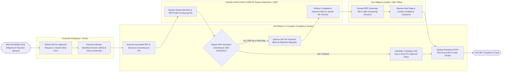

# Swimlane Diagram — Anti-Bribery & Corruption Compliance System

## Mermaid Code

## Flow Description | Mô tả luồng

| Lane | Actor | Role in Flow |
|------|-------|-------------|
| 1 | Corporate Employee / Vendor | Submits gift/hospitality pre-approval requests, completes Due Diligence Questionnaires (DDQ), and discloses Ultimate Beneficial Ownership (UBO) equity. |
| 2 | Due Diligence Auditor / ABC Officer | Reviews automated PEP/Sanctions screening hit reports, audits multi-tiered UBO corporate ownership structures, resolves red flags, and certifies compliance clearance. |
| 3 | Anti-Bribery & Corruption Compliance System | Runs automated fuzzy screening against global sanctions and PEP databases via API, evaluates monetary gift policy caps ($> \$50$), enforces automated SAP Accounts Payable payment holds, tracks 72-hour whistleblower incident timers, and computes executive FCPA scorecards. |
| 4 | Refinitiv World-Check & ERP AP System (Sanctions / SAP) | Streams real-time OFAC, EU, UN sanctions and PEP profile hits, and enforces automated SAP AP payment block codes (`COMPLIANCE_HOLD`) on un-cleared vendor invoices. |
