# Action Tree — Anti-Bribery & Corruption Compliance System

## Mermaid Code

```mermaid
graph TD
    Root["Anti-Bribery & Corruption Compliance System"]

    Root --> M1["PEP & Sanctions Automated Screening"]
    Root --> M2["Third-Party Intermediary & UBO Due Diligence"]
    Root --> M3["Gift, Entertainment & Hospitality Pre-Approvals"]
    Root --> M4["ERP Accounts Payable Compliance Payment Holds"]
    Root --> M5["FCPA Whistleblower Hotline & Investigations"]
    Root --> M6["DOJ/SEC Audit Binders & FCPA Risk Scorecards"]

    M1 --> A11["Execute Automated Screening against OFAC, EU, UN & UK Sanctions Lists"]
    M1 --> A12["Screen Vendor Officers & Sales Intermediaries against Global PEP Databases"]
    M1 --> A13["Execute Fuzzy Matching & Phonetic Algorithms on Transliterated Names"]
    M1 --> A14["Resolve False Positive Screening Hits & Log Compliance Verification Records"]

    M2 --> A21["Dispatch Automated Due Diligence Questionnaires (DDQ) to Sales Intermediaries"]
    M2 --> A22["Audit Ultimate Beneficial Ownership (UBO) Equity down to 10% Thresholds"]
    M2 --> A23["Flag Hidden Government Official Equity & Intermediary Red Flags"]
    M2 --> A24["Enforce Mandatory Anti-Bribery Representation Clauses in Vendor Contracts"]

    M3 --> A31["Enforce Mandatory Pre-Approval Workflows for Gifts & Travel (> $50 USD)"]
    M3 --> A32["Verify Policy Compliance (Prohibit Cash Gifts & Luxury Items)"]
    M3 --> A33["Track Cumulative Annual Gift & Hospitality Totals per Government Official"]
    M3 --> A34["Dispatches Automatic Policy Reminders for Annual Employee FCPA Attestations"]

    M4 --> A41["Integrate with SAP & NetSuite ERP Accounts Payable Modules via API"]
    M4 --> A42["Apply Automated Compliance Payment Block Codes (COMPLIANCE_HOLD) in ERP"]
    M4 --> A43["Prevent Manual Override of AP Payment Holds without Compliance Sign-Off"]
    M4 --> A44["Release Compliance Payment Block Codes upon Vendor Clearance Verification"]

    M5 --> A51["Ingest Encrypted Whistleblower Hotline Reports (NAVEX EthicsPoint API)"]
    M5 --> A52["Enforce Strict Anonymity & Restrict Access to Authorized FCPA Investigators"]
    M5 --> A53["Triage FCPA Bribery, Off-the-Books Offsets & Tax Official Extortion Reports"]
    M5 --> A54["Maintain Confidential Forensic Accounting Investigation Evidence Vaults"]

    M6 --> A61["Compile PDF/A FCPA Compliance Evidence Binders for DOJ & SEC Audits"]
    M6 --> A62["Benchmark Third-Party Vendor Risk Distribution & DDQ Clearance Rates"]
    M6 --> A63["Map Enterprise Residual Corruption Risk & High-Risk Jurisdiction Heatmaps"]
    M6 --> A64["Export Executive Enterprise FCPA, UK Bribery Act & Compliance Scorecards"]
```

## Module Description | Mô tả Module

| # | Module | Description | Actions |
|---|--------|-------------|---------|
| 1 | PEP & Sanctions Automated Screening | Runs automated screening against OFAC/EU/UN sanctions and PEP databases via Refinitiv World-Check, executes fuzzy matching, and resolves false positives. | Execute Automated Sanctions Screening, Screen Vendor Officers against PEP Databases, Execute Fuzzy Matching & Phonetic Search, Resolve False Positive Screening Hits. |
| 2 | Third-Party Intermediary & UBO Due Diligence | Dispatches DDQs to sales agents, audits UBO equity down to 10%, flags hidden government official ownership, and enforces contract ABC clauses. | Dispatch Due Diligence Questionnaires (DDQ), Audit Ultimate Beneficial Ownership (UBO), Flag Hidden Government Equity & Red Flags, Enforce Anti-Bribery Contract Clauses. |
| 3 | Gift, Entertainment & Hospitality Pre-Approvals | Manages pre-approval for gifts/travel ($> \$50$), enforces cash prohibitions, tracks cumulative annual totals per government official, and dispatches attestations. | Enforce Pre-Approval Workflows for Gifts & Travel, Verify Policy Compliance (Prohibit Cash), Track Cumulative Annual Gift Totals per Official, Dispatch Annual Employee FCPA Attestations. |
| 4 | ERP Accounts Payable Compliance Payment Holds | Integrates with SAP/NetSuite ERP AP modules, applies automated payment block codes (`COMPLIANCE_HOLD`), prevents manual overrides, and releases cleared payments. | Integrate with SAP/NetSuite ERP AP Modules, Apply Automated Compliance Payment Block Codes, Prevent Manual Override of AP Payment Holds, Release Payment Block Codes upon Vendor Clearance. |
| 5 | FCPA Whistleblower Hotline & Investigations | Ingests encrypted whistleblower reports via NAVEX EthicsPoint API, enforces strict confidentiality, triages FCPA bribery allegations, and maintains evidence vaults. | Ingest Encrypted Whistleblower Hotline Reports, Enforce Anonymity & Restrict Access, Triage FCPA Bribery & Extortion Allegations, Maintain Confidential Forensic Evidence Vaults. |
| 6 | DOJ/SEC Audit Binders & FCPA Risk Scorecards | Compiles PDF/A evidence binders for DOJ/SEC audits, benchmarks vendor risk across divisions, maps risk heatmaps, and exports scorecards. | Compile PDF/A FCPA Evidence Binders for DOJ/SEC, Benchmark Third-Party Vendor Risk Distribution, Map Enterprise Residual Corruption Risk Heatmaps, Export Executive Enterprise FCPA Scorecards. |
