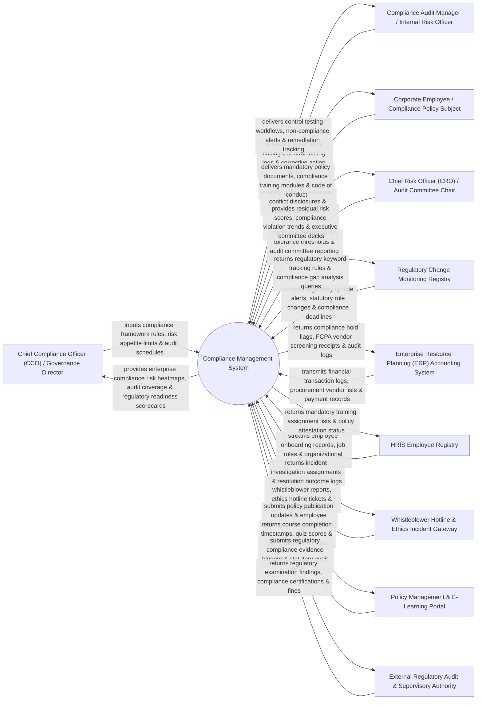

# Context Diagram — Compliance Management System

## Mermaid Code

## Actor & Interaction Table | Bảng Actor & Tương tác

| # | Actor | Actor Type | Data Sent TO System | Data Received FROM System | Notes |
|---|-------|------------|---------------------|---------------------------|-------|
| 1 | Chief Compliance Officer (CCO) / Governance Director | Primary | Compliance framework definitions (ISO 37001, SOC 2, HIPAA, SOX), risk appetite limits, audit schedules, policy governance rules. | Enterprise compliance risk heatmaps, regulatory readiness scorecards, audit coverage metrics, policy sign-off summaries. | CCO defining corporate compliance frameworks, monitoring regulatory risk, and leading compliance audits. |
| 2 | Compliance Audit Manager / Internal Risk Officer | Primary | Internal audit findings, control effectiveness testing logs, non-compliance issue logs, corrective action remediation plans. | Control testing workflows, non-compliance alert digests, remediation tracking dashboards, audit evidence binders. | Compliance auditor testing internal controls, logging compliance gaps, and tracking remediation plans. |
| 3 | Corporate Employee / Compliance Policy Subject | Primary | Policy sign-off attestations, conflict-of-interest disclosures, gift/hospitality declarations, training completions. | Mandatory corporate policy documents, Code of Conduct, compliance e-learning modules, conflict disclosure forms. | Corporate employee reviewing policy changes, completing mandatory compliance training, and signing attestations. |
| 4 | Chief Risk Officer (CRO) / Audit Committee Chair | Primary | Enterprise risk tolerance thresholds, audit committee reporting formats, risk escalation triggers. | Residual compliance risk scores, compliance violation trend reports, executive committee reporting decks, risk matrices. | Executive reviewing enterprise risk management (ERM), regulatory exposure, and audit committee reports. |
| 5 | Regulatory Change Monitoring Registry | Supporting | Regulatory rule changes (Thomson Reuters Regulatory Intelligence / LexisNexis), statutory update alerts, compliance deadlines. | Regulatory keyword tracking rules, compliance impact gap queries, statutory monitoring parameters. | External registry streaming real-time statutory regulatory updates and legal compliance changes. |
| 6 | Enterprise Resource Planning (ERP) Accounting System | Supporting | Financial transaction ledgers, vendor master registries, accounts payable payment records. | Compliance hold flags, FCPA/anti-bribery vendor screening receipts, transaction audit logs. | Enterprise ERP supplying financial records for compliance auditing and applying compliance payment holds. |
| 7 | HRIS Employee Registry | Supporting | Employee onboarding records (Workday / SuccessFactors), job roles, department codes, reporting lines. | Mandatory training assignment lists, policy attestation completion status, compliance violation flags. | HRIS supplying organizational employee hierarchies to route policy sign-offs and training modules. |
| 8 | Whistleblower Hotline & Ethics Incident Gateway | Supporting | Anonymous whistleblower reports, ethics hotline tickets, fraud allegation feeds, incident timestamps. | Incident investigation assignment tasks, case status updates, resolution outcome logs. | Secure third-party ethics hotline streaming anonymous fraud, harassment, and compliance reports. |
| 9 | Policy Management & E-Learning Portal | Supporting | E-learning course completion receipts, quiz scores, policy digital sign-off tokens, training feedback. | Policy publication updates, employee course assignment payloads, mandatory training SCORM packages. | Learning Management System (LMS) hosting compliance training courses and collecting sign-offs. |
| 10 | External Regulatory Audit & Supervisory Authority | Supporting / Regulatory | Regulatory examination notices, compliance audit findings, statutory directives, administrative penalties. | Regulatory compliance evidence binders, statutory audit reports, compliance certification files. | Government regulatory bodies (SEC, FINRA, OSHA, EPA) conducting compliance examinations. |

## System Boundary Description | Mô tả Phạm vi Hệ thống

The **Compliance Management System** is an enterprise regulatory compliance framework, policy governance, internal control testing, employee policy attestation, whistleblower incident management, and regulatory change tracking platform designed to minimize corporate legal and financial liability.

**Inside System Scope:**
- Multi-framework compliance modeling supporting SOX, ISO 27001, ISO 37001, GDPR, HIPAA, and OSHA.
- Policy governance and automated employee attestation workflow tracking policy sign-offs across global business units.
- Internal control testing and gap remediation management tracking control effectiveness and corrective action plans.
- Integration with Regulatory Change feeds (Thomson Reuters) mapping statutory updates to internal policies.
- Whistleblower incident triage and investigation management securing confidential ethics hotline reports.

**Outside System Scope:**
- Direct physical inspection of factory floor machinery safety (handled by On-Site Safety Inspectors).
- Direct hosting of external government regulatory servers (handled by Government Regulatory Agencies).
- Direct physical security guarding of corporate office buildings (handled by Corporate Physical Security).
