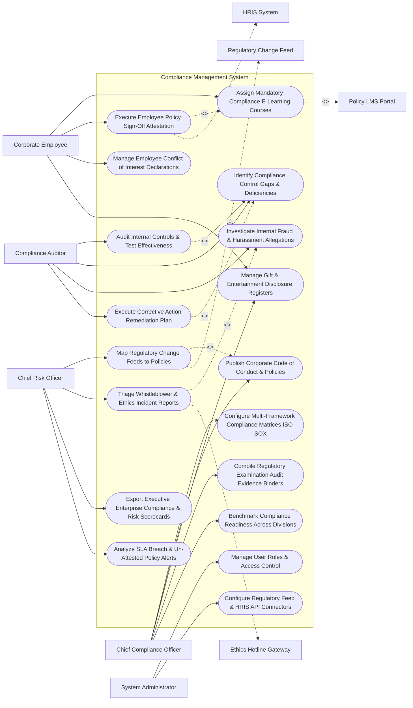

# Use Case Diagram — Compliance Management System

## Mermaid Code

## Actor Table | Bảng Actor

| # | Actor | Actor Type | Role Description | Related Use Cases |
|---|-------|------------|------------------|-------------------|
| 1 | Chief Compliance Officer | Primary | Executive modeling compliance frameworks, publishing policies, managing gift registers, and compiling evidence binders. | UC01, UC03, UC07, UC13, UC14 |
| 2 | Compliance Auditor | Primary | Internal auditor testing control effectiveness, identifying compliance gaps, investigating incidents, and managing remediation. | UC08, UC09, UC11, UC12 |
| 3 | Corporate Employee | Primary | Staff member completing compliance e-learning, signing policy attestations, and declaring conflicts/gifts. | UC04, UC05, UC06, UC07 |
| 4 | Chief Risk Officer | Primary | Executive monitoring regulatory change mapping, triaging whistleblower reports, viewing risk scorecards, and tracking alerts. | UC02, UC10, UC15, UC18 |
| 5 | System Administrator | Primary | IT admin managing user security roles, regulatory feed API connectors, and HRIS integrations. | UC16, UC17 |
| 6 | Regulatory Change Feed | System (Secondary) | Statutory regulatory intelligence service (Thomson Reuters/LexisNexis) streaming real-time legal updates. | UC02 |
| 7 | Ethics Hotline Gateway | System (Secondary) | Third-party whistleblower hotline streaming confidential ethics incident reports and fraud tickets. | UC10 |
| 8 | HRIS System | System (Secondary) | Enterprise HRIS supplying employee organizational hierarchies and onboarding feeds. | UC05 |
| 9 | Policy LMS Portal | System (Secondary) | E-learning platform delivering compliance SCORM courses and capturing quiz completion tokens. | UC04 |

## Use Case Table | Bảng Use Case

| # | UC ID | Use Case Name | Primary Actor | Secondary Actor | Description | Priority |
|---|-------|---------------|---------------|-----------------|-------------|----------|
| 1 | UC01 | Configure Multi-Framework Compliance Matrices ISO SOX | CCO | None | Maps regulatory frameworks (SOX 404, ISO 27001, ISO 37001, GDPR) into a unified enterprise compliance matrix. | Critical |
| 2 | UC02 | Map Regulatory Change Feeds to Policies | CRO | RegFeed | Ingests real-time statutory regulatory updates and auto-maps rule changes to internal corporate policies. | Critical |
| 3 | UC03 | Publish Corporate Code of Conduct & Policies | CCO | None | Authoritatively publishes updated corporate policies, Code of Conduct, and operational compliance procedures. | Critical |
| 4 | UC04 | Assign Mandatory Compliance E-Learning Courses | Employee | LMS | Assigns mandatory compliance training modules (Anti-Bribery, Cybersecurity, Harassment) to employees. | High |
| 5 | UC05 | Execute Employee Policy Sign-Off Attestation | Employee | HRIS | Collects legally binding digital signatures and annual policy sign-off attestations from all global employees. | Critical |
| 6 | UC06 | Manage Employee Conflict of Interest Declarations | Employee | None | Captures annual employee conflict-of-interest disclosures (outside board seats, family business ties), routing for review. | High |
| 7 | UC07 | Manage Gift & Entertainment Disclosure Registers | Employee | None | Logs employee gift, hospitality, and entertainment declarations ($> \$100$), enforcing pre-approval thresholds. | High |
| 8 | UC08 | Audit Internal Controls & Test Effectiveness | Auditor | None | Schedules and executes internal control effectiveness testing across financial, operational, and IT controls. | Critical |
| 9 | UC09 | Identify Compliance Control Gaps & Deficiencies | Auditor | None | Logs internal control testing failures, classifying deficiency severity (Material Weakness, Significant Deficiency). | Critical |
| 10 | UC10 | Triage Whistleblower & Ethics Incident Reports | CRO | Hotline | Ingests anonymous whistleblower hotline tickets, classifying urgency, potential legal exposure, and assigning investigators. | Critical |
| 11 | UC11 | Investigate Internal Fraud & Harassment Allegations | Auditor | None | Manages confidential ethics investigation cases, evidence logs, witness interviews, and investigative findings. | High |
| 12 | UC12 | Execute Corrective Action Remediation Plan | Auditor | None | Assigns corrective action remediation tasks (CAPA) to process owners, tracking completion deadlines. | Critical |
| 13 | UC13 | Compile Regulatory Examination Audit Evidence Binders | CCO | None | Auto-assembles comprehensive evidence binders, policy histories, and control test logs for external regulatory audits. | High |
| 14 | UC14 | Benchmark Compliance Readiness Across Divisions | CCO | None | Measures policy attestation %, training completion %, and open control gap counts across regional business units. | High |
| 15 | UC15 | Export Executive Enterprise Compliance & Risk Scorecards | CRO | None | Renders executive scorecards detailing residual compliance risk scores, audit coverage %, open investigation counts, and ROMI. | High |
| 16 | UC16 | Manage User Roles & Access Control | Admin | None | Controls user login credentials, RBAC permissions, and confidential ethics investigation access rights. | High |
| 17 | UC17 | Configure Regulatory Feed & HRIS API Connectors | Admin | None | Configures API connection parameters for Thomson Reuters, Workday, SuccessFactors, and Zendesk Ethics. | High |
| 18 | UC18 | Analyze SLA Breach & Un-Attested Policy Alerts | CRO | None | Dispatches urgent notifications when employee policy attestation drops below 95% or a CAPA task is overdue. | High |

## Use Case Specification | Đặc tả Use Case

---

### UC02 — Map Regulatory Change Feeds to Policies

| Field | Detail |
|-------|--------|
| **UC ID** | UC02 |
| **Use Case Name** | Map Regulatory Change Feeds to Policies |
| **Actor(s)** | Primary: Chief Risk Officer, Chief Compliance Officer   Secondary: Regulatory Change Monitoring Registry (Thomson Reuters / LexisNexis) |
| **Description** | Ingests real-time statutory regulatory change alerts, performs AI semantic mapping to internal corporate policies, and identifies compliance coverage gaps resulting from new laws. |
| **Precondition** | 1. Corporate policy catalog and compliance control matrices are indexed (UC01).   2. Thomson Reuters / LexisNexis Regulatory Intelligence API is connected. |
| **Main Flow** | 1. System receives automated daily regulatory update feed from Thomson Reuters API.   2. Regulatory Feed dispatches new statutory rule update payload:   &nbsp;&nbsp;&nbsp;&nbsp; a. Regulation: `EU AI Act Compliance Mandatory Transparency Directives (Ref: EU-2026-884)`.   &nbsp;&nbsp;&nbsp;&nbsp; b. Jurisdiction: `European Union`.   &nbsp;&nbsp;&nbsp;&nbsp; c. Effective Mandatory Date: `December 01, 2026`.   3. System executes AI NLP Semantic Mapping Engine:   &nbsp;&nbsp;&nbsp;&nbsp; a. Scans internal corporate policy repository for keyword topic clusters (`"Artificial Intelligence"`, `"Algorithmic Decisioning"`, `"Data Privacy"`).   &nbsp;&nbsp;&nbsp;&nbsp; b. Identifies Affected Policy: `Policy #POL-402 (Enterprise Data & AI Governance Policy)`.   4. System evaluates Policy Impact Gap:   &nbsp;&nbsp;&nbsp;&nbsp; a. Finding: Internal Policy #POL-402 lacks mandatory EU AI Act Article 13 transparency disclosures -> `POLICY_GAP_DETECTED`.   5. System generates Regulatory Change Impact Task, flagging Policy #POL-402 for revision and notifying Chief Compliance Officer.   6. CCO reviews regulatory update diff, initiates policy revision workflow (UC03), and updates compliance matrix. |
| **Alternative Flow** | **AF1** — Zero Impact Clearance: Regulatory update affects maritime shipping laws; System evaluates company business model (SaaS Software); Engine flags rule update as `NON_APPLICABLE` and archives alert. |
| **Exception Flow** | **EX1** — Regulatory API Feed Disruption: Thomson Reuters API fails to respond; System logs sync delay, maintaining previous day's regulatory baseline and alerting System Admin. |
| **Postcondition** | Statutory rule changes are ingested, mapped to internal policies, policy compliance gaps are flagged, and revision workflows initiate. |
| **Business Rule** | **BR1**: Statutory regulatory updates affecting corporate operating jurisdictions MUST be mapped to internal policies within <= 48 hours of publication. |

---

### UC05 — Execute Employee Policy Sign-Off Attestation

| Field | Detail |
|-------|--------|
| **UC ID** | UC05 |
| **Use Case Name** | Execute Employee Policy Sign-Off Attestation |
| **Actor(s)** | Primary: Corporate Employee, Compliance Operations Lead   Secondary: HRIS Employee Registry (Workday / SuccessFactors) |
| **Description** | Dispatches mandatory policy sign-off attestation requests to global employees, collecting legally binding digital signatures and tracking compliance attestation completion rates. |
| **Precondition** | 1. Corporate policy (e.g., Code of Business Conduct 2026) is published (UC03).   2. Employee roster and org hierarchy are synchronized from HRIS. |
| **Main Flow** | 1. CCO launches "Annual Policy Attestation Campaign" for `Global Code of Business Conduct 2026`.   2. System dispatches mandatory attestation task to all 10,000 global employees via web portal and mobile app.   3. Employee John Doe receives notification: `"Action Required: Review & Attest Code of Conduct 2026"`.   4. Employee John Doe opens Policy Management Portal and reviews document text.   5. System enforces minimum reading time (Scrolls through all 15 pages) -> `READING_VERIFIED`.   6. Employee John Doe completes mandatory 3-question comprehension check quiz -> `QUIZ_PASSED (100%)`.   7. Employee John Doe checks attestation box: *"I certify that I have read, understand, and agree to comply with the Code of Business Conduct 2026"* and applies Cryptographic Digital Signature.   8. System generates Attestation Certificate Record `ATT-2026-99412`, logs IP address `198.51.100.4` and timestamp `Oct 30, 2026 at 10:15 AM`.   9. System updates Employee Compliance Profile in HRIS: `Code of Conduct 2026 - ATTESTED`. |
| **Alternative Flow** | **AF1** — Automated Non-Compliance Escalation: Employee fails to attest after 14 days; System dispatches escalation email to employee's direct manager and places reminder on employee portal. |
| **Exception Flow** | **EX1** — Policy Exemption Request: Employee on extended medical leave; HR Manager submits "Temporary Attestation Waiver", extending attestation deadline until employee returns to work. |
| **Postcondition** | Employee reviews policy, passes quiz, applies digital signature attestation, certificate logs in database, and HRIS status updates. |
| **Business Rule** | **BR1**: Annual policy sign-off attestations MUST collect verifiable digital signatures and store audit certificates for a minimum of 7 years. |

---

### UC08 — Audit Internal Controls & Test Effectiveness

| Field | Detail |
|-------|--------|
| **UC ID** | UC08 |
| **Use Case Name** | Audit Internal Controls & Test Effectiveness |
| **Actor(s)** | Primary: Compliance Audit Manager / Internal Risk Officer   Secondary: Enterprise Resource Planning (ERP) Accounting System |
| **Description** | Schedules and executes systematic internal control effectiveness testing across financial (SOX 404), IT (ISO 27001), and operational controls, logging evidence and control deficiency scores. |
| **Precondition** | 1. Internal control matrix (Control ID, Control Objective, Test Frequency) is defined (UC01).   2. Internal audit schedule is active. |
| **Main Flow** | 1. Auditor opens "Internal Control Testing Console" for Scheduled Audit: `Q3 SOX 404 Financial Controls Audit`.   2. Auditor selects Target Control: `Control #FIN-402 (Dual Authorization on Accounts Payable Wire Transfers > $50,000)`.   3. System retrieves Population Sample from ERP Accounting System:   &nbsp;&nbsp;&nbsp;&nbsp; a. Total Population: 150 Wire Transfers $> \$50\text{k}$ in Q3.   &nbsp;&nbsp;&nbsp;&nbsp; b. Audit Sample Size: Random sample of 25 wire transfer transaction records.   4. Auditor inspects sample evidence files (wire approval tokens, dual manager signatures).   5. Auditor logs Sample Test Results:   &nbsp;&nbsp;&nbsp;&nbsp; a. 24 Sample Items: Dual approval verified -> `COMPLIANT`.   &nbsp;&nbsp;&nbsp;&nbsp; b. 1 Sample Item (Tx #88412): Single manager signature (Missing 2nd approval) -> `TEST_FAILURE`.   6. System evaluates Control Testing Result: 1 Failure in sample 25 -> `CONTROL_DEFICIENCY_DETECTED`.   7. System classifies Deficiency Severity: `Significant Deficiency in Financial Controls`.   8. System triggers UC09 (Identify Control Gaps) and UC12 (Execute Corrective Action Remediation Plan), assigning CAPA task to Accounts Payable Director. |
| **Alternative Flow** | **AF1** — Automated Continuous Control Monitoring (CCM): System continuously audits ERP logs via automated script, verifying dual signatures on 100% of wire transfers without manual sampling. |
| **Exception Flow** | **EX1** — Missing Audit Evidence Exception: Process owner fails to provide approval documentation for sample item; System flags sample item as "Un-Supported Testing Failure", logging control deficiency. |
| **Postcondition** | Control sample is audited, test evidence is attached, control deficiency is classified, and CAPA remediation assignment triggers. |
| **Business Rule** | **BR1**: Internal control testing failures MUST be categorized by severity (Deficiency, Significant Deficiency, Material Weakness) and assigned corrective remediation plans. |

---

### UC10 — Triage Whistleblower & Ethics Incident Reports

| Field | Detail |
|-------|--------|
| **UC ID** | UC10 |
| **Use Case Name** | Triage Whistleblower & Ethics Incident Reports |
| **Actor(s)** | Primary: Chief Risk Officer, Chief Compliance Officer   Secondary: Whistleblower Hotline & Ethics Incident Management Gateway |
| **Description** | Ingests confidential ethics hotline tickets and whistleblower reports, classifying allegation severity (FCPA bribery, financial fraud, harassment), enforcing anonymity, and assigning investigators. |
| **Precondition** | 1. Third-party whistleblower hotline (Zendesk Ethics / NAVEX EthicsPoint API) integration is active. |
| **Main Flow** | 1. System receives encrypted whistleblower report webhook from Ethics Hotline Gateway:   &nbsp;&nbsp;&nbsp;&nbsp; a. Ticket ID: `#ETH-2026-88412`.   &nbsp;&nbsp;&nbsp;&nbsp; b. Submission Channel: `Anonymous Web Form`.   &nbsp;&nbsp;&nbsp;&nbsp; c. Category: `Financial Fraud & Bribery Allegation`.   &nbsp;&nbsp;&nbsp;&nbsp; d. Location: `EMEA Regional Office (Dubai)`.   &nbsp;&nbsp;&nbsp;&nbsp; e. Allegation Summary: `"Regional manager approved un-disclosed cash payments to local customs officials to expedite imports"`.   2. System applies Strict Anonymity & Confidentiality Encryption:   &nbsp;&nbsp;&nbsp;&nbsp; a. Strips IP addresses, browser headers, and metadata.   &nbsp;&nbsp;&nbsp;&nbsp; b. Restricts ticket access exclusively to CCO and designated Ethics Investigators (UC16).   3. CRO opens "Whistleblower Incident Triage Studio".   4. CRO evaluates Incident Legal Exposure & Severity:   &nbsp;&nbsp;&nbsp;&nbsp; a. Allegation Type: FCPA / Anti-Bribery Violation -> `CRITICAL_SEVERITY_LEVEL_1`.   &nbsp;&nbsp;&nbsp;&nbsp; b. Potential Legal Penalty: High SEC / DOJ Exposure.   5. CRO assigns Incident to Senior Ethics Investigator `Investigator Sarah Jenkins`.   6. System dispatches confidential investigation task to Sarah Jenkins and updates ticket status to `UNDER_INVESTIGATION`.   7. System dispatches encrypted status update receipt back to anonymous reporter's secure portal inbox: *"Your report #ETH-88412 has been assigned to an executive investigator."* |
| **Alternative Flow** | **AF1** — Audit Committee Board Escalation: Incident involves C-suite executive (CEO/CFO); System automatically routes investigation control directly to Audit Committee Chair, bypassing internal management. |
| **Exception Flow** | **EX1** — Malicious / Spam Report Dismissal: Investigation reveals report is a spam marketing message; CRO classifies ticket as `DISMISSED_INVALID`, archiving case with formal justification log. |
| **Postcondition** | Whistleblower report is ingested with strict anonymity, severity is classified, executive investigator is assigned, and encrypted status updates. |
| **Business Rule** | **BR1**: Whistleblower hotline reports alleging executive fraud or FCPA violations MUST be encrypted and routed directly to the CCO and Audit Committee. |

---

### UC12 — Execute Corrective Action Remediation Plan

| Field | Detail |
|-------|--------|
| **UC ID** | UC12 |
| **Use Case Name** | Execute Corrective Action Remediation Plan |
| **Actor(s)** | Primary: Compliance Audit Manager, Chief Compliance Officer   Secondary: None |
| **Description** | Assigns Corrective and Preventive Action (CAPA) remediation plans to business process owners following control failures or audit findings, tracking remediation tasks to completion. |
| **Precondition** | 1. Internal control deficiency (UC09) or audit finding is logged in system. |
| **Main Flow** | 1. Auditor opens "Corrective Action (CAPA) Management Studio".   2. Auditor creates CAPA Remediation Plan for Deficiency `#DEF-88412` (`Single Approval on AP Wire Transfers`):   &nbsp;&nbsp;&nbsp;&nbsp; a. Remediation Objective: `Re-configure ERP workflow rules to enforce mandatory dual signatures on all wire transfers > $50,000`.   &nbsp;&nbsp;&nbsp;&nbsp; b. Assigned Process Owner: `Accounts Payable Director Dave Miller`.   &nbsp;&nbsp;&nbsp;&nbsp; c. Remediation Deadline: `30 Days (November 30, 2026)`.   &nbsp;&nbsp;&nbsp;&nbsp; d. Verification Requirement: `Re-test 10 wire transfer transactions in ERP after workflow update`.   3. Auditor submits CAPA Remediation Plan.   4. System dispatches CAPA assignment task to Dave Miller and starts 30-day remediation SLA timer.   5. Process Owner Dave Miller updates ERP workflow and submits Evidence of Remediation: `ERP Workflow Screenshot + Re-configuration Sign-Off PDF`.   6. Auditor reviews evidence, conducts verification re-test (10 sample items -> 100% Dual Signatures), and clicks "Validate CAPA Completion".   7. System updates CAPA status to `CLOSED_VERIFIED` and updates Control Deficiency status to `REMEDIATED`. |
| **Alternative Flow** | **AF1** — Remediation Deadline Extension Request: Process owner requests 15-day extension due to IT system maintenance; CCO approves extension, updating CAPA deadline to Dec 15. |
| **Exception Flow** | **EX1** — Overdue CAPA SLA Breach Alert: Remediation deadline passes without evidence submission; System triggers UC18 (Analyze SLA Breach Alerts), sending overdue alert to CCO and Audit Committee. |
| **Postcondition** | CAPA remediation plan is assigned, process owner submits evidence, auditor verifies re-test results, and control deficiency updates to Remediated. |
| **Business Rule** | **BR1**: Corrective Action (CAPA) remediation plans MUST be re-tested and verified by an independent compliance auditor prior to closure. |
