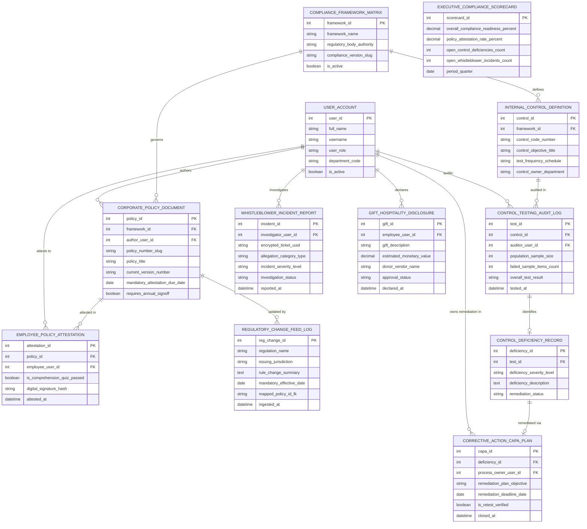

# Conceptual ERD — Compliance Management System

## Mermaid Code

## Entity Description Table | Bảng mô tả Entity

| # | Entity Name | Vietnamese Name | Description | Key Attributes | Main Relationships |
|---|-------------|-----------------|-------------|----------------|-------------------|
| 1 | USER_ACCOUNT | Tài khoản Nguời dùng | System credentials and access roles for compliance officers, auditors, employees, and admins. | `user_id`, `username`, `user_role`, `department_code` | Authors `CORPORATE_POLICY_DOCUMENT`, attests in `EMPLOYEE_POLICY_ATTESTATION`, audits `CONTROL_TESTING_AUDIT_LOG`, investigates `WHISTLEBLOWER_INCIDENT_REPORT`, owns remediation in `CORRECTIVE_ACTION_CAPA_PLAN`. |
| 2 | COMPLIANCE_FRAMEWORK_MATRIX | Ma trận Framework Tuân thủ | Central compliance framework definition entity storing regulatory framework names (ISO 27001, SOX, GDPR) and active status. | `framework_id`, `framework_name`, `regulatory_body_authority`, `compliance_version_slug`, `is_active` | Governs `CORPORATE_POLICY_DOCUMENT`, defines `INTERNAL_CONTROL_DEFINITION`. |
| 3 | CORPORATE_POLICY_DOCUMENT | Văn bản Chính sách Doanh nghiệp | Corporate policy document record tracking policy numbers, titles, current versions, attestation due dates, and sign-off flags. | `policy_id`, `framework_id`, `author_user_id`, `policy_number_slug`, `policy_title`, `current_version_number`, `requires_annual_signoff` | Governed by `COMPLIANCE_FRAMEWORK_MATRIX`, attested in `EMPLOYEE_POLICY_ATTESTATION`, updated by `REGULATORY_CHANGE_FEED_LOG`, authored by `USER_ACCOUNT`. |
| 4 | EMPLOYEE_POLICY_ATTESTATION | Xác nhận Attestation Chính sách | Employee policy sign-off attestation record tracking quiz completion, cryptographic signature hashes, and attestation timestamps. | `attestation_id`, `policy_id`, `employee_user_id`, `is_comprehension_quiz_passed`, `digital_signature_hash`, `attested_at` | Belongs to `CORPORATE_POLICY_DOCUMENT`, attested by `USER_ACCOUNT`. |
| 5 | REGULATORY_CHANGE_FEED_LOG | Nhật ký Regulatory Change Feed | Statutory regulatory update log recording regulation names, jurisdictions, rule change summaries, and effective dates. | `reg_change_id`, `regulation_name`, `issuing_jurisdiction`, `rule_change_summary`, `mandatory_effective_date` | Updates `CORPORATE_POLICY_DOCUMENT`. |
| 6 | INTERNAL_CONTROL_DEFINITION | Định nghĩa Kiểm soát Nội bộ | Internal control definition record tracking control code numbers, control objectives, test schedules, and owner departments. | `control_id`, `framework_id`, `control_code_number`, `control_objective_title`, `test_frequency_schedule`, `control_owner_department` | Belongs to `COMPLIANCE_FRAMEWORK_MATRIX`, audited in `CONTROL_TESTING_AUDIT_LOG`. |
| 7 | CONTROL_TESTING_AUDIT_LOG | Nhật ký Audit Kiểm thử Control | Internal control effectiveness testing audit log recording sample sizes, failed sample items, and overall test results (`PASSED/FAILED`). | `test_id`, `control_id`, `auditor_user_id`, `population_sample_size`, `failed_sample_items_count`, `overall_test_result` | Belongs to `INTERNAL_CONTROL_DEFINITION`, identifies `CONTROL_DEFICIENCY_RECORD`, audited by `USER_ACCOUNT`. |
| 8 | CONTROL_DEFICIENCY_RECORD | Bản ghi Control Deficiency | Control deficiency record logging deficiency severity levels (Material Weakness, Significant Deficiency) and remediation status. | `deficiency_id`, `test_id`, `deficiency_severity_level`, `deficiency_description`, `remediation_status` | Belongs to `CONTROL_TESTING_AUDIT_LOG`, remediated via `CORRECTIVE_ACTION_CAPA_PLAN`. |
| 9 | WHISTLEBLOWER_INCIDENT_REPORT | Báo cáo Whistleblower Incidents | Confidential ethics incident report tracking encrypted ticket UUIDs, allegation types, severity levels, and investigation status. | `incident_id`, `investigator_user_id`, `encrypted_ticket_uuid`, `allegation_category_type`, `incident_severity_level`, `investigation_status` | Investigated by `USER_ACCOUNT`. |
| 10 | CORRECTIVE_ACTION_CAPA_PLAN | Kế hoạch Remediation CAPA | Corrective and Preventive Action (CAPA) remediation plan record tracking objectives, process owners, deadlines, and re-test verifications. | `capa_id`, `deficiency_id`, `process_owner_user_id`, `remediation_plan_objective`, `remediation_deadline_date`, `is_retest_verified` | Remediates `CONTROL_DEFICIENCY_RECORD`, owned by `USER_ACCOUNT`. |
| 11 | GIFT_HOSPITALITY_DISCLOSURE | Kê khai Quà tặng & Giải trí | Employee gift, hospitality, and entertainment disclosure log tracking gift descriptions, monetary values, donor names, and approval status. | `gift_id`, `employee_user_id`, `gift_description`, `estimated_monetary_value`, `donor_vendor_name`, `approval_status` | Declared by `USER_ACCOUNT`. |
| 12 | EXECUTIVE_COMPLIANCE_SCORECARD | Scorecard Executive Tuân thủ | Executive compliance scorecard aggregating compliance readiness %, attestation rates %, open control deficiencies, and active incidents. | `scorecard_id`, `overall_compliance_readiness_percent`, `policy_attestation_rate_percent`, `open_control_deficiencies_count`, `open_whistleblower_incidents_count` | Standalone executive performance entity. |

## Relationship Description | Mô tả Quan hệ

| # | From Entity | Cardinality | To Entity | Label | Business Explanation |
|---|-------------|-------------|-----------|-------|----------------------|
| 1 | COMPLIANCE_FRAMEWORK_MATRIX | 1 to 0..N | CORPORATE_POLICY_DOCUMENT | governs | A compliance framework matrix governs corporate policy documents. |
| 2 | COMPLIANCE_FRAMEWORK_MATRIX | 1 to 1..N | INTERNAL_CONTROL_DEFINITION | defines | A compliance framework matrix defines internal control definitions. |
| 3 | CORPORATE_POLICY_DOCUMENT | 1 to 0..N | EMPLOYEE_POLICY_ATTESTATION | attested in | A corporate policy document is attested in employee policy attestations. |
| 4 | CORPORATE_POLICY_DOCUMENT | 1 to 0..N | REGULATORY_CHANGE_FEED_LOG | updated by | A corporate policy document is updated by regulatory change feeds. |
| 5 | INTERNAL_CONTROL_DEFINITION | 1 to 0..N | CONTROL_TESTING_AUDIT_LOG | audited in | An internal control definition is audited in control testing logs. |
| 6 | CONTROL_TESTING_AUDIT_LOG | 1 to 0..1 | CONTROL_DEFICIENCY_RECORD | identifies | A control testing audit log identifies control deficiency records. |
| 7 | CONTROL_DEFICIENCY_RECORD | 1 to 0..1 | CORRECTIVE_ACTION_CAPA_PLAN | remediated via | A control deficiency record is remediated via a CAPA plan. |
| 8 | USER_ACCOUNT | 1 to 0..N | CORPORATE_POLICY_DOCUMENT | authors | A compliance officer user account authors corporate policy documents. |
| 9 | USER_ACCOUNT | 1 to 0..N | EMPLOYEE_POLICY_ATTESTATION | attests to | A corporate employee user account attests to policy sign-offs. |
| 10 | USER_ACCOUNT | 1 to 0..N | CONTROL_TESTING_AUDIT_LOG | audits | A compliance auditor user account audits internal controls. |
| 11 | USER_ACCOUNT | 1 to 0..N | WHISTLEBLOWER_INCIDENT_REPORT | investigates | An ethics investigator user account investigates whistleblower reports. |
| 12 | USER_ACCOUNT | 1 to 0..N | CORRECTIVE_ACTION_CAPA_PLAN | owns remediation in | A process owner user account owns remediation in CAPA plans. |
| 13 | USER_ACCOUNT | 1 to 0..N | GIFT_HOSPITALITY_DISCLOSURE | declares | A corporate employee user account declares gift disclosures. |
