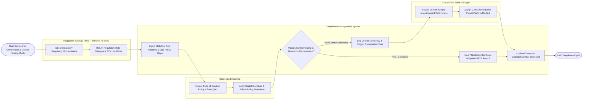

# Swimlane Diagram — Compliance Management System

## Mermaid Code

## Flow Description | Mô tả luồng

| Lane | Actor | Role in Flow |
|------|-------|-------------|
| 1 | Corporate Employee | Reviews mandatory corporate policies, completes comprehension quizzes, applies digital signature attestations, and declares conflicts of interest or gifts. |
| 2 | Compliance Audit Manager | Audits internal control effectiveness sample items, logs control deficiencies, assigns Corrective and Preventive Action (CAPA) plans, and performs verification re-tests. |
| 3 | Compliance Management System | Ingests statutory regulatory updates, maps rule changes to policies, tracks employee policy attestations, evaluates control testing sample results, logs deficiencies, issues attestation certificates, and updates compliance scorecards. |
| 4 | Regulatory Change Feed (Thomson Reuters) | Streams real-time statutory regulatory intelligence updates, statutory rule changes, and compliance effective dates across jurisdictions. |
