# Action Tree — Compliance Management System

## Mermaid Code

```mermaid
graph TD
    Root["Compliance Management System"]

    Root --> M1["Compliance Frameworks & Policy Governance"]
    Root --> M2["Regulatory Change Mapping & Intelligence"]
    Root --> M3["Employee Policy Attestations & Training"]
    Root --> M4["Internal Control Testing & Deficiency CAPA"]
    Root --> M5["Whistleblower Hotline & Ethics Investigations"]
    Root --> M6["Audits, Risk Scorecards & Executive Reporting"]

    M1 --> A11["Map Multi-Framework Matrices (SOX, ISO 27001, ISO 37001, GDPR)"]
    M1 --> A12["Publish Corporate Code of Conduct & Operational Policies"]
    M1 --> A13["Manage Gift, Entertainment & Hospitality Disclosure Registers"]
    M1 --> A14["Track Annual Employee Conflict-of-Interest Declarations"]

    M2 --> A21["Ingest Statutory Regulatory Update Feeds (Thomson Reuters API)"]
    M2 --> A22["Execute AI NLP Semantic Mapping of Statutory Rules to Policies"]
    M2 --> A23["Identify Policy Compliance Gaps from Statutory Rule Changes"]
    M2 --> A24["Trigger Policy Revision Workflows upon Regulatory Shifts"]

    M3 --> A31["Assign Mandatory Compliance E-Learning Courses via LMS API"]
    M3 --> A32["Execute Employee Policy Sign-Off Digital Attestations"]
    M3 --> A33["Enforce Minimum Policy Reading Scroll Times & Quiz Passing Rules"]
    M3 --> A34["Escalate Un-Attested Employee Deadlines to Direct Managers"]

    M4 --> A41["Execute Internal Control Effectiveness Audits & Sample Testing"]
    M4 --> A42["Classify Control Deficiency Severity (Deficiency vs Material Weakness)"]
    M4 --> A43["Assign Corrective Action (CAPA) Remediation Plans to Process Owners"]
    M4 --> A44["Perform Independent Re-Testing & Verification prior to CAPA Closure"]

    M5 --> A51["Ingest Encrypted Whistleblower Hotline Reports (Zendesk Ethics API)"]
    M5 --> A52["Enforce Strict Anonymity & Restrict Access to Authorized Investigators"]
    M5 --> A53["Triage FCPA Bribery, Fraud & Workplace Harassment Allegations"]
    M5 --> A54["Maintain Confidential Incident Evidence Vaults & Resolution Logs"]

    M6 --> A61["Compile Automated Regulatory Examination Audit Evidence Binders"]
    M6 --> A62["Calculate Enterprise Residual Compliance Risk & Readiness Scores"]
    M6 --> A63["Benchmark Attestation & Training Completion Rates across Business Units"]
    M6 --> A64["Export Executive Compliance, Risk & Audit Committee Scorecard PDFs"]
```

## Module Description | Mô tả Module

| # | Module | Description | Actions |
|---|--------|-------------|---------|
| 1 | Compliance Frameworks & Policy Governance | Models multi-framework compliance matrices (SOX, ISO, GDPR), publishes policies, manages gift registers, and tracks conflict disclosures. | Map Multi-Framework Compliance Matrices, Publish Corporate Code of Conduct, Manage Gift & Hospitality Registers, Track Employee Conflict Declarations. |
| 2 | Regulatory Change Mapping & Intelligence | Ingests Thomson Reuters feeds, performs AI NLP semantic mapping of statutory rules to internal policies, and flags compliance gaps. | Ingest Statutory Regulatory Update Feeds, Execute AI NLP Semantic Rule Mapping, Identify Policy Compliance Gaps, Trigger Policy Revision Workflows. |
| 3 | Employee Policy Attestations & Training | Assigns compliance e-learning courses, collects digital signature attestations, verifies quiz completion, and escalates un-attested policies. | Assign Mandatory Compliance E-Learning Courses, Execute Employee Policy Sign-Off Attestations, Enforce Policy Reading & Quiz Passing Rules, Escalate Un-Attested Employee Deadlines. |
| 4 | Internal Control Testing & Deficiency CAPA | Audits internal control sample items, classifies deficiency severity, assigns CAPA remediation plans, and performs verification re-tests. | Execute Internal Control Audits & Testing, Classify Control Deficiency Severity Levels, Assign CAPA Remediation Plans to Owners, Perform Independent Re-Testing & CAPA Closure. |
| 5 | Whistleblower Hotline & Ethics Investigations | Ingests anonymous whistleblower tickets, enforces encrypted access controls, triages FCPA bribery/harassment allegations, and manages investigations. | Ingest Encrypted Whistleblower Hotline Reports, Enforce Anonymity & Confidential Access, Triage FCPA Bribery & Harassment Allegations, Maintain Confidential Incident Evidence Vaults. |
| 6 | Audits, Risk Scorecards & Executive Reporting | Auto-assembles audit evidence binders, computes residual compliance risk scores, benchmarks readiness across divisions, and exports scorecards. | Compile Regulatory Audit Evidence Binders, Calculate Enterprise Residual Compliance Risk, Benchmark Compliance Readiness across Divisions, Export Executive Compliance Scorecards. |
