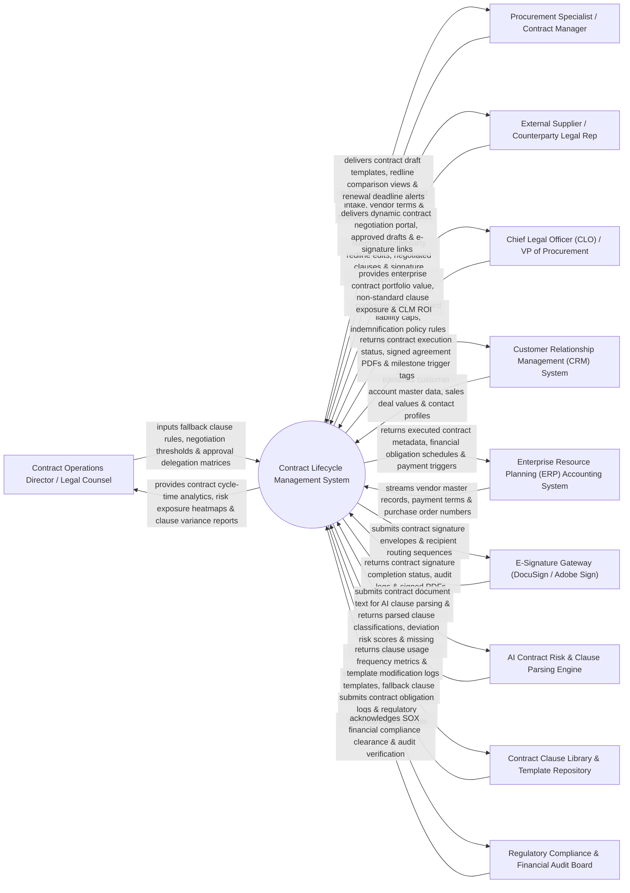

# Context Diagram — Contract Lifecycle Management System

## Mermaid Code

## Actor & Interaction Table | Bảng Actor & Tương tác

| # | Actor | Actor Type | Data Sent TO System | Data Received FROM System | Notes |
|---|-------|------------|---------------------|---------------------------|-------|
| 1 | Contract Operations Director / Legal Counsel | Primary | Fallback clause rules, non-standard term thresholds, approval delegation matrices, indemnification caps. | Contract cycle-time analytics, risk exposure heatmaps, clause variance reports, negotiation velocity scorecards. | Senior legal counsel managing contract policy, approval workflows, and legal risk governance. |
| 2 | Procurement Specialist / Contract Manager | Primary | Contract request intake details, counterparty negotiation notes, milestone tracking updates, renewal preferences. | Standard contract draft templates, redline comparison views, renewal deadline alerts, execution status. | Contract manager initiating contract requests, negotiating terms, and tracking post-execution obligations. |
| 3 | External Supplier / Counterparty Legal Rep | Primary | Counterparty redline document edits, negotiated clause counter-offers, digital signature executions. | Dynamic negotiation portal access, approved contract drafts, redline diff views, e-signature links. | External vendor or customer legal counsel negotiating contract terms and executing digital signatures. |
| 4 | Chief Legal Officer (CLO) / VP of Procurement | Primary | Corporate liability policy rules, maximum risk tolerance limits, high-value contract approval thresholds ($> \$250\text{k}$). | Enterprise contract portfolio value, non-standard clause exposure reports, contract SLA metrics, CLM ROI. | Executive monitoring total contract portfolio value, non-standard risk exposure, and procurement velocity. |
| 5 | Customer Relationship Management (CRM) System | Supporting | Customer account master profiles, sales opportunity values, contact details, deal stage updates. | Executed sales contract status, signed agreement PDF files, revenue milestone trigger tags. | Enterprise CRM (Salesforce / HubSpot) triggering sales contract requests and storing executed agreements. |
| 6 | Enterprise Resource Planning (ERP) Accounting System | Supporting | Vendor master profiles, chart of accounts (GL), purchase order numbers, payment term schedules. | Executed procurement contract metadata, financial obligation schedules, billing/payment triggers. | ERP accounting system (SAP / NetSuite) synchronizing financial commitments and triggering vendor payments. |
| 7 | E-Signature Gateway | Supporting | Signature completion receipts, cryptographic audit logs, fully signed PDF agreement files. | Contract signature envelopes, signer recipient routing sequences, email invitation payloads. | E-signature platform (DocuSign / Adobe Sign) executing digital signatures and returning audit trails. |
| 8 | AI Contract Risk & Clause Parsing Engine | Supporting | Parsed clause classifications, deviation risk scores (High/Med/Low), missing mandatory clause flags. | Contract document text streams, custom prompt extraction rules, clause boundary markers. | AI NLP engine (OpenAI / Kira Systems) analyzing contract text to detect risky clauses and deviations. |
| 9 | Contract Clause Library & Template Repository | Supporting | Standardized contract templates (NDAs, MSAs, SOWs), pre-approved fallback clauses, legal definitions. | Clause usage frequency analytics, template modification logs, clause approval audit trails. | Central clause repository providing pre-approved contract templates and fallback legal language. |
| 10 | Regulatory Compliance & Financial Audit Board | Supporting / Regulatory | SOX compliance rules, GDPR data protection clauses, FCPA anti-corruption requirements. | Contract obligation logs, regulatory compliance audit trails, non-standard clause audit logs. | Compliance governance board auditing executed contracts for regulatory compliance and SOX controls. |

## System Boundary Description | Mô tả Phạm vi Hệ thống

The **Contract Lifecycle Management System** is an enterprise contract intake, automated assembly, AI risk scoring, interactive redlining, e-signature, and post-execution obligation management platform designed to accelerate contract velocity.

**Inside System Scope:**
- Self-service contract request intake and automated assembly using pre-approved clause templates (NDAs, MSAs, SOWs).
- AI NLP contract risk scoring parsing third-party contract drafts to flag non-standard liability and indemnity terms.
- Real-time interactive redlining and collaborative negotiation portal for internal legal and external counterparties.
- Automated multi-tier approval workflow routing contracts based on dollar value ($> \$100\text{k}$) and risk scores.
- Post-execution obligation tracking monitoring milestone dates, auto-renewals, notice periods, and SLA performance.

**Outside System Scope:**
- Direct physical shipping of signed paper contract copies (handled by Postal Services / Courier Networks).
- Direct physical manufacturing of commercial goods specified in SOWs (handled by Manufacturing Plants).
- Direct processing of bank wire transfers for contract payments (handled by Enterprise Accounts Payable).
