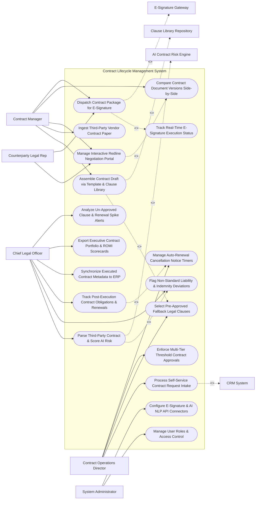

# Use Case Diagram — Contract Lifecycle Management System

## Mermaid Code

## Actor Table | Bảng Actor

| # | Actor | Actor Type | Role Description | Related Use Cases |
|---|-------|------------|------------------|-------------------|
| 1 | Contract Operations Director | Primary | Legal director defining template rules, fallback clauses, approval matrices, and renewal notice windows. | UC01, UC03, UC07, UC13 |
| 2 | Contract Manager | Primary | Manager creating contracts, importing vendor paper, negotiating redlines, and dispatching e-signature envelopes. | UC02, UC04, UC08, UC09, UC10 |
| 3 | Counterparty Legal Rep | Primary | External vendor or client legal representative negotiating terms in the redline portal and signing agreements. | UC08, UC10 |
| 4 | Chief Legal Officer | Primary | Executive reviewing AI contract risk scores, approving non-standard terms, tracking obligations, and viewing scorecards. | UC05, UC06, UC12, UC14, UC15, UC18 |
| 5 | System Administrator | Primary | IT admin managing user security roles, e-signature API keys, and AI NLP model settings. | UC16, UC17 |
| 6 | E-Signature Gateway | System (Secondary) | Digital signature platform (DocuSign/Adobe Sign) executing signatures and returning audit trails. | UC10 |
| 7 | AI Contract Risk Engine | System (Secondary) | AI NLP engine (OpenAI/Kira Systems) parsing contract text and scoring clause deviation risks. | UC05 |
| 8 | Clause Library Repository | System (Secondary) | Central template repository supplying standard legal templates and approved fallback clauses. | UC02 |
| 9 | CRM System | System (Secondary) | Enterprise CRM triggering sales contract requests and synchronizing executed agreement metadata. | UC01 |

## Use Case Table | Bảng Use Case

| # | UC ID | Use Case Name | Primary Actor | Secondary Actor | Description | Priority |
|---|-------|---------------|---------------|-----------------|-------------|----------|
| 1 | UC01 | Process Self-Service Contract Request Intake | Director | CRM System | Captures contract intake details (Type, Value, Term, Counterparty) from web forms or CRM sales deals. | Critical |
| 2 | UC02 | Assemble Contract Draft via Template & Clause Library | Manager | ClauseLib | Dynamically merges intake data with standard templates (NDA, MSA, SOW) to generate an initial contract draft. | Critical |
| 3 | UC03 | Select Pre-Approved Fallback Legal Clauses | Director | None | Provides pre-approved fallback clause options when a counterparty rejects standard contract terms. | High |
| 4 | UC04 | Ingest Third-Party Vendor Contract Paper | Manager | None | Imports external vendor-provided contract documents (Word/PDF) for AI parsing and negotiation. | Critical |
| 5 | UC05 | Parse Third-Party Contract & Score AI Risk | CLO | AICores | Uses AI NLP to scan contract drafts, identifying clause types and calculating a 0-100 Contract Risk Score. | Critical |
| 6 | UC06 | Flag Non-Standard Liability & Indemnity Deviations | CLO | None | Automatically flags risky non-standard terms (e.g., Unlimited Liability, Governing Law Shift) requiring executive sign-off. | Critical |
| 7 | UC07 | Enforce Multi-Tier Threshold Contract Approvals | Director | None | Routes contract drafts through automated approval chains based on contract value ($> \$100\text{k}$) and AI risk scores. | Critical |
| 8 | UC08 | Manage Interactive Redline Negotiation Portal | Manager | None | Provides a collaborative web environment for real-time track-changes redlining and counterparty comments. | Critical |
| 9 | UC09 | Compare Contract Document Versions Side-by-Side | Manager | None | Renders a visual diff tool allowing users to compare two contract revisions side-by-side on canvas. | High |
| 10 | UC10 | Dispatch Contract Package for E-Signature | Manager | ESign | Assembles final contract files and dispatches DocuSign/Adobe Sign envelopes for multi-party digital signature. | Critical |
| 11 | UC11 | Track Real-Time E-Signature Execution Status | Manager | None | Monitors signature envelope status (Sent, Viewed, Signed) and auto-updates contract status upon completion. | High |
| 12 | UC12 | Track Post-Execution Contract Obligations & Renewals | CLO | None | Tracks post-execution deliverables, payment milestones, SLA benchmarks, and expiration dates. | Critical |
| 13 | UC13 | Manage Auto-Renewal Cancellation Notice Timers | Director | None | Tracks auto-renewal opt-out deadlines (e.g., 60-Day Cancellation Notice) and dispatches advance alerts. | Critical |
| 14 | UC14 | Synchronize Executed Contract Metadata to ERP | CLO | None | Transmits executed contract terms, payment schedules, and renewal dates to SAP or NetSuite. | High |
| 15 | UC15 | Export Executive Contract Portfolio & ROMI Scorecards | CLO | None | Renders executive scorecards detailing active contract count, total TCV value, average cycle time, and risk exposure. | High |
| 16 | UC16 | Manage User Roles & Access Control | Admin | None | Controls user login credentials, RBAC permissions, and contract authorization limits. | High |
| 17 | UC17 | Configure E-Signature & AI NLP API Connectors | Admin | None | Configures API connection parameters for DocuSign, Adobe Sign, OpenAI, SAP, and Salesforce. | High |
| 18 | UC18 | Analyze Un-Approved Clause & Renewal Spike Alerts | CLO | None | Dispatches urgent notifications when a high-risk contract is signed without approval or a renewal deadline is within 14 days. | High |

## Use Case Specification | Đặc tả Use Case

---

### UC02 — Assemble Contract Draft via Template & Clause Library

| Field | Detail |
|-------|--------|
| **UC ID** | UC02 |
| **Use Case Name** | Assemble Contract Draft via Template & Clause Library |
| **Actor(s)** | Primary: Contract Manager, Contract Operations Director   Secondary: Contract Clause Library & Template Repository |
| **Description** | Automatically generates a customized contract draft (DOCX/PDF) by merging intake metadata with pre-approved legal templates and standard clause language from the clause repository. |
| **Precondition** | 1. Contract intake request is submitted and validated (UC01).   2. Standard contract templates (NDA, Master Services Agreement, SOW) and clause rules are active. |
| **Main Flow** | 1. Contract Manager opens "Contract Assembly Wizard" for Request `#REQ-88412`.   2. System retrieves Intake Metadata:   &nbsp;&nbsp;&nbsp;&nbsp; a. Contract Type: `Master Services Agreement (MSA)`.   &nbsp;&nbsp;&nbsp;&nbsp; b. Customer Name: `Acme Corporation`.   &nbsp;&nbsp;&nbsp;&nbsp; c. Contract Value: `$150,000.00 Annual Value`.   &nbsp;&nbsp;&nbsp;&nbsp; d. Payment Terms: `Net 30 Days`.   &nbsp;&nbsp;&nbsp;&nbsp; e. Governing Law: `State of Delaware`.   3. System fetches Standard MSA Template (`template_msa_v2026.docx`) from Clause Library Repository.   4. System executes Dynamic Clause Assembly Rules:   &nbsp;&nbsp;&nbsp;&nbsp; a. Insert Standard Section 4.1 (Payment Terms): `Net 30 Days Clause`.   &nbsp;&nbsp;&nbsp;&nbsp; b. Insert Standard Section 8.2 (Limitation of Liability): `1x Contract Value Cap ($150,000)`.   &nbsp;&nbsp;&nbsp;&nbsp; c. Insert Standard Section 12.1 (Governing Law): `Delaware State Jurisdiction`.   5. System compiles customized contract document `MSA_AcmeCorp_Draft_v1.0.docx`.   6. System attaches draft to contract record, logs version `v1.0`, and opens draft in interactive editor for review. |
| **Alternative Flow** | **AF1** — High-Value Customization Assembly: Contract value exceeds $500,000; System automatically injects specialized "Executive Security Indemnification Clause" into the draft. |
| **Exception Flow** | **EX1** — Missing Mandatory Field Error: Intake request lacks governing law selection; System halts assembly, prompting manager to select governing jurisdiction before generating document. |
| **Postcondition** | Contract draft document is compiled using standard template rules, version `v1.0` is logged, and document is ready for review/negotiation. |
| **Business Rule** | **BR1**: Standard contract drafts MUST be assembled exclusively from pre-approved templates and clause library rules maintained by Legal Counsel. |

---

### UC05 — Parse Third-Party Contract & Score AI Risk

| Field | Detail |
|-------|--------|
| **UC ID** | UC05 |
| **Use Case Name** | Parse Third-Party Contract & Score AI Risk |
| **Actor(s)** | Primary: Chief Legal Officer, Contract Manager   Secondary: AI Contract Risk & Clause Parsing Engine (OpenAI / Kira Systems) |
| **Description** | Uses AI NLP models to parse third-party vendor contract documents, classify clause types, detect missing mandatory clauses, and calculate a 0-100 Contract Risk Score based on policy deviations. |
| **Precondition** | 1. Third-party vendor contract document (Word or PDF) is imported into system (UC04).   2. AI NLP model parsing rules and company legal risk policies are configured. |
| **Main Flow** | 1. Contract Manager uploads vendor paper document `Vendor_MSA_ThirdParty.pdf`.   2. System dispatches document text stream to AI Contract Risk Engine.   3. AI Engine executes NLP Natural Language Processing & OCR extraction.   4. AI Engine classifies and extracts contract clauses:   &nbsp;&nbsp;&nbsp;&nbsp; a. Section 6 (Liability): `Unlimited Liability for Data Breach` -> `HIGH_RISK_DEVIATION`.   &nbsp;&nbsp;&nbsp;&nbsp; b. Section 9 (Indemnification): `Vendor Indemnifies Only Up to $10,000` -> `MEDIUM_RISK_DEVIATION`.   &nbsp;&nbsp;&nbsp;&nbsp; c. Section 14 (Governing Law): `State of New York` -> `LOW_RISK_COMPLIANT`.   &nbsp;&nbsp;&nbsp;&nbsp; d. Mandatory Clause Scan: `Cyber Insurance Clause Missing` -> `CRITICAL_MISSING_CLAUSE`.   5. AI Engine calculates Composite Contract Risk Score:   &nbsp;&nbsp;&nbsp;&nbsp; a. Base Score: 0 (Low Risk).   &nbsp;&nbsp;&nbsp;&nbsp; b. Unlimited Liability (+40) + Low Indemnity (+25) + Missing Cyber Clause (+20) = `85 / 100 Risk Score` (`HIGH_RISK_TIER`).   6. System highlights flagged clauses in red, renders AI Risk Summary Panel, and triggers UC06 (Flag Non-Standard Deviations).   7. System routes contract for mandatory Chief Legal Officer approval (UC07). |
| **Alternative Flow** | **AF1** — Standard Low-Risk Paper Ingestion: Vendor contract uses 95% standard language; AI Engine calculates Risk Score `12/100` (`LOW_RISK`), routing directly to fast-track e-signature. |
| **Exception Flow** | **EX1** — Unreadable Scanned Image PDF Error: PDF is a low-quality scanned image with unreadable text; System triggers OCR pre-processing worker, re-extracting text before running AI parsing. |
| **Postcondition** | Contract text is parsed into structured clauses, missing clauses are identified, Risk Score (0-100) is calculated, and high-risk contracts route for CLO approval. |
| **Business Rule** | **BR1**: Third-party contract paper MUST be parsed by AI NLP scoring engines to flag non-standard liability and missing mandatory clauses prior to execution. |

---

### UC08 — Manage Interactive Redline Negotiation Portal

| Field | Detail |
|-------|--------|
| **UC ID** | UC08 |
| **Use Case Name** | Manage Interactive Redline Negotiation Portal |
| **Actor(s)** | Primary: Contract Manager, External Supplier / Counterparty Legal Rep   Secondary: None |
| **Description** | Renders a web-based collaborative negotiation environment allowing internal legal teams and external counterparties to redline terms, propose fallback clauses, and track version history in real time. |
| **Precondition** | 1. Contract draft is assembled (UC02) or parsed (UC05).   2. Secure external counterparty portal access token is generated. |
| **Main Flow** | 1. Contract Manager clicks "Invite Counterparty to Negotiate" and inputs Counterparty Legal Email: `counsel@vendor.com`.   2. System dispatches secure magic-link invitation to `counsel@vendor.com`.   3. Counterparty Legal Rep opens "Interactive Redline Negotiation Portal" in web browser.   4. Counterparty Rep reviews Section 8.2 (Limitation of Liability) and adds redline edit:   &nbsp;&nbsp;&nbsp;&nbsp; a. Striking out: `1x Contract Value Cap ($150,000)`.   &nbsp;&nbsp;&nbsp;&nbsp; b. Inserting: `2x Contract Value Cap ($300,000)`.   &nbsp;&nbsp;&nbsp;&nbsp; c. Adding Comment: *"Our corporate policy requires 2x cap for cloud software services."*   5. System saves redline revision as `v1.1_Redline_Vendor`, highlights changes in track-changes markup, and sends instant notification to Contract Manager.   6. Contract Manager opens portal, views side-by-side diff (UC09), and clicks "Insert Pre-Approved Fallback Clause #F-402" (UC03):   &nbsp;&nbsp;&nbsp;&nbsp; a. Fallback Term: `1.5x Contract Value Cap ($225,000)`.   7. Counterparty Rep reviews fallback offer and clicks "Accept Redline Edit".   8. System accepts edit, updates clean contract document to Version `v2.0_Clean_Approved`, and locks contract for final execution. |
| **Alternative Flow** | **AF1** — Offline Word Document Redline Import: Counterparty prefers negotiating offline via Word; Manager uploads `MSA_Vendor_Redlines.docx`; System parses track-changes and merges edits into web portal. |
| **Exception Flow** | **EX1** — Unauthorized Redline Modification Error: Counterparty attempts to edit locked boilerplate legal text; System blocks edit, displaying notice "Boilerplate Section 15.1 is locked by corporate policy". |
| **Postcondition** | Contract redlines are negotiated collaboratively, fallback clauses are applied, version `v2.0` is accepted, and document locks for e-signature. |
| **Business Rule** | **BR1**: All redline modifications proposed by external counterparties MUST be logged in an immutable version history audit trail. |

---

### UC10 — Dispatch Contract Package for E-Signature

| Field | Detail |
|-------|--------|
| **UC ID** | UC10 |
| **Use Case Name** | Dispatch Contract Package for E-Signature |
| **Actor(s)** | Primary: Contract Manager, Counterparty Legal Rep   Secondary: E-Signature Gateway (DocuSign / Adobe Sign) |
| **Description** | Assembles final clean contract documents and exhibits, defines sequential signer routing orders, and dispatches electronic signature envelopes to DocuSign/Adobe Sign for execution. |
| **Precondition** | 1. Contract negotiation is complete and version `v2.0` is approved (UC08).   2. All mandatory approvals (UC07) are obtained.   3. DocuSign API integration is active. |
| **Main Flow** | 1. Contract Manager opens "E-Signature Execution Desk" for Contract `#CTR-88412`.   2. System retrieves Clean Approved Document Package:   &nbsp;&nbsp;&nbsp;&nbsp; a. Main Contract: `MSA_AcmeCorp_Approved_v2.0.pdf`.   &nbsp;&nbsp;&nbsp;&nbsp; b. Attachment A: `Statement of Work SOW-01.pdf`.   3. Manager configures Sequential Signer Routing Order:   &nbsp;&nbsp;&nbsp;&nbsp; a. Signer 1 (Counterparty Executive): `Jane Doe (CEO, Vendor Inc) - jane@vendor.com`.   &nbsp;&nbsp;&nbsp;&nbsp; b. Signer 2 (Company Executive): `Dave Miller (VP Procurement) - dave@company.com`.   4. Manager defines Anchor Signature Tags (`\s1\`, `\d1\`) on signature pages.   5. Manager clicks "Dispatch DocuSign E-Signature Envelope".   6. System transmits HTTPS REST API payload to DocuSign API endpoint (`POST /v2.1/accounts/{accountId}/envelopes`).   7. DocuSign API creates envelope `ENV-88412` and dispatches signature invitation email to Signer 1 (Jane Doe).   8. System updates contract status to `OUT_FOR_SIGNATURE` and initializes UC11 (Track Real-Time E-Signature Execution Status). |
| **Alternative Flow** | **AF1** — Automated Contract Execution & Activation: Signer 1 and Signer 2 complete digital signatures; DocuSign returns `ENVELOPE_COMPLETED` webhook; System marks contract `EXECUTED_ACTIVE` and syncs to ERP (UC14). |
| **Exception Flow** | **EX1** — E-Signature Envelope Expiration Warning: Envelope remains unsigned after 14 days; DocuSign API triggers warning; System sends reminder alert to Signer 1 and Contract Manager. |
| **Postcondition** | Final contract package is dispatched via e-signature gateway, signer routing sequence is initialized, and contract status updates to Out for Signature. |
| **Business Rule** | **BR1**: E-signature envelopes MUST be dispatched only after all internal legal and managerial approvals are verified in system records. |

---

### UC12 — Track Post-Execution Contract Obligations & Renewals

| Field | Detail |
|-------|--------|
| **UC ID** | UC12 |
| **Use Case Name** | Track Post-Execution Contract Obligations & Renewals |
| **Actor(s)** | Primary: Chief Legal Officer, Contract Manager, Procurement Specialist   Secondary: Enterprise Resource Planning (ERP) Accounting System |
| **Description** | Tracks post-execution contract milestones, payment schedules, SLA performance deliverables, expiration dates, and auto-renewal cancellation notice windows to prevent unwanted auto-renewals. |
| **Precondition** | 1. Contract status is `EXECUTED_ACTIVE` (UC10).   2. Obligation terms, renewal dates, and notice windows are extracted into system database. |
| **Main Flow** | 1. System logs executed contract `#CTR-88412` in Post-Execution Obligation Engine:   &nbsp;&nbsp;&nbsp;&nbsp; a. Effective Date: `November 01, 2026`.   &nbsp;&nbsp;&nbsp;&nbsp; b. Expiration Date: `October 31, 2027` (1-Year Term).   &nbsp;&nbsp;&nbsp;&nbsp; c. Renewal Term: `Auto-Renews for 1 Year unless canceled 60 days prior`.   &nbsp;&nbsp;&nbsp;&nbsp; d. Cancellation Notice Deadline: `August 31, 2027` (60 Days prior to expiration).   2. System logs Milestones & Obligations:   &nbsp;&nbsp;&nbsp;&nbsp; a. Obligation 1 (Deliverable): `Submit Q2 Security Audit Report by May 15, 2027` (Assigned: Vendor).   &nbsp;&nbsp;&nbsp;&nbsp; b. Obligation 2 (Financial): `Pay Annual Support Maintenance $25,000 by Nov 15, 2026` (Assigned: AP).   3. System initializes Automated Renewal Notice Timer (UC13):   &nbsp;&nbsp;&nbsp;&nbsp; a. Sets 90-Day Advance Warning Trigger: `May 31, 2027` (30 days before cancellation deadline).   4. On `May 31, 2027`, System triggers Renewal Notice Alert:   &nbsp;&nbsp;&nbsp;&nbsp; a. Dispatches high-priority alert to Contract Manager & VP Procurement: *"RENEWAL WARNING: Contract #CTR-88412 auto-renews on Oct 31. Cancellation Notice required by Aug 31 (90 days remaining to evaluate vendor)."*   5. Manager reviews vendor performance score, decides to renew, and logs "Intent to Renew" decision. |
| **Alternative Flow** | **AF1** — Automated Cancellation Notice Generation: Manager decides to terminate contract; System auto-generates formal "Notice of Non-Renewal Letter PDF" and dispatches certified email to vendor. |
| **Exception Flow** | **EX1** — Overdue Vendor Deliverable Alert: Vendor fails to submit Security Audit Report by May 15 deadline; System flags `OBLIGATION_BREACH_WARNING`, notifying Contract Manager to withhold payment. |
| **Postcondition** | Contract obligations, financial milestones, and auto-renewal notice timers are tracked, and automated advance renewal warnings update. |
| **Business Rule** | **BR1**: Auto-renewing contracts MUST generate automated cancellation notice alerts at least 30 days prior to the required non-renewal notice deadline. |
