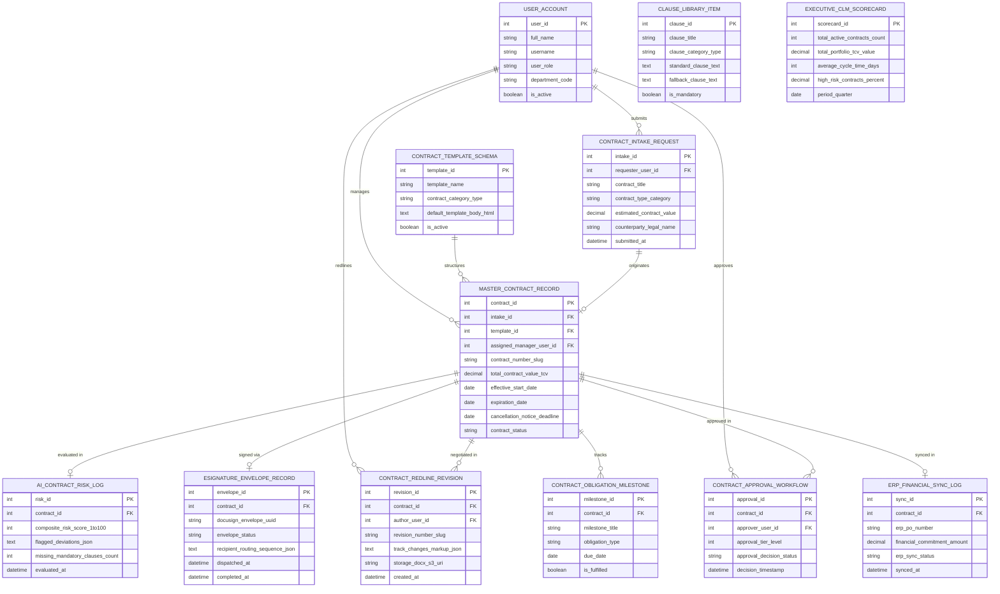

# Conceptual ERD — Contract Lifecycle Management System

## Mermaid Code

## Entity Description Table | Bảng mô tả Entity

| # | Entity Name | Vietnamese Name | Description | Key Attributes | Main Relationships |
|---|-------------|-----------------|-------------|----------------|-------------------|
| 1 | USER_ACCOUNT | Tài khoản Nguời dùng | System credentials and access roles for contract directors, contract managers, CLOs, and admins. | `user_id`, `username`, `user_role`, `department_code` | Submits `CONTRACT_INTAKE_REQUEST`, manages `MASTER_CONTRACT_RECORD`, redlines `CONTRACT_REDLINE_REVISION`, approves `CONTRACT_APPROVAL_WORKFLOW`. |
| 2 | CONTRACT_INTAKE_REQUEST | Yêu cầu Intake Hop dong | Contract request intake record capturing contract title, type, estimated value, counterparty legal name, and submission timestamps. | `intake_id`, `requester_user_id`, `contract_title`, `contract_type_category`, `estimated_contract_value`, `counterparty_legal_name` | Originates `MASTER_CONTRACT_RECORD`, submitted by `USER_ACCOUNT`. |
| 3 | MASTER_CONTRACT_RECORD | Master Hop dong Record | Central contract record tracking contract number, Total Contract Value (TCV), start/expiration dates, cancellation notice deadlines, and status. | `contract_id`, `intake_id`, `template_id`, `assigned_manager_user_id`, `contract_number_slug`, `total_contract_value_tcv`, `expiration_date`, `contract_status` | Structured by `CONTRACT_TEMPLATE_SCHEMA`, evaluated in `AI_CONTRACT_RISK_LOG`, negotiated in `CONTRACT_REDLINE_REVISION`, approved in `CONTRACT_APPROVAL_WORKFLOW`, signed via `ESIGNATURE_ENVELOPE_RECORD`, tracks `CONTRACT_OBLIGATION_MILESTONE`, synced in `ERP_FINANCIAL_SYNC_LOG`. |
| 4 | CONTRACT_TEMPLATE_SCHEMA | Schema Template Hop dong | Standard contract template definition storing template name, category type (NDA, MSA, SOW), and default HTML template bodies. | `template_id`, `template_name`, `contract_category_type`, `default_template_body_html`, `is_active` | Structures `MASTER_CONTRACT_RECORD`. |
| 5 | CLAUSE_LIBRARY_ITEM | Mục Thu vien Dieu khoan | Central clause library record storing standard clause text, pre-approved fallback clause text, category, and mandatory flags. | `clause_id`, `clause_title`, `clause_category_type`, `standard_clause_text`, `fallback_clause_text`, `is_mandatory` | Standalone legal clause repository entity. |
| 6 | AI_CONTRACT_RISK_LOG | Nhật ký AI Risk Hop dong | AI NLP contract risk scoring log recording composite risk score (0-100), flagged non-standard deviations JSON, and missing clause counts. | `risk_id`, `contract_id`, `composite_risk_score_1to100`, `flagged_deviations_json`, `missing_mandatory_clauses_count` | Belongs to `MASTER_CONTRACT_RECORD`. |
| 7 | CONTRACT_REDLINE_REVISION | Bản ghi Redline Hop dong | Historical contract redline revision tracking revision numbers (`v1.0`, `v1.1`), track-changes markup JSON, and Word doc S3 URIs. | `revision_id`, `contract_id`, `author_user_id`, `revision_number_slug`, `track_changes_markup_json`, `storage_docx_s3_uri` | Belongs to `MASTER_CONTRACT_RECORD`, redlined by `USER_ACCOUNT`. |
| 8 | CONTRACT_APPROVAL_WORKFLOW | Luồng Phê duyệt Hop dong | Automated contract approval log recording approver user ID, approval tier level, and approval decision status (`APPROVED/REJECTED`). | `approval_id`, `contract_id`, `approver_user_id`, `approval_tier_level`, `approval_decision_status` | Belongs to `MASTER_CONTRACT_RECORD`, approved by `USER_ACCOUNT`. |
| 9 | ESIGNATURE_ENVELOPE_RECORD | Bản ghi Envelope E-Signature | E-signature execution record tracking DocuSign envelope UUID, status (Out for Signature / Signed), and recipient routing sequence JSON. | `envelope_id`, `contract_id`, `docusign_envelope_uuid`, `envelope_status`, `recipient_routing_sequence_json`, `completed_at` | Belongs to `MASTER_CONTRACT_RECORD`. |
| 10 | CONTRACT_OBLIGATION_MILESTONE | Milestone Nghia vu Hop dong | Post-execution contract obligation milestone tracking title, obligation type (Financial/Deliverable/SLA), due date, and fulfillment status. | `milestone_id`, `contract_id`, `milestone_title`, `obligation_type`, `due_date`, `is_fulfilled` | Belongs to `MASTER_CONTRACT_RECORD`. |
| 11 | ERP_FINANCIAL_SYNC_LOG | Nhật ký Sync Tài chính ERP | ERP financial integration log tracking ERP PO numbers, financial commitment amounts, and NetSuite/SAP sync status. | `sync_id`, `contract_id`, `erp_po_number`, `financial_commitment_amount`, `erp_sync_status` | Belongs to `MASTER_CONTRACT_RECORD`. |
| 12 | EXECUTIVE_CLM_SCORECARD | Scorecard Executive CLM | Executive contract portfolio scorecard aggregating total active contracts, total portfolio TCV value, average cycle time days, and high-risk %. | `scorecard_id`, `total_active_contracts_count`, `total_portfolio_tcv_value`, `average_cycle_time_days`, `high_risk_contracts_percent` | Standalone executive performance entity. |

## Relationship Description | Mô tả Quan hệ

| # | From Entity | Cardinality | To Entity | Label | Business Explanation |
|---|-------------|-------------|-----------|-------|----------------------|
| 1 | CONTRACT_INTAKE_REQUEST | 1 to 1 | MASTER_CONTRACT_RECORD | originates | A contract intake request originates a master contract record. |
| 2 | CONTRACT_TEMPLATE_SCHEMA | 1 to 0..N | MASTER_CONTRACT_RECORD | structures | A contract template schema structures master contract records. |
| 3 | MASTER_CONTRACT_RECORD | 1 to 0..1 | AI_CONTRACT_RISK_LOG | evaluated in | A master contract record is evaluated in AI contract risk logs. |
| 4 | MASTER_CONTRACT_RECORD | 1 to 1..N | CONTRACT_REDLINE_REVISION | negotiated in | A master contract record is negotiated across contract redline revisions. |
| 5 | MASTER_CONTRACT_RECORD | 1 to 0..N | CONTRACT_APPROVAL_WORKFLOW | approved in | A master contract record is approved in multi-tier approval workflows. |
| 6 | MASTER_CONTRACT_RECORD | 1 to 0..1 | ESIGNATURE_ENVELOPE_RECORD | signed via | A master contract record is signed via an e-signature envelope. |
| 7 | MASTER_CONTRACT_RECORD | 1 to 0..N | CONTRACT_OBLIGATION_MILESTONE | tracks | A master contract record tracks post-execution obligation milestones. |
| 8 | MASTER_CONTRACT_RECORD | 1 to 0..1 | ERP_FINANCIAL_SYNC_LOG | synced in | An executed contract record is synced in ERP financial logs. |
| 9 | USER_ACCOUNT | 1 to 0..N | CONTRACT_INTAKE_REQUEST | submits | A user account submits self-service contract intake requests. |
| 10 | USER_ACCOUNT | 1 to 0..N | MASTER_CONTRACT_RECORD | manages | A contract manager user account manages master contract records. |
| 11 | USER_ACCOUNT | 1 to 0..N | CONTRACT_REDLINE_REVISION | redlines | A contract manager user account redlines contract revisions. |
| 12 | USER_ACCOUNT | 1 to 0..N | CONTRACT_APPROVAL_WORKFLOW | approves | A legal director user account approves high-risk contract drafts. |
